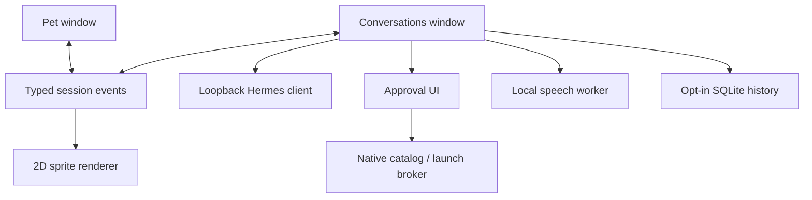

# Mivuneko v0.3 architecture
Original blueprint is preserved in /blueprint. User decisions supersede its AURA name and primary-screen ordering. Windows and macOS remain native targets; platform behavior needs the respective local checklist.

## Desktop shell
Tauri defines a transparent frameless pet and a hidden conversation utility. Main close hides the window. Mac/Windows menu-bar/tray source offers show/hide/reopen/quit. Mac-specific config enables private-API transparency, Accessory behavior, .icns icon, application bundling and microphone usage description. Whole-pet click-through is opt-in; menu-bar Show pet restores interaction and updates preferences. Native behavior remains subject to the Mac checklist.

React owns ephemeral UI state. Pet/chat text, mood and mouth events pass through a Rust in-memory session and Tauri events; browser preview uses BroadcastChannel. Native publish validates text length, moods and mouth amplitude and accepts agent updates from the trusted pet/main windows. Nonsecret preferences are versioned localStorage with cross-window storage events. Pet position and check-in budget persist. Previously imported VRM data is left intact but no longer selected by the UI.

## Character / behavior
Character state separates activity, expression, body action and mouth amplitude. Luna, unofficial Miku fan art, Kiko and Stella use local transparent sprite sheets. Illustrated characters have 21 individually mapped emotion cells and separate front, back and side locomotion frames. Mouth changes follow playback amplitude rather than phonemes.

Scheduler checks validated opt-in interval/daily cap, local-device quiet hours, do-not-disturb and unanswered status. It does not inspect other apps or screen contents. Native monitor driver uses physical work-area coordinates and scale factors, clamps/restores position and confines roaming to selected/current monitor. Browser movement is a bounded preview. Automatic icon/window perching and traversal across display gaps remain future work; manual drag + Sit is available.

## Tools / policy
Typed RPC: list_apps -> AppInfo[]; request_launch(appId) -> {id,app}; resolve_launch(requestId,allow) -> {ok,message}; revoke -> void. Discovery/launch work runs on blocking workers so filesystem scans do not block the UI. Approval is target-specific, bounded to eight pending requests, single-use and expires after 60 seconds. It is consumed before execution. Browser mock mirrors expiry, replay, deny and revoke.

Mac scans standard .app roots with metadata, skips symlinks and produces SHA-256 IDs over canonical paths. Approval/picker displays bundle paths for disambiguation. Resolve rediscovers the exact ID before fixed `/usr/bin/open -a` invocation; success means Launch Services accepted the request, not that the application finished loading. Windows catalog remains constrained to System32 Notepad/Calculator and the standard per-user Telegram executable. Linux catalog is unsupported. No model-supplied path, argument or shell command reaches launch.

Live Hermes is an authenticated HTTP IPv4 loopback client with no proxy or redirects, bounded history/responses and timeouts. Every turn first checks /v1/toolsets and refuses enabled/unknown toolsets. Use a dedicated tool-free profile. Text/closed expression JSON is parsed with plain-text fallback; model output is displayed as text and never interpreted recursively as an action. Explicit user Open requests, Apps selections and validated Gemini installed-app proposals can reach the local broker; all require approval. API keys remain in the native environment or Mac Keychain. Server-side logging/memory is configured in Hermes, independently of local history. Stop suppresses stale results but does not stop a generation already admitted by Hermes.

## Voice / storage
User Record obtains system microphone permission, caps capture at 29 seconds, locally decodes/downmixes and writes canonical mono PCM16/16k WAV, then calls configured whisper-cli/model paths. Transcript becomes ordinary user input. A generation guard prevents duplicate mic requests and canceled work from starting later. Local worker uses private temporary files, bounded outputs, timeouts and cancellation; no shell. Intel macOS uses Whisper's CPU backend. Mac say exports a temporary WAV with selectable natural, bright or language-specific voices; Web Audio playback/analyser drives approximate amplitude lip sync. Local Windows TTS and phonemes are not implemented; Gemini output is platform-independent native HTTP audio.

History is opt-in: native SQLite (Unix owner-only database file) or browser localStorage, bounded to recent validated messages. Disabling history deletes saved text; deletion does not reach Hermes/provider logs. Voice paths are nonsecret app-support JSON produced by setup helper. Hermes keys are removed from launch/voice child environments. No telemetry, screenshot streaming or accessibility/shell/file-system plugin is exposed. Custom native commands still assume trusted packaged UI; native audit, app signature checks, command ACL review, signing and notarization remain release gates.

## Gemini / inline chat revision
Both pet inline chat and utility chat use the same agent adapter, shared bounded ephemeral conversation and tool-activity stores, and per-turn approval flow. Gemini lives in `crates/gemini-client`: fixed Google HTTPS endpoint, Rustls, no redirects/system proxy, optional explicit HTTP/HTTPS/SOCKS5/SOCKS5h proxy, no direct fallback, 12 MB response bounds, 15s connect and 90s request limits. Session-only Settings or environment supplies at most 16 keys without project labels. Round-robin idle key leases permit parallel independent requests; one lease per key. Auth errors disable keys, 429/503 conservatively cool the whole unlabeled pool, with no automatic cross-key replay.

Chat returns schema-constrained text/emotion/appQuery JSON. Only names from the native installed catalog are allowed in an app proposal; Chat/Creative send no catalog and accept no action. The final launch broker independently verifies the unique installed app and single-use approval. App names/context go to Google only for live Gemini reasoning; keys never enter prompts. Voice recordings become bounded WAV and are explicitly sent to Gemini only when Gemini voice is selected. TTS audio is WAV (passed through) or PCM16/24k (wrapped as WAV) for Web Audio; actual playback amplitude drives the mouth while the emotion persists independently.

Gemini requests register unique cancellation IDs. Stop aborts network futures and drops leases; cancellation tombstones cover commands not registered yet. Google may already have received the request, so cancellation does not guarantee no remote work/billing. Local Hermes has its separate preflight and transport and is not routed through the Gemini proxy. Configuration replacement cancels registered Gemini work; clear removes native configuration. Persistent OS credential-vault support remains a release task.

Pet controls are a single handle/context menu; Chat creates an inline composer and does not open the utility window. Character drag uses a small movement threshold; double-click/Enter opens inline chat. Model textures/VRM data stay local. Spoken proactive check-ins are separately opt-in and use the same voice provider, quiet hours and unanswered suppression. Continuous listening and Gemini Live calls are not implemented.

Gemini 3.8-style TTS uses speechMetadata for delivery style and sends only the transcript as text. Complete WAV responses pass through without an extra header; older PCM16/24k responses are wrapped once. Legacy Gemini 2.x/3.1 TTS uses its prompt-style direction format.
