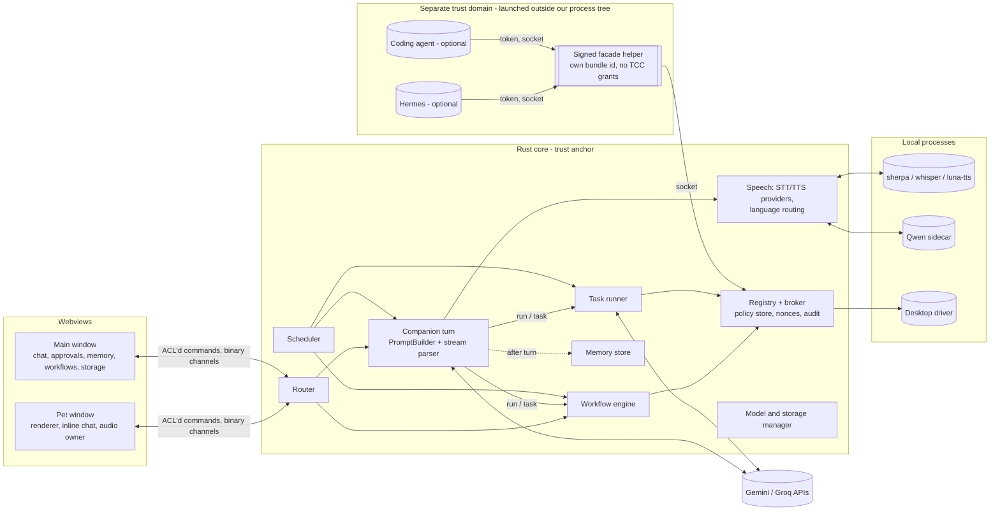
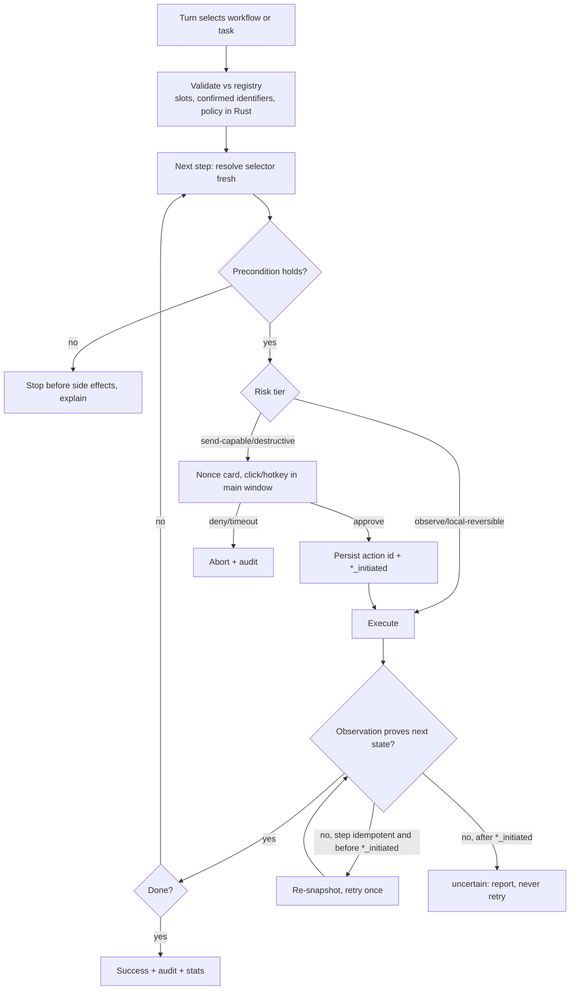

# Mivuneko — Architecture & Feature Evolution Plan (v3)

| | |
|---|---|
| Author | Claude (Opus 5.5) |
| Date | 2026-10-29 |
| Baseline | `main` @ `a3131b0` |
| Supersedes | v2 (`EVOLUTION_PLAN.v2.md`), v1 |
| Review | Independent Opus review: `REVIEW_OPUS.md`; owner's review of v2 |
| Status | **Planning only.** Nothing is implemented, deleted, installed or downloaded until the owner approves. |

Legend:
- **[V]** verified in this repo (file:line), in upstream source at a pinned tag, or by a command run here.
- **[R]** external documentation or reports, with a source.
- **[A]** assumption, not yet tested.
- **[P]** proposal.

Scope: the desktop app, local runtimes, and the cloud model APIs Mivuneko already calls. No VPS or server hosting.

### Owner decisions (fixed)

1. Ordinary conversation is independent of Hermes, and low-latency streaming has priority.
2. Local TTS (Qwen and others) speaks **English only**. **Persian speech uses Gemini TTS only.**
3. STT engines are **ranked in Settings** with a device-based recommendation.
4. Personal memory, procedural knowledge and executable workflows are distinct. Workflows run without LLM calls only after verification, use semantic selectors (no blind coordinate replay), and are permissioned, versioned and invalidated on app change. **Learning never grants permissions.**
5. Native shared tool registry with central permissions; MCP exposure is optional.
6. Hermes is optional and kept only where it measurably adds value.
7. Nothing working is removed without an audit, a tested migration and a rollback.
8. All original requirements are preserved: local Qwen TTS, character voices, memory, automation, IDE help, disk cleanup, resource optimisation.
9. Plan for hardware tiers, not the owner's current machine.
10. Claude makes and justifies technical decisions. Only genuinely owner-level questions go back (Part E).

---

# Part A — Review response

## A.1 Findings and corrections

Sources: **O#** = owner's review point; **C/H/M/L#** = `REVIEW_OPUS.md`. All were accepted after discussion unless marked otherwise. Severity reflects impact on the plan.

| # | Sev. | Finding | Evidence | Correction in v3 |
|---|---|---|---|---|
| O1 / C1 | **Critical** | Hermes's own terminal/file/code/browser tools bypass our broker. On macOS a child process inherits Mivuneko's TCC grants | [V upstream v0.22.5] config re-read per run and fails open to `{}` (`gateway/run.py:2881-2893`, `api_server.py:2315`); `hermes-api-server` composite includes terminal, file, browser, execute_code (`toolsets.py:196-199`); `tool.started` is fire-and-forget, so the host can't veto (`api_server_runs.py:324-336`); docker terminal backend isolates only shell commands (`security.md:239,596-606`). [R] TCC responsible-process attribution | §2.5–2.6. External executors run **outside our process tree** (launchd / separate Windows process) behind one transport rule. v1 Hermes runs with **no host side-effect tools**. Host tools only with the **whole Hermes in a container**. Runtime toolset assertion. Canary suite. Seatbelt/restricted-user deferred as hardening |
| C1-b | High | A `/v1/runs` body can apparently replace the enabled toolsets via `_room_execution_policy`; its digest is unkeyed SHA-256 | [V code reading only] `api_server_room_dispatch.py:78-80`, `api_server_runs.py:734-737`, `api_server.py:2322-2326`, `hosted_room_execution_policy.py:21-65` | Request bodies are built from a fixed struct; a unit test asserts the serialized keys against an allowlist. Confirm in a throwaway install, then report privately upstream **with owner OK** (Part E) |
| O6 | High | `/v1/toolsets` shape | [V] at tag v0.22.5 the code returns `{object, platform, data[]}` (`api_server.py:2891-2916`); the docs at the same tag show a bare array (`api-server.md:831-835`); our client calls `as_array()` on the body (`agent-client/src/lib.rs:52`) | **Code beats docs:** against v0.22.5 the client fails. Decision: accept both shapes, fail closed otherwise. A live test only confirms. Request `tools`/`tool_choice` are ignored upstream [V], so `tools:[]` protects nothing |
| H1 | **High** | The approval boundary is in the webview: `request_launch`/`resolve_launch` have no window check; `allow` and `approvalMode` come from JS; no command ACL | [V] `main.rs:122-145`, `App.tsx:261-275`, `build.rs` | §2.4. Policy is stored and evaluated in Rust. Payload-bound nonces for `send-capable`/`destructive`, approvable only from the main window. Tauri app-manifest command permissions. Voice may approve `local-reversible` at most. Moved into Phase 0 / Slice 0 |
| O4 / H2 | **High** | Generic "retry once" could double-send. "Field cleared" and "title changed" don't prove a send | [V] plan v2 §2.3, §4.4, §5.3 | §4.2. Explicit send state chain, `idempotent` flag per capability, at-most-once action ids, persisted state machine, "uncertain" outcome with no auto-retry, recipient bound to a confirmed identifier |
| O2 | **High** | No Qwen3-TTS variant gives a custom identity **and** emotion instruction | [V `qwen_tts/inference/qwen3_tts_model.py`] Base has no `instruct`; CustomVoice uses 9 preset speakers only; 0.6B CustomVoice drops `instruct`; VoiceDesign is non-deterministic (#298); clone+instruct only in the unreleased 25Hz VoiceEditing (#14) | §3.3. Identity = stored clone prompt from a 4–6 s anchor. Emotion = a bank of per-emotion reference clips gated by speaker similarity (sherpa-onnx embeddings). Per-character calibration gate for real-time use. Fine-tuning dropped. Bake-off (VoxCPM2, CosyVoice3) only on a Qwen no-go, time-boxed |
| O3 | **High** | Incremental JSON delays first text. Groq JSON is prompt-only | [V] serde_json is built without `preserve_order` (Cargo.lock: no indexmap), so the `json!` schema goes out alphabetically: `appQuery, companionActions, emotion, speech, text`. Gemini keeps schema order [R], so **visible text is generated last**, after actions, emotion and the duplicate `speech`. [V] Groq sends no `response_format` (`groq.rs:144`); malformed replies are shown and spoken with braces (`shared-schemas/agent.ts:9-10,61`) | §3.4. Interim fix: `propertyOrdering` array + drop `speech`. Target format chosen by a Phase-0 A/B: (A) ordered JSON, (B) tagged header + plain body + `@actions` trailer, (C) tagged header + body + function call. Lean: B |
| H3 | High | "Zero-LLM" workflow triggering still runs a parallel LLM call; regex triggers miss most phrasings, especially Persian | [V] `desktop-intent.ts:29-99` | §2.3. The one companion turn that already runs selects `run{workflow_id, slots}`. Metric: 0 calls during execution, ≤ 1 shared selection call. Hotkey, button and scheduler triggers are truly zero-call |
| H4 | High | Memory poisoning into send-capable actions | [O] design gap | §5.2. Extract only from user-authored turns. Contact identifiers need `user-confirmed` source. Cards show the resolved identifier. Poisoning cases added to the corpus |
| O5 / H5 | High | Persian gets no latency wins; turn detection relies on punctuation + silence | [V] `useOpenMic.ts:181`, `preferences.ts:172`. [R] Nemotron is EN-only; Smart Turn v3.2 and LiveKit detectors don't list Persian | §3.8–3.9. Silero VAD + Smart Turn (EN). Adaptive silence + grace window (FA). Segment-only partials. Tiny/base LID constrained to {en, fa}. Stable-prefix display. Persian targets in §10 |
| H6 / H7 / O8 | High | Phase 1 couples a quick win to a rewrite; no MVP lines or sizing | [V] plan v2 §10 | Part D. Vertical slices with S/M/L sizes, cut lines and go/no-go checkpoints. Rust turn loop only when forced |
| O7 | Medium→High | Deletion incomplete: event log keeps content, summaries, queued jobs, WAL, FTS shadow tables | [V] v2 `memory_events(before, after)`; [V] the history store opens connections ad hoc, with `secure_delete` set only on save (`desktop-core/src/lib.rs:727-765`) | §5.3. Deletion lifecycle with tombstones, redacted event log, summary provenance, job cancellation, FTS5 `secure-delete`, WAL checkpoint, canary grep test |
| O8 | Medium | Targets mix local and provider-bound latency | [V] v2 §11 | §10 splits targets into **local pass/fail** and **provider-bound, recorded** |
| M1 | Medium | `auto` round-robins providers every turn | [V] `agent.ts:63` | `auto` = healthy provider with the best rolling p50 TTFT, with failover |
| M2 | Medium | Failover after speech started is undefined | [V] `agent.ts:65-80`, `gemini-client/src/lib.rs:676-684` | §3.4. No failover once audio started; actions validated separately from text |
| M3 | Medium | No single audio owner; mic audio sent as JSON number arrays | [V] four `useVoice` instances share `cancel_voice` (`useVoice.ts:76`); `Array.from(wav)` (`useOpenMic.ts:88`) | §3.6. One audio owner, decided in Slice 1. Binary mic channel. Mic stays in the webview for echo cancellation |
| M4 | Medium | Streaming speech must be Markdown-aware | [V] `speech.ts:4-30`, `App.tsx:453-470` | §3.4. Streaming `speakable` that holds back inside fences/tables |
| M5 | Medium | Mixed-language replies switch voices mid-reply | [O] | §3.5. **Per-turn** routing: any Persian or other Arabic-script text → the whole turn uses Gemini |
| M6 | Medium | Real-time Qwen serves a narrow hardware band | [R] | §3.3. A second use: **pre-rendered** expressive lines on mid-tier hardware. Two go/no-go decisions |
| M7 | Medium | The workflow recorder is risky and unspecified | [O] | §5.5. v1 learned workflows compose **registry capabilities only**; raw AX steps in v2 after spike data |
| M8 | Medium | MCP facade transport/auth unspecified | [O] | §2.5. One transport rule: authenticated loopback/socket, per-client tokens, a separate signed helper bundle |
| M9 | Medium | Signing is a prerequisite for desktop control | [V] `bundle.active: false`, nothing signed | Part D. Signing is a hard dependency of Slice 6 |
| M10 | Medium | Idle targets conflict with the WebView throttling-disable flags | [V] `tauri.conf.json` | §7. Measure first; per-OS targets; flags only on the audio-owner window |
| M11 | Medium | Per-turn memory in the system prompt defeats prefix caching | [R] | §2.2. Prompt order: rules → persona → pinned memory → history → per-turn retrieval last |
| M12 | Medium | Imported packs: persona injection, cloned real voices | [V] `character-pack.ts` | §3.3. Capped, delimited persona fields; reference-audio consent on import |
| D-fixes | — | D1 fix method; D2 scope; D3 numbers; D5 diagnosis | [V] see §1.3 | §1.3 corrected |
| L1–L8 | Low | Contract test as dev script; grace window; panel size; reference HW; quarantine; FTS/ZWNJ; Intel mapping; keychain shell-out | [V]/[O] | Applied in place |

## A.2 What did not change

1. **No agent mesh:** router → one streamed companion turn → workflow engine / one task runner → background workers.
2. **Native Rust tool registry + central broker**, with an optional MCP facade (the comparison stands; the facade transport is now specified).
3. **Three memory layers.** Procedural notes never enter ordinary chat. Workflows never widen permissions; `requires` is a ceiling; `confirm: fresh` never decays; editing `requires` resets to draft; coordinates are evidence only.
4. **Hermes optional,** behind a measured value gate, never on the chat path.
5. **Structured-first desktop ladder** (channels → AX/UIA → vision opt-in) behind a `DesktopDriver` trait.
6. **Telegram via deep links**, no MTProto client.
7. **IDE edits delegated** to an installed coding agent; Mivuneko owns scope, diffs and approvals.
8. **Voice tiers:** Light (Kokoro, Pocket) / Expressive (Qwen) / Cloud (Gemini), plus language routing.
9. **Storage classes:** cleanup only in disposable classes; `user/` never auto-deleted.
10. **Streaming speech** as the first user-visible win. **Phase-0 measurement first.**

---

# Part B — The plan (revised)

## 0. Summary

1. **Fast path:**
   - The local router handles instant commands (0 calls).
   - Everything else is **one streamed companion turn**.
   - Speech starts at the first complete sentence. Today it starts after the full reply, and the text field is generated last on Gemini.
2. **Hands:**
   - The turn may select a **verified workflow**, which runs deterministically with 0 further calls.
   - Otherwise it creates a task for the **task runner**.
   - All actions go through one **Rust-enforced broker**.
3. **Learning:** facts, know-how notes and workflows are separate. Workflows are verified, versioned and permission-capped.
4. **External executors** (Hermes, coding agents) are a separate OS trust domain, started outside our process tree. They reach our tools only through an authenticated facade, and only as far as their grant allows.
5. **Voice:**
   - Kokoro and Pocket TTS for real-time everywhere.
   - Qwen3-TTS Base with per-character anchor and emotion-reference banks for real-time on strong hardware, and pre-rendered lines elsewhere.
   - Gemini for Persian.
   - Per-character persona and voice identity live in the pack.
6. **Listening:**
   - Silero VAD; Smart Turn for English end-of-turn; Nemotron streaming captions (English).
   - Persian-tuned Whisper or Gemini for Persian.
   - Engines ranked per device.

---

## 1. Current project assessment

### 1.1 What exists [V]

Unchanged from v2 §1.1 (see `EVOLUTION_PLAN.v2.md`). The key items:
- Gemini/Groq streaming clients (`gemini-client`);
- local regex intents;
- the approval-gated app launcher (`os-broker`);
- Parakeet/Whisper STT with an energy VAD and barge-in;
- Kokoro/Gemini/`say` TTS with per-character Kokoro packs;
- 12 built-in 2D characters + VRM + importable packs;
- opt-in history in SQLite;
- verified in-app model downloads;
- unit/E2E/cargo tests.

**Additional properties to keep:**
- strict CSP;
- no `innerHTML` / `dangerouslySetInnerHTML` [V];
- network only from Rust (`connect-src` self/IPC).

### 1.2 Gaps [V]

- No per-character personality.
- Four hard-coded system prompts.
- Speech after the full reply.
- No memory beyond a rolling window.
- No AX/URL/shell/file capabilities.
- No streaming ASR.
- No scheduler outside the pet webview.
- No storage management.
- Gemini keys are session-only.
- **The approval decision is made in the webview** (H1).
- Nothing is signed (`bundle.active: false`).

### 1.3 Defects (corrected after review) [V]

| # | Defect | Evidence | Fix |
|---|---|---|---|
| D1 | The in-app Kokoro install never gets `luna-tts`, so every phrase reloads the 321 MB model via the CLI. Also, a character switch restarts the worker | `voice_install.rs:333-403`, `main.rs:354-366`, `desktop-core/src/lib.rs:141` | Build `luna-tts` in CI per target, sign it, and ship it as a Tauri `externalBin`. Keep the worker across character switches by passing the voice table per request |
| D2 | `synthesize_speech` (system voice) and `transcribe_audio` both bump one cancel counter; four `useVoice` instances share the global `cancel_voice` | `main.rs:428,627`, `useVoice.ts:76` | Folded into the single audio owner (§3.6) |
| D3 | The blend cache writes a full 28.2 MB `voices.bin` copy per character per recipe and never deletes old ones | `main.rs:302-328`, `lib.rs:907-916` | Now: delete other `{character}-*.bin` on write. Later: blend in memory in `luna-tts`. (A rows-only file is ~4.7 MB for 9 rows, not 0.5 MB, and the CLI path needs a full table) |
| D4 | Check-in fullscreen gate reads the pet webview's own `document.fullscreenElement` | `Pet.tsx:375` | Native fullscreen/foreground detection (§6.2) |
| D5 | The schema serializes alphabetically; **visible text is generated last**, after actions, emotion and the duplicate `speech` | Cargo.lock (no indexmap → no `preserve_order`), `gemini-client/src/lib.rs:657` | `propertyOrdering: ["emotion","lang","text","appQuery","companionActions"]`; drop `speech`. Confirm by logging the request body in the Phase-0 A/B |
| D6 | Inline chat hard-codes `Assist`, no streaming/identity, ignores `approvalMode`/`companionActions` | `InlineChat.tsx:67-94` | Shared `runTurn()` (Slice 1) |
| D7 | Native Gemini STT is unused | `main.rs:805` | Persian cloud STT path |
| D8 | `load_history`/`clear_history` not window-restricted; `consent:true` always sent; **`request_launch`/`resolve_launch` have no window check**; no command ACL | `main.rs:122-145,709-715`, `history.ts:23`, `build.rs` | Slice 0 ACL work (§2.4) |
| D9 | `src-tauri` tests not in CI | `ci.yml` | Add to CI |
| D10 | Stale docs | `GAPS.md:12`, `ARCHITECTURE.md:34` | Update |
| D11 | `gemini`/`groq` preferences coerced to `auto` | `preferences.ts:282-286` | Allow pinning |
| D12 | Groq JSON is prompt-only; a malformed reply is displayed and spoken raw, braces included | `groq.rs:144`, `shared-schemas/agent.ts:9-10,61` | The streaming format decision (§3.4) |
| D13 | Groq sends no `reasoning_effort`; gpt-oss reasons before content, adding to time-to-first-text | `groq.rs:136-190` [V]; [R] Groq reasoning docs | Set `reasoning_effort: low` for chat turns; measure in the A/B |
| D14 | The Hermes path makes a blocking `/v1/toolsets` call per turn, doesn't stream, and runs `/usr/bin/security` per call | `agent-client/src/lib.rs:104-106`, `main.rs:160-171` | Superseded by the executor design; the keychain read moves to `keyring` |

### 1.4 Disk (dev checkout) [V]

~2.2 GB of voice files in `.local/` (4 Whisper models, Parakeet, Kokoro, 2 sherpa runtimes, blend cache, samples) with no usage view.

### 1.5 Audit of components proposed for change [V]

| Component | Actual role | Dependents | Plan | Migration / rollback |
|---|---|---|---|---|
| `mockHermes` (`services/agent-adapter/mock.ts`) | **Live code:** every "open X" on every backend + the whole `offline` backend (`agent.ts:39-43`) | `agent.ts`, `tests/unit/agent.test.mjs` | Rename to `localIntentAgent`; port to the Rust router later with identical outputs | Unit cases run against old and new; old module kept until E2E passes for one release; rollback = restore the import |
| Hermes chat backend (`hermes_chat`, `hermes_status`, settings option, `agent-client`) | Optional backend, failing against v0.22.5 code; mocked chat path in E2E (`desktop.spec.ts`, `settings-redesign.spec.ts`) | Pref value `"hermes"`, env-scrub lists, `doctor.mjs`, Keychain `dev.mivuneko.hermes` | Slice 0: accept both toolsets shapes; a neutral `test` provider for E2E. Retired only after the Hermes executor exists and the value gate has run | Pref `"hermes"` maps to `auto` + notice behind flag `legacyHermesChat`; rollback = flip the flag |
| Four system prompts | Provider-specific; Groq lacks `appQuery`; only Gemini gets the app catalog | Gemini schema tests (`lib.rs:1306,1351`), E2E | One PromptBuilder (Rust, since the prompts already live there) | Golden snapshots → flag `promptV2` → contract tests + A/B validity rate; rollback = flag off |
| `approvalMode: "auto"` | Silently approves LLM-proposed launches (`App.tsx:261-275`) | Prefs, E2E approval tests | Maps to a revocable **session grant for `local-reversible` app launches** in the Rust policy store. It never extends to `send-capable` | Pref migration test; rollback = keep the JS path behind flag `rustPolicy` until Slice 6 |
| `speech` reply field | Duplicate spoken summary, generated before `text` on Gemini | `agent.ts`, `pet-actions.ts`, Hermes prompt, Gemini schema, `speakable()` (`speech.ts:8` already prefers `text`) | Remove in the streaming-format change | Parser keeps accepting `speech` for one release; golden tests |
| Per-window `useVoice` + global `cancel_voice` | Four players across two windows | App, approvalVoice, Pet check-ins, InlineChat | Single audio owner (§3.6) | Flag `audioOwnerV2`; rollback = old hooks |

---

## 2. Architecture

### 2.1 Components

| Component | LLM calls | Responsibility |
|---|---|---|
| **Local router** (Rust) | 0 | Instant commands; approval answers; hotkey/button/scheduler workflow triggers |
| **Companion turn** | 1 streamed | Conversation, persona, emotion, language. May select a verified workflow (`run{workflow_id, slots}`) or create a task |
| **Workflow engine** | 0 during execution | Deterministic runs of verified workflows over registry capabilities (§5.5) |
| **Task runner** | Tool loop, one task at a time | Multi-step work with a capability profile (`desktop`, `dev`, `research`). Proposes workflow drafts |
| **Memory worker** | Cheap, async | Extraction from user-authored turns; summaries; know-how notes |
| **Scheduler** | 0 | Reminders, automations, check-ins, with game/quiet gating |
| **External executors** (optional) | Theirs | Hermes, coding agents: separate trust domain (§2.5) |

`research` profile tools: web search + fetch via the Rust HTTP client, with the SSRF guard (§2.4) and content tagged untrusted. Grounded search uses the configured provider where available.

### 2.2 Overall architecture



**Prompt layout** (preserves provider prefix caching):
1. stable rules;
2. persona;
3. pinned memory (changes rarely);
4. history;
5. per-turn retrieved memory as a late context message.

### 2.3 Delegation

```mermaid
sequenceDiagram
  participant U as User
  participant R as Router
  participant C as Companion turn
  participant W as Workflow engine
  participant T as Task runner
  participant B as Broker (Rust)
  U->>R: "Send Amir on Telegram: online in 10"
  R->>C: no instant match → one streamed turn (catalog of verified workflows in prompt)
  C-->>U: header + "Drafting it for Amir." (speech starts)
  alt turn selected run{telegram.send_message, slots}
    C->>W: run(v3, slots)  — validated against registry
    W->>B: steps; send-capable step → nonce card in main window
  else no matching workflow
    C->>T: task{profile: desktop, goal, slots}
    T->>B: capability calls (same policy)
  end
  B-->>U: card shows resolved handle @amir_x + exact text
  U->>B: click Approve (not voice)
  B-->>W: step results with observed states
  W-->>C: status event → companion narrates
```

- **Task envelope:** persisted; one `cancel_task(id)`; budgets of 12 steps / 90 s.
- **Retry policy:** only for steps declared `idempotent`, and only before any `send_initiated` (§4.2).

### 2.4 Registry and broker — enforcement lives in Rust

**Capability manifest** (adds `idempotent`):

```text
id: telegram.send_draft   risk: send-capable   idempotent: false   automatable: no
inputs: {chat: ConfirmedContactRef}   precondition: state == draft_filled
observes: sent_observed (outgoing bubble with matching text appears)   confirm: fresh (click/hotkey only)
```

| Tier | Policy | Approval channel |
|---|---|---|
| `observe` | allowed after OS permission | — |
| `local-reversible` | per-app/per-task session grant, revocable | click, hotkey, or voice |
| `send-capable` | fresh confirmation every time | **click or hotkey in the main window only**; payload-bound nonce |
| `destructive` | fresh confirmation + preview | click only; never automatable |

**Enforcement:**
1. **The policy store is in Rust:** tiers, grants, `approvalMode` mapping. Webviews display the policy, never decide it.
2. **Approval tokens** (all tiers that need approval):
   - **Token:** a 256-bit value from the OS CSPRNG, **not** a hash of the payload, so it can't be predicted or derived.
   - **What Rust stores with the token:**
     - action id;
     - capability id;
     - SHA-256 of the canonical payload;
     - expiry (default 60 s);
     - the **authorized approval context**: the window label(s) allowed to approve, and for `send-capable`/`destructive`, the main window only;
     - required input channel (click/hotkey vs voice).
   - **Validation**, all in Rust:
     1. The token exists and has not expired.
     2. The approving context matches.
     3. The payload hash is recomputed from the re-resolved target and matches.
     4. Constant-time comparison.
     5. The token is **removed before execution** (one-time, so a replay finds nothing).
   - Webviews only display the card and echo the token. A pet window (for send-capable), MCP client or voice can't approve beyond its context.
3. **Command ACL:** Tauri 2 app-manifest command permissions (`tauri_build::Attributes::app_manifest`) with per-window capabilities. `resolve_*` and `save/clear/load_history` are main-window only.
4. **Untrusted content:** web, AX text, screenshots, files, MCP results and executor output can't create tasks, widen grants, choose recipients or approve.
5. **SSRF guard** in every fetch path we control and in the executor egress proxy. It blocks loopback, RFC1918, link-local, CGNAT, ULA and metadata ranges, after DNS resolution.
6. **Audit log:** request → decision → result, with a payload **hash** plus redactable fields (deletion-safe, §5.3).

### 2.5 External executors — separate trust domain

**Trust assumptions:**
- The executor, its model and everything it reads are untrusted.
- Same-user malware is out of scope; no desktop app can defend against it.
- Anything we pass to an executor can leave through its LLM provider.

**What "outside our process tree" does and does not buy.** It only stops macOS TCC from attributing the executor's access to Mivuneko, so the executor doesn't inherit *our* Accessibility or Screen Recording grants. **It is not isolation.** The executor still runs as the same OS user, with:
- full read/write to that user's files (incl. `~/.ssh`, browser profiles, Telegram data);
- network access;
- the ability to start processes;
- its own TCC prompts.

The OS-enforced boundaries actually relied on are:

| Boundary | Enforced by | Covers | Does not cover |
|---|---|---|---|
| TCC attribution | macOS (responsible process = launchd-started agent) | Our AX / Screen Recording / Automation grants | Anything the user later grants to the executor itself |
| Mode-1 tool surface | **Not OS-enforced.** Hermes config + our per-run toolset assertion + event monitor (detection) | Model-driven side effects, as long as no exec/write toolset is enabled | Hermes bugs, plugin/MCP code in-process, config fail-open between checks |
| Mode-2 container | Container runtime (namespaces/VM): no home mount, internal network, egress proxy | Files outside the mounted workspace, direct network | Kernel/VM escapes; anything passed through the facade |
| Egress proxy | Only for Mode 2 (container network); in Mode 1 Hermes could bypass a proxy setting | — | Mode 1 direct sockets |
| Socket + token | Filesystem permissions (0700 dir, 0600 token) | Other local users | Same-user processes (out of scope) |

**Residual risks, stated in the UI when Hermes is enabled:**
- In Mode 1, Hermes is a same-user process. Its "no host tools" state is a configuration we verify, not a sandbox.
- A Hermes bug or a malicious upstream release could act with the user's file and network access.
- So Mode 1 is offered as "trusted-software, restricted-configuration". OS-enforced confinement in Mode 1 needs the deferred Seatbelt / restricted-user work.

**Transport rule** (one rule, with a protocol adapter per executor):
1. Executors are **never children of the Mivuneko process** once Mivuneko holds TCC grants.
   - macOS: a user LaunchAgent via `launchctl bootstrap` (public launchd route; no private disclaim API).
   - Windows: a separate process launched by the Task Scheduler.
2. If an executor speaks only stdio, a **separate signed helper** (its own bundle id, never granted Accessibility/Screen Recording) started by launchd bridges stdio ↔ socket.
3. **Auth:**
   - a per-user Unix socket in a 0700 app-data directory (Windows: a named pipe ACL'd to the user SID);
   - plus a per-launch 0600 token file, never in a plist or argv.
4. **MCP facade:**
   - Served through that helper.
   - Lists only registry tools allowed by the client's **grant**, with every call attributed in the audit log.
   - Default grant: **observe only**. `local-reversible` needs a per-task grant. `send-capable`/`destructive` always go through our nonce flow.
5. **TCC canary per executor type:** an AX action via `osascript`/Python, a screen capture, a read of our app data or keychain item. All must fail.

### 2.6 Hermes profile and isolation

**Mode 1 — default ("no host side-effects")**
- Mivuneko-managed, version-pinned venv (hash-verified), with a private `HERMES_HOME` (not `~/.hermes`) and a scrubbed environment holding only the LLM key.
- **Config** (written by Mivuneko; checked before every run):
  - `platform_toolsets.api_server: [mivuneko]`
  - `mcp_servers`: only the facade
  - `agent.disabled_toolsets`: terminal, file, browser, code_execution, delegation, cronjob, computer_use, memory, skills, session_search, context_engine, vision, image_gen, tts, kanban…
  - `plugins.enabled: []`; no `hooks`; `context.engine: compressor`; `approvals.mode: manual`
  - background review off
  - web search/extract allowed through the egress proxy
- **Why this is enforceable without an OS sandbox:** no write-capable or exec-capable toolset is enabled, so the model has no path to edit its own config. Config is re-read per run and fails open [V], so we add:
  - **(a) Config check:** re-hash the config + managed dir before each run.
  - **(b) Runtime toolset assertion:** after start and before each run, `GET /v1/toolsets` must show the effective enabled set equal to the allowed set (accepting both response shapes); otherwise fail closed. This catches the parse-failure fail-open case.
  - **(c) Event monitor:** any `tool.started` that isn't a `mivuneko` facade tool, any `subagent.*`, or any `approval.request` → stop the run, kill the process, alert. This is **detection, not prevention.**
  - **(d) Fixed-struct request bodies:** they can never carry `hosted_room_*` / `_room_*` (unit-tested key allowlist).
  - Approvals answered by Mivuneko are only ever `once` or `deny`.
- **Egress:** a Mivuneko-run CONNECT proxy with an SSRF denylist. Messaging APIs (`api.telegram.org`…) are blocked. Mode 1 has no CDP browser, so no user cookies are involved.
- Hermes's own state under its private home is explicitly out of scope.

**Mode 2 — opt-in ("host tools")**
- Only with **the whole Hermes in a container** (Docker Desktop, OrbStack or Podman): an internal network + our egress proxy, a per-task workspace volume, and no home mount.
- The facade is exposed via a mounted socket or a bridge-only bind with a token, never `0.0.0.0`.
- Cost stated to the user: a container runtime install and GBs of RAM for its VM.
- The docker *terminal backend* alone is **not** accepted: it isolates shell commands, not Hermes's file/code tools [V `security.md:239,242-250`].

**Fallback:** where Mode 2 can't run, host tools stay off. The only alternative is an explicit "Hermes is fully trusted with your account; Mivuneko's permissions do not apply" switch. It is off by default and never suggested.

**Deferred hardening (PoC, not promised):**
- a macOS Seatbelt profile (Codex ships one [R]; our probe blocked file read, network and `open` exec, but **not** an `osascript` AppleEvent);
- a Windows restricted token + dedicated user + WFP (Codex pattern [R]).

**Skills sharing** via `external_dirs` needs the skills toolset. Read-only use without `skill_manage` is an open question (PoC 12). Until then, there is no skill sharing with Hermes.

### 2.7 Hermes value gate

Same metrics as v2:
- success rate;
- calls and tokens;
- wall time p50/p95;
- approvals;
- unsafe attempts;
- RAM;
- setup failures;
- **plus actions attempted outside our broker** (must be 0 in Mode 1).

Starting suite: **5 tasks per category** (desktop via facade, research, coding chores in Mode 2, scheduled). The built-in runner's `research` profile is the comparison baseline.

**Keep a category** if success is ≥ 15 points higher, or wall time ≥ 30% lower at equal success, with no extra unsafe attempts. Record the date and Hermes version, and re-run the gate on version bumps together with the canary suite.

---

## 3. Voice and character system

### 3.1 Verified Qwen3-TTS capabilities [V source / R docs]

| Variant | Speaker | `instruct` | Reference clone | Notes |
|---|---|---|---|---|
| 1.7B CustomVoice | 9 presets (2 native English) | yes | no | Can't use our voices |
| 0.6B CustomVoice | presets | **dropped** in code | no | — |
| 1.7B / 0.6B Base | from reference | **no parameter** (#25) | yes (in-context or x-vector) | Identity source |
| 1.7B VoiceDesign | from description | = description | no | Non-deterministic (sampling, no seed; #298) → **offline authoring only** |

**Other verified facts:**
- **Clone prompt:** `create_voice_clone_prompt(...)` output is reusable; mlx-audio and faster-qwen3-tts cache it. Longer references cost more on every call.
- **Streaming:**
  - official `qwen-tts`: no audio streaming;
  - **mlx-audio:** streams all variants (6-bit 1.7B CustomVoice ~85 ms first audio, 3.88 GB [R README]);
  - **faster-qwen3-tts:** streams all variants (RTX 4060 Windows ~413 ms; experimental Base `instruct`, rejected by its GGML backend).
- **Drift:**
  - gradual text-feed mode drifts in speed (+16.7% with a 12.9 s reference; 0% with full-text prefill, #239);
  - Base clone speaker switches in ~20% of one user's English requests (#80);
  - mixed languages change the voice (#61).
- **Nonverbals:** not supported; only implicit ("haha", random; #9). "Very happy" caused unwanted laughter (#16).
- **Pronunciation:** no phoneme or lexicon input.
- **Fine-tuning:** Base only, single speaker, no instruct data. Instruct afterwards has "minimal impact" (#72). Open bugs #179, #343, PR #351.
- **Sizes:** 1.7B Base 3.86 GB, 0.6B Base 1.83 GB, + 0.68 GB tokenizer (bf16) [R].

### 3.2 Tiers

| Tier | Engine | Lang | Use |
|---|---|---|---|
| Light (default) | Kokoro + **Pocket TTS** (CC-BY-4.0 weights [R]) on sherpa-onnx | en | Real-time everywhere, CPU, game-safe |
| Expressive real-time | Qwen3-TTS **Base 1.7B** (0.6B if the PoC shows it is enough) via mlx-audio (Apple Silicon) / faster-qwen3-tts (NVIDIA) sidecar | en | Only on devices passing the benchmark |
| Expressive pre-rendered | Same engine, run while idle | en | Check-ins, greetings, reminders, reaction barks on mid-tier hardware; cached under the LRU budget |
| Cloud | Gemini TTS (streams; Persian supported [R]) | en + **fa** | The only Persian voice |
| System | macOS `say`, Windows SAPI | en | Explicit last resort |

### 3.3 Character voice identity with emotion [P]

1. **Authoring (offline, once per character):**
   - Design the voice with VoiceDesign, or use a **consented** recording.
   - Choose a **4–6 s neutral English anchor clip** and store its clone prompt.
2. **Emotion bank:**
   - Generate candidate clips per emotion family (neutral, bright/happy, soft/sad, excited, calm/teasing…) with VoiceDesign: "<identity description>, <emotion>".
   - **Accept a clip only if** its speaker-embedding cosine (sherpa-onnx extractor, §3.3 step 4) to the anchor is ≥ baseline mean − 2σ **and** above its similarity to every other character.
   - Keep 3–6 clips per character.
3. **Runtime:**
   - Clone with Base in-context mode using the clip for the line's emotion.
   - Full-text prefill per call, calls < 30 s, the same clone-prompt cache.
   - One resident model.
   - Intensity is expressed through the clip choice + speed/pause from the persona mapper.
4. **Speaker guard:**
   - **Similarity model:** the ECAPA-class speaker-embedding extractors (wespeaker / 3D-Speaker ONNX) in the **sherpa-onnx runtime we already ship**. No speechbrain or torch. Checks run on every tier without Python.
   - **Pre-rendered:** always check and regenerate on failure.
   - **Real-time — per-character calibration gate:**
     1. In the PoC, synthesize ~200 lines per character across its emotion bank and measure the speaker-switch rate.
     2. Real-time Qwen ships only for characters at **≤ 1%**.
     3. At runtime, score each line **asynchronously** and log locally (no pre-play delay).
     4. If a character's rolling switch rate rises above the threshold, it is demoted to the Light tier **from the next turn**. Voices never switch mid-turn.
   - A pre-play gate (score ~1.5 s before playback) remains an option that PoC 5 measures. It is not the default, because it costs ~0.75 s + scoring at RTF ~2.
5. **Experiment to run:** keep the anchor's `ref_spk_embedding` with the emotion clip's `ref_code`.
6. **Fallback bake-off — only on a Qwen no-go** (overall, or for a specific character). It is **time-boxed** (≤ 1 week), limited to **2 alternates** chosen for licence and runtime fit, and run under the same protocol:
   - **VoxCPM2** (Apache-2.0; reuses mlx-audio);
   - **CosyVoice3** (Apache-2.0; `[laughter]`/`[breath]` tags; CMU phonemes).
   - The English-only / Persian-via-Gemini rule applies to any alternate.
   - **No fine-tuning.** No CustomVoice for our characters.
7. **Expressive flags** (`laugh`, `whisper`, `hesitation`) in the pack are **gated by engine capability**: punctuation and pauses where unsupported, tags where verified. **Qwen is not promised laughter or whisper.**
8. **Consent and packs (M12):**
   - Built-in characters use designed voices only.
   - User or imported reference audio requires an attestation ("my voice or I have permission"), stays on-device and is deletable.
   - Synthetic speech is disclosed.
   - Imported `persona` fields are length-capped, URL-free, and placed in a delimited prompt section that can't override rules.

**Pack schema additions:** `persona` (summary, traits, speechStyle, proactivity) and `voice` (`identity.anchor`, `emotionBank[]`, per-engine settings, `lexicon`, `expressive`). All optional; existing packs keep working.

### 3.4 Streaming format and pipeline [P]

**Phase-0 A/B** (decides the format; Part C PoC 1):

| Variant | Body | Metadata | Actions |
|---|---|---|---|
| A (interim, ships first) | JSON `text` field | `propertyOrdering` emotion, lang first | JSON fields; `speech` dropped |
| **B (lean)** | plain Markdown | first line `@meta emotion=happy lang=en` | final line `@actions {…}`, parsed only after a clean finish |
| C | plain Markdown | first line `@meta …` | native function call |

**Measurements:**
- **Matrix:** {Gemini, Groq} × {A, B, C} × {Groq `reasoning_effort` low/medium, Gemini thinking default/minimal}.
- **Prompts:** 60 (20 chit-chat, 15 code/Markdown, 10 Persian, 5 mixed, 10 action requests).
- **Repetition:** 5 interleaved runs each.
- **Timestamps:** t0 request → t1 first byte → t2 first visible char → t3 first complete sentence → t4 first audio → t5 end.
- **Rates:**
  - malformed-turn;
  - action validity;
  - emotion validity;
  - render correctness after a random cancel;
  - **trailer leaked to speech/UI** (target 0);
  - **action latency** (request → action executed).

  Variant B places actions after the full text. If movement feels late, explicit move intents are already handled by the local router with zero calls.
- **Decision rule:** pick the variant with the lowest p50 of t2 and t3 whose malformed-turn rate is ≤ 1% and whose action validity is ≥ 99%.

**Variant B rules:**
1. The `@actions` trailer is accepted **only as the last line, outside any code fence, after a clean finish**. Anything else is malformed: actions are dropped, text is kept.
2. The streaming segmenter **holds back any line starting with `@` until its newline arrives**, so a partial `@act…` is never shown or spoken.
3. A truncated finish (length limit or cancel) means **no actions, ever**.

**Robustness rules (all variants):**
- Missing or invalid metadata → `idle` + script-detected language.
- A malformed action part → drop actions, keep text, log it.
- Actions execute only after a clean finish.
- A cancelled stream keeps the text shown so far.
- **Failover:** none once audio has started. Finish, or say "sorry, I lost that".
- `appQuery` and actions are validated independently of the text.

**Pipeline:**
1. Parse the provider stream in Rust and emit `meta` / `text_delta` / `actions`.
2. A **streaming `speakable`** holds back inside code fences and tables until they close, and emits "a code example is in our chat" once. It is tested at every chunk boundary.
3. The sentence segmenter's first chunk is a clause or ≥ 60 chars.
4. Language router (§3.5) → normalizer + lexicon → style mapper → TTS queue (depth 2, ordered) → single audio owner (§3.6).
5. Barge-in cancels the provider stream, TTS and audio.

### 3.5 Language routing (per turn) [P]

- **Text language:**
  - Persian if it contains پ چ ژ گ, Persian ی (U+06CC) / ک (U+06A9), or Persian digits (U+06F0–06F9).
  - Arabic-only ي ك ة without those → `ar`.
  - Urdu letters ٹ ڈ ڑ ں ے ھ → `ur`.
  - Pashto ټ ډ ړ ښ ږ ځ څ ڼ ې → `ps`.
  - Fallback: the model's `lang` + the user's sticky language.
- **Routing:** any Persian or other Arabic-script text in the reply → **the whole turn uses Gemini TTS** (one voice per turn). Pure English → the user's local tier. Gemini unavailable → Persian is shown as text with "voice unavailable offline". Never spoken by an English-only engine.

### 3.6 Single audio owner [P]

- The **pet webview** hosts the only `AudioContext` (it is the always-present window).
- All speech (chat, check-ins, approvals, previews) is routed there by event, with one queue and priority rules (chat > approval > check-in).
- The throttling-disable WebView flags stay only on this window (M10).
- **Mic capture stays in the webview** for `getUserMedia` echo cancellation. PCM goes to Rust over a binary Tauri `Channel` (no `Array.from`).
- Native output (`cpal`) is reconsidered only if Slice-1 measurements show webview playback problems.

### 3.7 Pronunciation [P]

- A Rust normalizer for numbers, times, dates, units and code.
- A layered lexicon: global → character → user corrections.
- Phoneme overrides only where the engine supports them (Kokoro G2P, CosyVoice CMU).
- A hard-words regression list.

### 3.8 Speech recognition engines and ranking [P with R data]

| Engine | Lang | Streaming | Reported accuracy | Runtime |
|---|---|---|---|---|
| Nemotron Speech Streaming EN 0.6B | en | yes (80/160/560/1120 ms → avg WER 8.43/7.67/7.07/6.93) | — | sherpa-onnx online server — **pinned v2.0.1 macOS/Windows archives unconfirmed (PoC 3)** |
| Parakeet TDT 0.6B v2 (current) | en | no | strong; 0.2–0.8 s warm [V doc] | sherpa-onnx (installed) |
| Moonshine v2 Tiny/Base | en | yes | Tiny 12.0% / Medium 6.65% (self-reported) | sherpa-onnx; MIT for English/streaming models |
| Whisper large-v3-turbo q5_0 (current) | 99 incl. fa | no | Persian CV ~44 / FLEURS ~36 WER | whisper.cpp (installed) |
| BuzzASR/persian (large-v3 FT, MIT) | fa | no | FLEURS+CV WER 14.45 / CER 4.71 | one-time ggml conversion + q5_0 by us → whisper.cpp (PoC 4) |
| Whisper tiny/base | multi | no | LID only | whisper.cpp |
| Gemini transcription (D7) | many incl. fa | no | unmeasured for Persian | existing client |
| Qwen3-ASR 0.6B (sherpa) | incl. fa | no | weak on Persian per the paper's per-language table (arxiv.org/html/2601.21337), not re-verified | not used |

**Settings ranking:**
- Engine cards show accuracy (reference + local measurement), speed on this device, size, languages, streaming badge and licence.
- A **"Recommended for this device"** badge per language.
- **Device probe:** RAM, physical cores, CPU brand (Apple M-gen; Intel Macs → "other x64"), GPU vendor/VRAM (Metal; DXGI + NVML), free disk.
- **Heuristic** (initial):
  - < 8 GB RAM → Moonshine (en), Gemini (fa).
  - Apple Silicon ≥ 16 GB → Nemotron (+ Parakeet second pass), BuzzASR.
  - NVIDIA ≥ 4 GB → Nemotron, BuzzASR.
  - Other → Nemotron/Parakeet (en), Gemini → Whisper turbo (fa).
- **On-device benchmark** (~30 s, opt-in): 10 s en + 10 s fa clips with references; warm up, decode ×3, median RTF + WER/CER. The recommendation is the most accurate engine with final RTF < 0.3; streaming engines must keep up. It is stored with versions and overrides the heuristic.

### 3.9 Turn detection, interruption, partials [P with R data]

1. **VAD:** replace the energy VAD with **Silero VAD** ONNX (32 ms frames). The ggml Silero model is already used by whisper.cpp.
2. **End of turn:**
   - **English:**
     - After ~200 ms of silence, run **Smart Turn v3.2** (BSD-2, 8 MB int8 ONNX, ~10–100 ms CPU [R]; Persian not supported).
     - "Complete" → submit.
     - Otherwise wait up to 2.5 s.
   - **Persian:**
     - Adaptive silence: 700 ms base, extended to ~1.5 s if the last token is a filler or connective ("اِم", "یعنی", "و", "که").
     - Cap 2.5 s.
     - **Grace window:** cancel the submit if speech resumes within 400 ms.
     - Smart Turn on Persian is tried in the PoC (Arabic prosody may transfer).
   - Short commands ("stop", "yes", "بسه", "آره") are accepted after ~250 ms.
   - Manual "Done speaking" stays.
3. **Barge-in while speaking:**
   - Echo cancellation on by default.
   - Require ≥ 400 ms of VAD speech **and** (≥ 2 words **or** a stop keyword).
   - Drop transcripts that fuzzy-match the text currently being spoken.
   - Barge-in decisions are VAD-based, never driven by unstable partial text.
4. **Partials:**
   - English: Nemotron per-segment finals.
   - Persian: re-decode **only the current VAD segment** (constant cost), with a **stable prefix** via LocalAgreement-2 (commit what two consecutive decodes agree on) and a greyed unstable tail.
   - Only finals are submitted. Intents and workflow triggers never run on unstable text.
5. **Language ID:**
   - The user's one-tap pet toggle (English / فارسی / Auto).
   - In Auto: Whisper **tiny/base** LID restricted to {en, fa}, plus the sticky last language.
   - No second large model resident just for LID.

---

## 4. Desktop intelligence

### 4.1 Ladder and driver [P]

1. **Ladder:** app channels (URL schemes, CLIs, Shortcuts/AppleScript) → AX/UIA via the `DesktopDriver` trait (`snapshot → refs → find(selector) → act → wait_for`) → vision (interactive opt-in, never in workflows).
2. **Driver spike** (cut line H7): one backend per OS first.
   - **Native AX** (`objc2-application-services`) on macOS: public APIs, owner tests on Mac.
   - **cua-driver embedded** on Windows (MIT Rust; UIA + background input) [R]. Its AGPL perception extension is **excluded**.
   - The second backend per OS is evaluated only if the first fails the spike metrics: selector stability, action success, latency, permission UX.
3. **Prerequisites — local development vs distribution (separated per owner):**
   - **Local development and accessibility prototypes** need no certificates. Use a stable **self-signed local code-signing identity** (Keychain Access → Certificate Assistant) or a consistent ad-hoc signature applied by the build script, so TCC grants survive rebuilds on the developer's machine. If the identity changes, grants are reset with `tccutil reset Accessibility dev.mivuneko.companion`. Windows UIA needs no signing.
   - **Distribution** to other users needs Developer-ID signing + notarization (macOS) and Windows code signing, with a **stable identity** shared by sidecars. The owner is not purchasing certificates yet, so this blocks distributing desktop control, not building or prototyping it.
   - Build scripts take the signing identity as a parameter, so switching from local to Developer ID changes no code.
   - Accessibility permission is requested just in time; Screen Recording only for vision.

### 4.2 Non-idempotent actions — send and call state machine [P]

```text
app_open → chat_open(verified) → draft_filled(verified) → [confirm: nonce, click] → send_initiated → sent_observed | uncertain
                                                                                    call_initiated → call_ui_observed | uncertain
```

| State | Proof required (AX/UIA observation) | Not accepted as proof |
|---|---|---|
| `chat_open` | Chat header shows the **confirmed identifier** (username/phone) or a stored stable chat id, not just a display name | Window title changed |
| `draft_filled` | Input field value == exact text | — |
| `send_initiated` | Recorded **before** pressing the key or clicking. Durable in SQLite | — |
| `sent_observed` | A **new outgoing message element** with matching text appears at the end of the message list after `send_initiated` (and the count of matching outgoing bubbles increased by exactly one) | Input field empty |
| `delivered/read` | **Not claimed** unless PoC 6 proves the AX tree exposes status reliably | Anything else |
| `call_ui_observed` | Call window/controls (hang-up button) appear | Click succeeded |

**Rules:**
1. Capabilities declare `idempotent`. Retries and recovery are allowed **only for idempotent steps and only before `send_initiated`/`call_initiated`**.
2. Each send-capable invocation has an **action id**, executable at most once. Once `send_initiated` is persisted, that id can never execute again, including after a crash or restart.
3. **`uncertain`** (timeout, app crash, focus loss, the list not observable): report "I pressed send but couldn't confirm it went through — please check." Never retry automatically. A user "try again" creates a **new** action id with a fresh confirmation, after showing whether a matching outgoing message exists.
4. **Duplicate guard:** before `send_initiated`, if an identical outgoing text to the same chat exists within the last 10 minutes, show "You already sent this at 14:02 — send again?"
5. **Recipient ambiguity:**
   - Multiple contacts match → ask, showing identifiers.
   - The identifier is not `user-confirmed` → confirm once and store it.
   - A Telegram "Saved Messages" or group with the same name is never auto-selected.
6. **Unexpected state** (modal dialog, logged out, update prompt, different chat focused): stop before any non-idempotent step, explain, and leave the draft in place.
7. **Interrupted runs:** on startup, runs in `send_initiated` without an observation become `uncertain` and are reported, never resumed.
8. **Tests:**
   - inject a postcondition timeout after `send_initiated` → exactly one send event + an uncertain report;
   - kill the app between `send_initiated` and observation → no resend after restart;
   - duplicate-text guard;
   - two contacts named Amir.

### 4.3 Telegram [P]

- **Draft:** `tg://resolve?domain=<username>&text=…` or `tg://resolve?phone=<number>&text=…` (for contacts without a username) [R] opens the chat with a draft.
- **Send:** `telegram.send_draft` (send-capable, clicked confirmation).
- **Call:** open the chat → find the call button by selector → nonce confirmation → `call_initiated` → `call_ui_observed`. If the selector fails: "Amir's chat is open — tap the phone icon."
- **Not used:** an MTProto user client (ban risk, session custody) or the Bot API (can't initiate chats).
- Desktop deep-link behaviour and AX observability of the message list and call UI are **PoC 6**.

### 4.4 IDE assistance [P]

Unchanged from v2:
- project scope with canonicalization;
- read-only understanding;
- diff preview with per-file apply;
- git checkpoint;
- allowlisted project commands.

Edits are delegated to an installed coding agent **under §2.5's transport rule** (out of our process tree, so its shell doesn't inherit our TCC grants). Applying a patch is `destructive` (preview + click).

### 4.5 Desktop action execution



---

## 5. Memory and learning

### 5.1 Three layers (unchanged)

| Layer | Content | Read by | Executes |
|---|---|---|---|
| Personal | Facts about the user and their people | Companion turn | No |
| Procedural | Know-how notes per app/capability | Task runner (app-scoped) | No |
| Workflows | Verified step programs over registry capabilities | Workflow engine | Yes, after verification |

### 5.2 Personal memory [P]

- **Schema:** as in v2 (`messages`, `memories` with bi-temporal fields, scopes `user` / `character:<id>` / `project:<id>`), plus `source_kind{user_turn, user_manual, user_confirmed}` and an `identifiers` table for contact handles/phones (`source` must be `user_confirmed` for use by send-capable capabilities).
- **Extraction sources:** **only user-authored turns.** Never assistant text, tool output, AX/web/screen/MCP/executor content.
- **Write path — local-first, with no additional large model (owner decision):**
  1. **Explicit capture** ("remember that…", "my sister is…", "call me…") is handled by deterministic patterns in English and Persian, with Memory-UI editing. This works fully offline.
  2. **Lightweight local extraction** from user-authored turns:
     - rule- and gazetteer-based candidates (names next to relation words, "I like/hate…", dates, places);
     - optional small ONNX token-classification / NER models on the existing sherpa-onnx / ONNX Runtime stack (tens of MB, multilingual). These are evaluated in Slice 4, not assumed.
     - Candidates are shown as "Remember this?" suggestions, not saved silently.
  3. **Optional cloud extraction**, off by default. The user approves it in Settings and can see which snippets are sent (user-authored turns only).
  4. Then: secret filter → ADD / UPDATE / INVALIDATE / NOOP reconciliation → contradictions invalidate.
  - Local-only mode is fully functional (explicit capture + suggestions + manual editing). Cloud extraction only improves recall.
- **Encryption at rest (owner preference):**
  - SQLCipher (rusqlite `bundled-sqlcipher`) with a random key in the macOS Keychain / Windows Credential Manager (`keyring`).
  - Slice 4 evaluates migration (plaintext → encrypted export/import), backup (encrypted export with a user passphrase), recovery (lost key → data unrecoverable; stated in the UI), and performance (open-time KDF; use a raw key to skip PBKDF2).
- **Read path:** pinned core ≤ 300 tokens + top-k ≤ 400 tokens, < 15 ms p95. With small memory, "pinned + scoped + recent" may be enough; measure before adding embeddings.
- **FTS5:** `trigram` tokenizer (or ZWNJ/Arabic-letter normalization: ي→ی, ك→ک, ZWNJ handling) for Persian/mixed text.
- **Migration:** history JSON → tables, keeping the old row until verified. Tested forward → back → forward.

### 5.3 Deletion and data lifecycle [P]

"Forget X" (or a correction) must reach:
1. `messages` and `memories` rows **and their FTS5 shadow tables.** FTS uses external content with triggers and `secure-delete` enabled (SQLite ≥ 3.44 [R]; the bundled libsqlite3-sys 0.30 is newer [A]).
2. **`memory_events`:** stores op, id, actor and time only. **No before/after text.** The UI's "undo" holds the content in memory for the session only.
3. **Summaries:** each summary records `source_message_ids`. Deleting a covered message marks the summary dirty; it is regenerated without that content, or deleted.
4. **Queued/in-flight extraction jobs:** cancelled by source id. A **tombstone** (`hash(normalized fact)`, subject key, source ids) is written. Any extraction result matching a tombstone or a tombstoned source is dropped on write. **This prevents resurrection.** Tombstones hold no plaintext.
5. **Procedural notes, workflow slots/stats/provenance, run logs, broker audit:** personal values are stored as references (contact id) or redactable fields; the audit keeps a payload hash. Forgetting a contact redacts those fields.
6. **Embeddings** (if added): deleted with their row.
7. **SQLite internals:** `secure_delete=ON` on **every** connection (one long-lived connection); `wal_checkpoint(TRUNCATE)` after deletes; `VACUUM` on "forget everything".
8. **In-memory caches** (retrieval cache, pinned block): invalidated on any memory write.
9. **Out of reach** (stated in the UI): exports the user saved, OS backups (Time Machine/OneDrive), provider-side logs.

**Policies by layer:**
- **Personal:** hard delete + tombstone.
- **Procedural:** delete; notes derived from a forgotten conversation are deleted.
- **Workflows:** delete removes all versions and run logs; "disable" keeps them.

**Test:** a canary string inserted via conversation, extracted, summarized and used in a workflow slot. After "forget", grep the DB file, WAL, FTS shadow tables, logs and caches; re-run extraction on the remaining history and assert no resurrection.

### 5.4 Procedural knowledge [P]

Unchanged:
- app/version-scoped notes;
- created from failures, recoveries and user corrections;
- retrieved only into the task runner.

Export/import to agentskills.io format is deferred until the Hermes skills question is answered (PoC 12).

### 5.5 Executable workflows [P]

- **v1 scope:** workflows compose **registry capabilities only** (hand-authored adapter capabilities with manifests and observations). No raw AX steps.
- **Generalization:** at proposal time, one LLM call determines which arguments are slots. The user approves a readable diff of the workflow.
- **v2 (after the driver spike's selector-stability data):** raw selector steps with fresh resolution, preconditions and observations; coordinates kept only as evidence.
- **Definition:**
  - Same as v2 (`intent`, `requires.capabilities` ceiling, app fingerprint, preconditions, steps, stats, provenance), **minus regex patterns as the primary trigger.**
  - Triggers: turn selection (`run{workflow_id, slots}` validated against verified workflows), hotkey, button, scheduler.
  - Each step inherits its capability's `idempotent` / confirmation.
- **Lifecycle:** draft → candidate → verified → stale/suspect → disabled, as in v2.
  - Version increments on every change; previous versions are kept for rollback.
  - Editing `requires` resets to draft.
- **Zero-LLM execution:**
  - Verified, all slots resolved deterministically.
  - Missing/ambiguous slots → ask the user (or the selecting turn already filled them).
  - A failed step → stop. Repairs are proposals.

### 5.6 Memory UI

As in v2:
- About you;
- Characters;
- Conversations;
- Know-how;
- Workflows (version, capabilities/risk, run history, re-verify, rollback, disable, delete);
- Automations;
- Settings (opt-in, categories, retention 90 days for raw messages, forget-everything, export).

---

## 6. Automation and proactive behaviour

Unchanged from v2, with these clarifications:
1. **Classes:**
   - **Suggestion:** does nothing until accepted.
   - **Standing grant:** observe + local-reversible capabilities or verified workflows composed only of `automatable` capabilities; expiring, revocable.
   - **Fresh confirmation:** any send-capable/destructive step. An automation reaching one pauses and notifies, and needs a **click** to proceed.
2. **Scheduler in Rust** with a job table, missed-run rules, backoff and game/focus mode. Native fullscreen detection: macOS frontmost app + window covering the screen; Windows `SHQueryUserNotificationState` + foreground window. In game mode:
   - proactive speech is suppressed;
   - the GPU sidecar unloads;
   - jobs defer.
3. **Alive behaviours:**
   - zero-cost idle animations;
   - model-generated check-ins from pinned memory, same gates, 2/day default;
   - pre-rendered Expressive lines where available (M6).

```mermaid
sequenceDiagram
  participant S as Scheduler
  participant G as Gatekeeper
  participant W as Workflow engine / runner
  participant B as Broker
  participant U as User
  S->>G: job due (grant g1)
  G-->>S: defer (game/quiet) | proceed
  S->>W: run{origin: automation, grant: g1}
  W->>B: step within g1 and automatable?
  alt yes
    B-->>W: execute + audit
  else send-capable / destructive / outside grant
    B->>U: notification → click in main window (nonce)
    U-->>B: approve | ignore (timeout → skipped)
  end
  W-->>S: result → run log; retries only for idempotent steps
```

---

## 7. Resource and storage management

**Runtime footprint** (v2 table, corrected):

| Component | Footprint |
|---|---|
| Qwen Base 1.7B | ~3.86 GB weights + 0.68 GB tokenizer (bf16) [R]; quantized smaller |
| Hermes RSS | [A] (unverified) |
| Pocket TTS | CC-BY-4.0 |

**Policies:**
- one heavy model resident where possible;
- idle unload timers;
- game mode drops GPU users within 5 s;
- **idle targets are per OS and set only after the Slice-0 idle probe** (WebView2 cost with the current flags [A]);
- animation loops pause when static.

**Disk footprint:** as in v2, plus:

| Item | Size | Class |
|---|---|---|
| Emotion clip banks | ~6 × 6 s clips × 12 characters, a few MB | `user/` for user-made, install for built-in |
| Pre-rendered line cache | — | `cache/`, LRU |
| D3 after the fix | one current blend per character (or none, if blending in memory) | cache |

**Storage lifecycle:** classes `user/`, `models/`, `cache/` (512 MB LRU), `logs/`, `tmp/`, with a model manifest and refcounted runtimes.
- **Unlisted files in `models/` are moved to `tmp/quarantine` for 7 days, not deleted** (L5).
- Before removing a model, **stop its worker** (Windows can't delete open files).
- Storage UI and free-space check as in v2.
- Automatic cleanup never touches `user/`.

---

## 8. Diagrams (index)

- Overall architecture — §2.2
- Delegation — §2.3
- Streaming pipeline — §3.4 (text)
- Send/call state machine — §4.2
- Desktop execution — §4.5
- Memory lifecycle — §5.2–5.3 and v2 §5.4
- Automation — §6

---

## 9. Trade-offs (changed rows only; others as v2 §9)

| Decision | Recommended | Alternatives | Why / risk |
|---|---|---|---|
| Streaming format | Decided by A/B; lean tagged header + plain body + `@actions` trailer | Ordered JSON; function calls | Fastest first text on both providers, no escaping; risk: model drift from the format → graceful defaults |
| Qwen identity + emotion | Base + anchor + similarity-gated emotion clip bank + per-character calibration gate | CustomVoice instruct (wrong voice); fine-tuning (bugs, no instruct); VoiceDesign at runtime (non-deterministic) | Only path that keeps our voice; risk: emotion range limited to clips, speaker flips → guard |
| External executors | Out-of-process-tree, token-authenticated, observe-only default grant | Child processes; trusting Hermes config | TCC isolation; config fails open |
| Hermes host tools | Whole-Hermes container only (opt-in) | Terminal backend container; Seatbelt (deferred) | Terminal backend doesn't isolate Hermes's own tools |
| Approval enforcement | Rust policy + payload nonces + app-manifest ACL | Today's JS-side approval | Required before any send-capable capability |
| Turn detection | Silero + Smart Turn (EN), adaptive silence + grace (FA) | Silence + punctuation | Measured false-cut/latency trade-off; Persian lacks open models |
| Driver spike | One backend per OS first | Both backends on both OSes | Cuts the spike in half |

---

## 10. Testing and acceptance criteria

### 10.1 Targets (proposed; reference tiers: Apple Silicon Mac, Windows + mid NVIDIA, CPU-only x64 — measured by owner or community, results tagged with device)

**Local, pass/fail** (the app owns these):

| Span | Target |
|---|---|
| Local intent → visible reaction | < 100 ms p95 |
| Provider first byte → first visible char (format parser) | < 50 ms p95 |
| First complete sentence → first audio, Light tier | < 300 ms p50 |
| First complete sentence → first audio, Expressive (gated HW; no pre-play gate) | < 700 ms p50 (PoC 5 confirms) |
| Barge-in detected → silence | < 150 ms |
| Verified workflow selected → first action | < 300 ms p95; 0 LLM calls during execution |
| Speech → first streaming caption, English (Nemotron) | < 300 ms |
| End of speech → turn submitted, English | < 800 ms p50; false-cut rate ≤ 3% on the test set |
| End of speech → turn submitted, Persian | < 1.2 s p50; false-cut rate ≤ 5% |
| Persian segment partial update | < 1.0 s after segment end (gated HW), local engine |
| Memory retrieval | < 15 ms p95; ≤ 700 injected tokens |
| Game mode → Mivuneko GPU memory 0 | < 5 s |
| Idle CPU/RAM | Per-OS targets set after the Slice-0 probe |

**Provider-bound, recorded per provider/model/region** (not pass/fail):
- request → first byte;
- Gemini TTS request → first audio (baseline 1.29 s [V doc]);
- Gemini STT latency.

### 10.2 Suites

- **Latency harness:** the A/B matrix (§3.4); spans t0–t5; measured results reported separately from targets.
- **STT/turn-taking:**
  - **English:** smart-turn-data-v3.1-test.
  - **Persian:** Common Voice fa + FLEURS fa_ir, plus ar/ur/ps as confusers.
  - **Owner recordings:** 10 speakers × 40 turns (50% complete, 30% pauses/hesitations of 0.5–2 s, 20% one-word commands), 3 noise levels, 10 code-switched turns each.
  - **Barge-in set:** silence, backchannels, real interruptions, "stop".
  - **Metrics:** false-cut, end-of-turn latency, false/missed interruption, stop latency, LID accuracy (fa vs ar/ur/ps), transcript flicker.
- **TTS:**
  - Speaker similarity: sherpa-onnx speaker embeddings (wespeaker / 3D-Speaker) vs anchor, per emotion, per-line pass rate, and per-character speaker-switch rate.
  - Whisper WER (intelligibility).
  - Speaking-rate drift (first vs last third).
  - Blind panel: ≥ 8 listeners, 3 characters × 6 emotions × 10 lines. ABX "same character?", emotion identification, 1–5 naturalness.
  - Hard-words list.
- **Memory:**
  - extraction precision/recall;
  - invalidation correctness;
  - **deletion canary suite** (§5.3);
  - poisoning cases (pasted web text, screen output, "Amir's Telegram is @attacker").
- **Workflows/actions:**
  - record → verify → replay;
  - app-fingerprint change → stale;
  - selector miss → suspect;
  - permissions unchanged after learning;
  - 0 calls during execution;
  - **at-most-once tests** (§4.2 rule 8).
- **Security:**
  - per-window command ACL;
  - nonce replay/mismatch;
  - voice can't approve send-capable;
  - path traversal;
  - injection corpus via web/AX/file/MCP/executor content, incl. **"injected page asks Hermes to use our Telegram tool"** → zero unconfirmed send-capable executions;
  - fixed-struct key allowlist;
  - SSRF denylist;
  - secrets absent from prompts/logs.
- **Executor canaries** (per executor type, on every version bump):
  - canary files in `~`, `~/.ssh`, Mivuneko app data, Telegram/browser profiles;
  - loopback canary port + `api.telegram.org`;
  - `open -a`, `osascript`, `cmd /c start`;
  - keychain/DPAPI reads;
  - config/skills/cron write attempts;
  - toolset assertion mismatch → refuse to start.
  - Run with hostile prompts **and** with a deliberately over-permissive config, to prove the outer layer holds.
- **Resources:** 2-hour soak with a GPU load; unload checks; Windows WebView2 idle probe.
- **Storage/model lifecycle:**
  - kill mid-download → resume;
  - hash mismatch;
  - disk full during extract;
  - remove a model while its worker runs;
  - manifest change on app update;
  - orphan → quarantine;
  - LRU never touches `user/`.
- **Rollback:**
  - CI runs golden + E2E suites with each migration flag on and off (`promptV2`, `legacyHermesChat`, `rustPolicy`, `audioOwnerV2`, streaming format);
  - data migrations forward → back → forward.
- **Cross-platform:** macOS/Windows checklists extended (AX/UIA, TCC, signing, notifications, keyring, game mode); `src-tauri` tests in CI.

---

# Part C — Unresolved assumptions requiring experiments

Each experiment is ≤ 3 days and produces numbers plus a go/no-go.

| # | Experiment | Go criterion | If no-go |
|---|---|---|---|
| 1 | Streaming format A/B (A/B/C × Gemini/Groq × reasoning settings) | Lowest p50 first-char/first-sentence with ≤ 1% malformed, ≥ 99% action validity | Keep variant A (ordered JSON) |
| 2 | CI-built, signed `luna-tts` externalBin on macOS arm64/x64 + Windows x64 | Runs from an app-installed Kokoro; first phrase < 1 s warm | Keep the CLI path; document |
| 3 | Nemotron streaming on sherpa-onnx (pinned v2.0.1 or a bumped pin) on macOS + Windows | Online server present; RTF < 1 at 560 ms chunks on CPU-only | Moonshine streaming (en) or Parakeet + segment partials |
| 4 | BuzzASR → ggml q5_0 conversion; RTF + CER on owner Persian clips (CPU-only, M-series, NVIDIA) | CER better than Gemini or large-v3-turbo, at final RTF < 0.5 on gated HW | Gemini first, Whisper turbo offline |
| 5 | Qwen Base 1.7B / 0.6B + anchor + emotion bank (mlx-audio M-series; faster-qwen3-tts RTX 3060/4060; with a game running); per-character calibration of ~200 lines; sherpa-onnx speaker embeddings | Speaker-switch rate ≤ 1% per character; bank similarity gate passes; listener emotion identification ≥ 60%; real-time first audio within target on the tier | Real-time no-go → pre-render only; full no-go → time-boxed bake-off with 2 alternates (VoxCPM2, CosyVoice3) |
| 6 | Telegram Desktop (macOS + Windows) AX/UIA observability: chat header identifier, input value, outgoing bubble appearance, call UI; deep links with `domain` and `phone` | `chat_open`, `draft_filled`, `sent_observed`, `call_ui_observed` observable in ≥ 95% of 50 trials | Draft-only flow (user presses send); calls = open chat + instruct user |
| 7 | Hermes isolation: Mode-1 config + runtime toolset assertion + canaries; TCC check for the LaunchAgent route; confirm the `_room_execution_policy` behaviour in a throwaway install | All canaries fail; assertion detects a corrupted config | Hermes stays disabled |
| 8 | Windows WebView2 + macOS WKWebView idle CPU/RAM with current flags, and with flags only on the pet window | Data for the per-OS targets | — |
| 9 | Driver spike: native AX (macOS), cua-driver embedded (Windows) on 6 apps | Selector stability ≥ 95% across restarts; action success ≥ 95% | Try the other backend on that OS |
| 10 | Smart Turn v3.2 on Persian; adaptive-silence parameters on owner recordings | Persian false-cut ≤ 5% at < 1.2 s p50 | Tune thresholds; keep manual mode |
| 11 | Gemini Persian STT/TTS quality and latency | CER and listening acceptable to the owner | Whisper turbo / BuzzASR only for STT; text-only Persian if TTS is unacceptable |
| 12 | Hermes skills read-only via `external_dirs` without `skill_manage` | Skills readable, not writable | No skill sharing with Hermes |
| 13 | Gemini `propertyOrdering` honoured while streaming (request-body log + chunk order) | `text` streams right after `emotion`/`lang` | Variant B/C mandatory |

---

# Part D — Implementation sequence (vertical slices)

Each slice:
- ships one user-visible improvement end to end;
- sits behind a flag;
- has rollback tests.

Sizes: **S** ≈ days, **M** ≈ 1–2 weeks, **L** ≈ 3–5 weeks (one developer). **Cut line** = what is deferred if the slice overruns.

| Slice | Ships | Size | Depends on | Go/no-go checkpoint | Cut line |
|---|---|---|---|---|---|
| **0. Foundations** | Spans + metrics table; idle probe; golden prompt tests; neutral `test` provider; D1 (PoC 2), D3–D5, D9–D11, D13; **command ACL + Rust policy store + window checks (H1)**; Hermes shape fix; device probe | M | — | Baseline numbers recorded; all suites green with flags on/off; ACL tests pass | Device probe → Slice 3 |
| **1. Streaming voice (TS path)** | Speech at first sentence (Kokoro/Gemini); shared `runTurn()` (D6); streaming `speakable`; single audio owner; binary mic channel; failover rule; per-turn language routing; format A (ordered JSON, no `speech`) | M | 0, PoC 1 & 13 | First-audio targets met on Light tier; no barge-in regressions | Binary mic → Slice 3 |
| **1b. Format + persona** | Winning format from PoC 1 (if not A); Rust PromptBuilder (`promptV2`); persona fields + 12 built-ins; prompt order for caching; `auto` = best p50 | M | 1 | Reply-validity ≥ baseline; persona listening check | Persona for imported packs → later |
| **2. Listening** | Silero VAD; Smart Turn (EN); adaptive silence + grace (FA); stable-prefix partials; LID toggle; Nemotron (PoC 3); Persian path (PoC 4/11); Settings ranking + benchmark | L | 0 | §10 STT targets; false-cut/interruption rates | Benchmark UI → heuristic only; BuzzASR → Gemini/Whisper |
| **3. Expressive voice** | `TtsProvider` trait; Pocket TTS; PoC 5 → Qwen sidecar (real-time and/or pre-render); emotion banks for 3 characters first; speaker guard; consent flow | L | 1 | PoC 5 gates; resource caps; listening panel | Remaining characters' banks; real-time tier |
| **4. Personal memory + storage + secrets** | Tables + migration; extraction from user turns; retrieval; deletion lifecycle; Memory UI; `keyring`; model manifest; quarantine; Storage UI | L | 1b | Memory precision/recall; deletion canary suite; sweep never touches `user/` | Embeddings; export formats |
| **5. Signing** | Developer ID + notarization; Windows signing; sidecars signed with the same identity | S–M | — (start early, parallel) | TCC grants survive an update | — (hard prerequisite for 6) |
| **6. Registry + desktop + safe sends** | Generalized broker with nonces + audit; `open_url`; driver spike (PoC 9) → one backend per OS; adapters (Telegram, browser, VS Code, Finder/Explorer); task runner `desktop` profile; **send/call state machine** (PoC 6) | L | 0 (ACL), 4 (confirmed identifiers), 5 | At-most-once tests; injection corpus zero unconfirmed sends; scenario suite on both OSes | Calls; second adapter set |
| **7. Workflows v1 + know-how** | Registry-capability workflows; turn selection; lifecycle; Workflows UI; procedural notes | M | 6 | 0 calls during execution; permission-ceiling tests | Recorder generalization → manual authoring |
| **8. Automation** | Rust scheduler; grants; game mode; generated check-ins; pre-rendered lines | M | 6, 7 | No proactive speech in game mode; grant revocation tests | Event triggers |
| **9. Dev assistance** | Project scope; diff UX; coding-agent adapter under the transport rule | M | 6 (transport rule) | Path-traversal + TCC canaries; patch apply/rollback | Built-in patch fallback |
| **10. Hermes (optional)** | Mode-1 executor via the facade (PoC 7); value gate; then Mode-2 container; retire `legacyHermesChat` | M | 6, 9 (transport) | Canaries; value gate per category | Mode 2; Hermes stays off if PoC 7 fails |

**Order rationale:**
- Slices 0–1 deliver the biggest felt improvement (speech within one sentence) with the least risk.
- Signing (5) starts in parallel because Apple/Windows processes take calendar time.
- Desktop actions (6) wait for enforcement in Rust (0), confirmed identifiers (4) and signing (5).
- Hermes comes last, because it depends on the transport rule and the executor canaries, and it is optional.

**Deferred** (revisit with data):
- vision-driven workflows;
- raw-AX learned workflows (v2);
- Seatbelt/restricted-user hardening;
- MTProto;
- wake word and full-duplex;
- native (no-Python) Qwen;
- parallel sub-agents;
- Live2D;
- Linux.

---

# Part E — Decisions

**Owner answers (2026-10-29):**
1. **Python sidecar:** yes — optional, securely installed, removable, isolated, version-pinned, with disk cleanup and cross-platform support.
2. **Memory extraction:** local-first without an extra large model; cloud extraction optional and user-approved (§5.2).
3. **Database encryption:** SQLCipher + OS-backed key preferred, with migration/backup/recovery/performance evaluated in Slice 4.
4. **Signing:** no certificates purchased yet. The architecture is prepared for signing; local development and accessibility prototypes are not blocked (§4.1).
5. **Licence:** Apache-2.0 for our own source after a dependency + asset licence audit; third-party model and character licences kept separate.
6. **BuzzASR ggml hosting:** deferred until conversion, licence, accuracy and runtime are verified.
7. **Hermes issue:** investigate in an isolated environment (PoC 7). If confirmed, report privately upstream through its security channel. No public exploit details.

**Authorization:** Slice 0 only. Later slices need explicit approval. Slice 0 downloads no Qwen or other large models.

The items below were the questions as originally posed.

**Made by Claude** (owner may override):
1. Voice approves `local-reversible` only. `send-capable`/`destructive` need a click or hotkey in the main window.
2. Mixed Persian/English replies: one Gemini voice for the whole turn.
3. Pre-rendering Qwen lines on mid-tier hardware counts as "local Qwen TTS".
4. Hermes v1 = Mode 1 (no host side-effects). Mode 2 only with a whole-Hermes container.
5. `approvalMode: "auto"` becomes a revocable session grant for app launches only.
6. Driver: native AX on macOS, cua-driver (minus the AGPL extension) on Windows, pending PoC 9.

**Owner-level questions:**
7. **Python sidecar** (pinned, hash-verified) for the Qwen tier: acceptable?
8. **Cloud model for memory extraction**, or local-only (which needs a local LLM and changes the resource budget)?
9. **SQLCipher** for the memory DB, or OS file permissions only?
10. **Signing:** Apple Developer ID + a Windows code-signing certificate (cost and identity are the owner's).
11. **Project licence** (affects bundling vs on-demand download of models).
12. **Hosting the converted BuzzASR ggml** (e.g. a project Hugging Face repo).
13. **Report the suspected Hermes `_room_execution_policy` issue privately upstream** (GitHub security advisory) after PoC 7 confirms it?

---

# Part F — Final assessment

**Slice 0 is ready to implement now.**
- Its scope is concrete, verified against code, low-risk and fully reversible.
- It includes the security prerequisite the review found (Rust-side policy and command ACL).

**Slice 1 is ready once PoC 1 and PoC 13 run** (both inside Slice 0).

**Slices 2–10 are ready to plan in detail, not to build.** Each depends on a named PoC with a go criterion and a fallback (Part C).

**No architectural reversal is pending.** All review disagreements are settled (`REVIEW_OPUS.md` §6.7, CONVERGED). The remaining unknowns are empirical, and the PoCs answer them before money or time is committed.

---

## Appendix — Sources (additions to v2)

- Hermes v0.22.5 source:
  - `gateway/platforms/api_server.py` (2315, 2322-2326, 2891-2916)
  - `api_server_runs.py` (324-336, 734-737)
  - `api_server_room_dispatch.py` (78-80)
  - `hosted_room_execution_policy.py`
  - `gateway/run.py` (2881-2893)
  - `hermes_cli/tools_config.py` (578-720)
  - `toolsets.py` (196-199)
  - docs `api-server.md`, `security.md`, `hooks.md`, `managed-scope.md`
- Codex sandboxing: `openai/codex` `codex-rs/sandboxing/src/seatbelt.rs`, `windows-sandbox-rs`
- Qwen3-TTS: `qwen_tts/inference/qwen3_tts_model.py`; `finetuning/sft_12hz.py`; issues #9, #14, #16, #25, #61, #72, #80, #179, #239, #298, #343; PR #351, #362
- mlx-audio Qwen README; faster-qwen3-tts README
- Bake-off candidates: VoxCPM2, Ming-3.0-tts, CosyVoice3
- Gemini structured output: ai.google.dev structured-output; blog.google (2025-11-05); Vertex control-generated-output
- Groq: structured-outputs, tool-use, reasoning docs
- LiveKit Agents nodes and turn-detector docs; Pipecat Smart Turn (github.com/pipecat-ai/smart-turn, HF smart-turn-v3); Pipecat interruptions; Deepgram endpointing; whisper_streaming LocalAgreement (arXiv 2307.14743)
- Telegram deep links: core.telegram.org/api/links (domain and phone forms)
- Pocket TTS licence: huggingface.co/kyutai/pocket-tts
