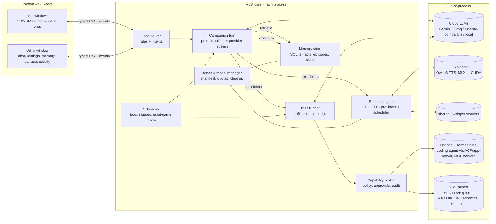
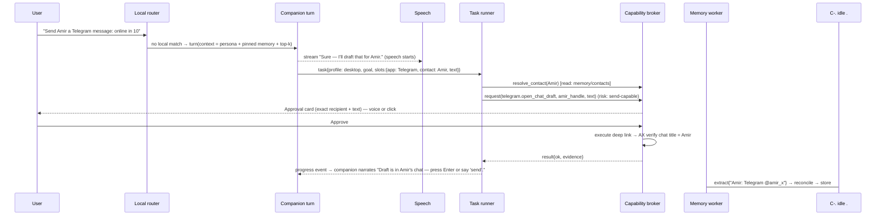
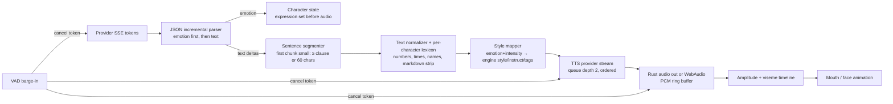
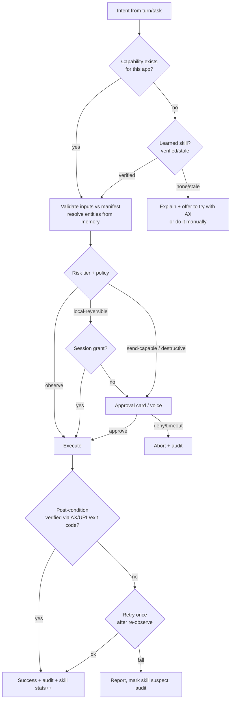
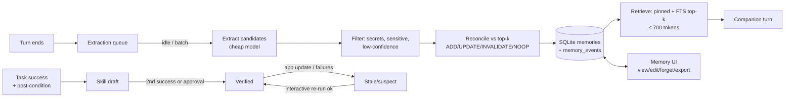
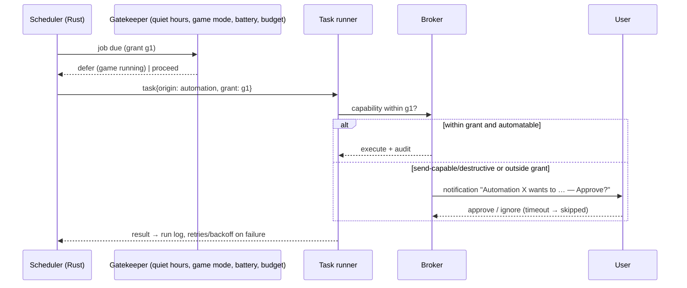

# Mivuneko — Architecture & Feature Evolution Plan

Author: Claude (Opus 5.5) · Date: 2026-10-29 · Baseline: `main` @ `a3131b0`
Status: **proposal for review — nothing implemented, installed or downloaded.**

Legend used throughout:
- **[V]** verified in this repo (file:line) or by running a command here.
- **[R]** from external research with a source; not run on this project.
- **[A]** assumption.
- **[P]** proposal.

Line numbers refer to `a3131b0`.

---

## 0. Executive summary

1. **Do not build a society of LLM agents.** [P] Mivuneko should run **one fast companion turn** per message. It should add **one task runner** that executes multi-step plans with scoped tool profiles, plus **background jobs** (memory consolidation, automations) that never sit on the chat path. "Agents" become *capability profiles* (prompt + toolset + permission scope), not separate always-on model loops. Simple messages keep their current cost: one streamed LLM call.
2. **Hermes Agent: optional external executor, not the runtime.** [P] It is MIT, capable and moving fast. It is also Python 3.11–3.14 + Node + Chromium, pre-1.0 with releases every few days, and its tool-free guarantee can't be proven from the client [R]. Our current Hermes client probably fails against current Hermes [V+R] (§1.4). Keep the security boundary and memory in Mivuneko.
3. **The biggest latency win is not a new model.** Today nothing is spoken until the full JSON reply has arrived [V `App.tsx:425-500`]. Streaming sentence-level TTS from the streamed `text` field cuts time-to-first-audio by roughly the whole generation time for every engine, including Kokoro. This ships first.
4. **Qwen3-TTS is the right expressive tier, gated by hardware.** [R] It is Apache-2.0, has natural-language emotion instructions, VoiceDesign and 3-second cloning. It runs faster than real time on NVIDIA (RTX 4060: about 1.8–2.3× real-time, about 0.4–0.46 s first audio) and on high-end Apple Silicon. It is at or below real time on mid Apple Silicon and on CPU. So: a pluggable TTS provider layer with Light (Kokoro / Pocket TTS on sherpa-onnx), Expressive (Qwen3-TTS sidecar) and Cloud (Gemini) tiers, and per-character voice identity that carries across tiers.
5. **Desktop control follows a structured-first ladder:** URL schemes / app CLIs / Shortcuts → accessibility tree (AX / UIA) → vision only as a last resort. Every action goes through a generalized version of the existing approval broker. Telegram works through `tg://` deep links plus accessibility verification, not a user-account API client.
6. **Memory lives in the SQLite we already ship.** Bi-temporal facts, FTS5 first, embeddings later. Extraction runs asynchronously after the turn. Operational memory is a skill library with verified / unverified / stale status that **never grants permissions**.
7. **Developer assistance delegates instead of rebuilding a coding agent.** [P] Mivuneko drives an installed coding agent over a standard protocol (Codex app-server / ACP) and owns the project scope, diff preview and approval UX.

---

## 1. Current project assessment

### 1.1 What exists and works [V]

| Area | State | Evidence |
|---|---|---|
| Shell | Tauri 2, transparent pet window + hidden utility window, tray, macOS Accessory policy, multi-monitor placement | `src-tauri/src/main.rs:716-780`, `pet_displays.rs` |
| LLM providers | Gemini (multi-key pool, cooldowns, proxy, cancel, SSE streaming) and Groq (SSE). `auto` round-robins Gemini/Groq with fallback | `crates/gemini-client/src/lib.rs:204-253,352-429,510`, `groq.rs:144`, `apps/desktop/src/agent.ts:49-83` |
| Streaming to UI | Token streaming via a `provider-stream` event; `partialText()` extracts the JSON `text` field | `agent.ts:111-126`, `partialText.ts:1` |
| Structured replies | `{text, emotion, speech?, appQuery?, companionActions?}`, schema-constrained on Gemini, parsed with plain-text fallback | `agent.ts:3-62`, `gemini-client lib.rs:657`, `shared-schemas/pet-actions.ts:3-44` |
| Local intents | Regex parsers handle move/sit/hide/expression/open without any LLM call | `shared-schemas/desktop-intent.ts:29-99`, `App.tsx:317-424` |
| App launching | Catalog (mac `.app` scan, Windows `Get-StartApps`), single-use approvals with 60 s expiry (max 8), re-discovery before launch, `open -a` / `explorer.exe`, env scrubbing; ask/auto/deny policy | `crates/os-broker/src/lib.rs:39-267`, `windows_catalog.rs`, `preferences.ts:89,154` |
| Screen | Explicit capture + Gemini analysis; temp file deleted immediately | `src-tauri/src/screen.rs:23-42`, `ScreenAssistant.tsx:48-60` |
| STT | Parakeet TDT 0.6B (resident sherpa server) → whisper-server → whisper-cli fallback chain; energy VAD with adaptive floor; open mic; barge-in | `desktop-core/src/lib.rs:414-698`, `shared-schemas/vad.ts`, `useOpenMic.ts` |
| TTS | Kokoro (resident `luna-tts` C worker or per-phrase CLI), Gemini TTS (streamed PCM), macOS `say`; per-character Kokoro blend packs with per-mood speed/gain/pause | `desktop-core/src/lib.rs:102-221,556-596`, `tools/luna-tts/luna-tts.c`, `assets/characters/*/voice/voice.json`, `voice-style.ts` |
| Characters | 12 built-in 2D characters with 21 emotion cells and locomotion; VRM 3D via three-vrm; importable character packs (2D/2.5D/3D) in IndexedDB | `lunaModel.ts`, `CharacterScene.tsx`, `shared-schemas/character-pack.ts:27-42` |
| Proactive | Opt-in check-ins: 15 s timer in the pet window, quiet hours, daily cap, unanswered suppression; fixed strings | `Pet.tsx:355-410`, `packages/character/controller.ts:138-157` |
| Persistence | Opt-in history: one-row JSON in SQLite (0600, `secure_delete`); prefs in localStorage; assets in IndexedDB | `desktop-core/src/lib.rs:727-783`, `apps/desktop/src/preferences.ts:9-43` |
| Model install | In-app verified (SHA-256) downloads for Whisper / Parakeet / Kokoro into `app_data/speech/*`, cancellable, with progress | `src-tauri/src/voice_install.rs:269-475` |
| Tests | 27 unit files (node:test), 4 Playwright specs with a mocked Tauri IPC, cargo tests for 4 crates in CI on 3 OSes | `tests/`, `.github/workflows/ci.yml` |

### 1.2 Gaps relevant to the requested features [V]

- **No per-character personality.** The three providers each hard-code their own "You are Mivuneko…" system prompt (`agent-client/src/lib.rs:105`, `groq.rs:136`, `gemini-client/src/lib.rs:657`). Character identity is just a name injected as a fake user/assistant pair (`agent.ts:85-98`). The pack schema has no persona field.
- **Speech starts only after the full reply.** `voice.speak(speakable(reply))` runs after `agent.reply()` resolves (`App.tsx:425-500`, `InlineChat.tsx:96`).
- **No memory** beyond the bounded rolling window (last 30 messages, ~13k chars, `shared-schemas/agent.ts:63-78`). No summarization.
- **No accessibility API, no URL-scheme opening, no shell, no file access.** Capabilities are window-only (`capabilities/default.json`). The launcher can only `open -a <app>`.
- **No scheduler** beyond the check-in timer, which lives in the *pet webview* (dies if the window reloads).
- **No storage management.** No inventory, quotas or cleanup beyond tempdirs.
- **Secrets:** Gemini keys from Settings are session-only. Only the Hermes key uses the macOS Keychain (`main.rs:160-180`). No Windows credential store.

### 1.3 Defects found while planning [V] — cheap, high-value fixes

| # | Defect | Evidence | Impact |
|---|---|---|---|
| D1 | The in-app Kokoro installer never builds `luna-tts`, so app-installed users always hit the per-phrase CLI path that reloads the 321 MB model every phrase | `voice_install.rs:333-403`; selection `main.rs:354-366`; `docs/VOICE.md:227` | Seconds of extra latency per phrase for every non-developer user |
| D2 | `synthesize_speech` calls `worker.cancel()` for every phrase, which bumps the shared generation counter and can cancel an in-flight transcription | `main.rs:428` | Lost user utterances during barge-in |
| D3 | The Kokoro blend cache writes a full 28 MB copy of `voices.bin` per character per recipe hash and never deletes old hashes | `main.rs:302-328` | ~336 MB for 12 characters; unbounded growth on edits |
| D4 | Check-in "fullscreen" gate reads `document.fullscreenElement` of the pet webview, so it can't detect a fullscreen game | `Pet.tsx:375` | Proactive speech can interrupt games |
| D5 | Gemini `responseSchema` sets no `propertyOrdering`. Order of `text` vs `emotion` in the stream is not controlled | `gemini-client/src/lib.rs:657` | Blocks mood-correct streaming TTS (§3.3) |
| D6 | Pet inline chat hard-codes mode `Assist`, has no streaming callback and no identity, and ignores `approvalMode` and `companionActions` | `InlineChat.tsx:67-94` | Two divergent chat paths; the fast surface is the slower one |
| D7 | Gemini STT exists natively but has no frontend caller | `gemini.rs:66` | Dead code or missing feature — decide |
| D8 | `load_history` / `clear_history` are not window-restricted, and `save_history`'s `consent:true` is always sent by the frontend | `history.ts:23`, `main.rs:690-694` | Weak command ACL (matters once memory exists) |
| D9 | `src-tauri` crate tests are not run in CI | `ci.yml` | Voice-pack and installer regressions go unnoticed |
| D10 | Docs are stale: GAPS.md says streaming responses and barge-in are missing; ARCHITECTURE.md says capture caps at 29 s and TTS is `say` | `docs/GAPS.md:12`, `docs/ARCHITECTURE.md:34` | Misleads future work and reviewers |

### 1.4 Hermes client vs current Hermes [V code + R upstream]

`validate_toolsets` calls `value.as_array()` on the whole `/v1/toolsets` body (`crates/agent-client/src/lib.rs:52`). Current Hermes returns `{"object":"list","data":[…]}` [R: `gateway/platforms/api_server.py` `_handle_toolsets`]. If that holds, **every Hermes turn fails at preflight**. Upstream also ignores request-level `tools` / `tool_choice` / `max_tokens`. It injects MCP and memory-provider tools outside the toolsets listing, and layers our system prompt *on top of* its own persona/memory/skills prompt [R]. **Not yet verified against a live install.** The first Phase-0 task is to confirm it.

### 1.5 Disk observations on the dev checkout [V]

`.local/` holds four Whisper models (tiny 74 MB, base 141 MB, small.en 190 MB, large-v3-turbo 574 MB), Parakeet 634 MB, Kokoro 394 MB, two sherpa runtimes (66 + 71 MB), a 28 MB blend cache and 9.5 MB of audition samples. That is ~2.2 GB from voice alone, and nothing tells the user which models are unused.

---

## 2. Recommended architecture

### 2.1 Should Mivuneko become multi-agent?

**Assessment.** Most requested features need three things:
- (a) one good conversational turn with the right context,
- (b) occasionally a multi-step tool-using plan,
- (c) background work.

A network of peer agents (companion ↔ planner ↔ desktop ↔ memory ↔ dev) multiplies model calls, latency, cost and failure modes. It duplicates context and makes permission reasoning harder. The proven benefits of sub-agents are **context isolation** for long tool work and **parallel independent subtasks**. Both are needed only on the slow path.

**Recommendation [P]: "one voice, one hands, many background chores".**

| Component | Is it an LLM loop? | When it runs | Responsibility |
|---|---|---|---|
| **Companion turn** | 1 streamed call | Every user message | Conversation, personality, emotion, speech text; *decides* whether to delegate by emitting a `task` intent in its structured reply (extends today's `appQuery` / `companionActions` pattern) |
| **Local router** | No (regex/rules, exists today) | Before the LLM | Instant commands (`move`, `hide`, `open X`, `stop`), approval answers |
| **Task runner** | Tool loop, 1 at a time (queue) | Only when a task is created | Executes a plan with one **capability profile**: `desktop`, `dev`, `research`. A profile = system prompt + allowed capabilities + model choice + step and time budget. It narrates progress back through the companion (template lines or a cheap model), not a second persona |
| **Memory worker** | Cheap model call, async | After a turn ends / when idle | Extract → reconcile → store facts; consolidate; never blocks a reply |
| **Scheduler** | No | Timer in the Rust core | Fires automations, reminders, check-ins; hands work to the task runner or companion |
| **External executors** (optional) | Out of process | On demand | Hermes `/v1/runs`, Codex app-server / ACP coding agents, MCP servers — always behind the capability broker |

Sub-agents (parallel task-runner children) are a **later, optional** feature inside the task runner, limited to read-only research fan-out. They are not part of the core design.

### 2.2 Overall architecture



Key structural moves [P]:
1. **Move the turn loop and prompt building into Rust.** Today it is split across `agent.ts` and three hard-coded prompts. One `PromptBuilder` composes: base rules + character persona + mode + retrieved memory + capability catalog. Both chat surfaces call one `companion_turn` command. That fixes D6 and removes the duplicated prompts.
2. **Generalize `os-broker` into a capability broker** (§2.4). Keep its proven properties: typed requests, single use, expiry, rediscovery before execution, no model-supplied paths.
3. **Move the check-in timer into the Rust scheduler** so proactive behaviour survives window reloads and can see OS state (fullscreen apps, idle time).

### 2.3 Agent communication and delegation



Contracts [P]:
- **Task envelope**: `{id, profile, goal, slots, origin: user|automation|suggestion, risk_ceiling, budget:{steps, seconds, tokens}, parent_turn}`. Stored in SQLite so tasks survive restarts. Cancel is via a single `cancel_task(id)` that propagates to the provider stream, sidecars and broker.
- **Shared context** is *pulled*, not broadcast. The task runner receives the goal and slots plus the memory items it asks for, never the whole chat. That bounds tokens and limits injection blast radius.
- **Failure recovery**: each step is a typed capability call with a post-condition. On a failed post-condition the runner may retry once with a re-observed state, then stop and report. Repeated failures mark any skill used as `suspect` (§5.2). The companion always gets a final status event, so the pet is never left "busy".
- **Budgets**: default 12 steps / 90 s / one model. The task runner is serialized (one active task) unless a profile is explicitly read-only.

### 2.4 Capability broker (tool and interaction boundaries)

A **capability** is a typed Rust function with a manifest:

```text
id: telegram.open_chat_draft      risk: send-capable   platforms: [mac, win]
inputs: {handle: Username, text: ≤4096}   reads: [contacts]   effects: [opens app, fills draft]
postcondition: focused window title contains display name
confirmation: always (fresh)       learnable: yes       automatable: no
```

Risk tiers [P]:

| Tier | Examples | Default policy |
|---|---|---|
| `observe` | read app list, read focused window title, read AX tree of a named app, read project files in scope | allowed after the one-time OS permission |
| `local-reversible` | launch app, open URL (allowlisted schemes), focus window, scroll, type into a field the user pointed at | ask once per app (session grant), revocable |
| `send-capable` | message drafts, emails, form submit, call initiation, git commit | **fresh confirmation every time**, showing the exact payload |
| `destructive` | delete/move files, apply code changes, run non-allowlisted commands, purchases | fresh confirmation + diff/preview; never automatable |

Rules:
- The model can only *request* capabilities. Paths, URLs and commands are validated against manifests. Content from external sources (web pages, AX text, screenshots, files, messages) is tagged **untrusted** and can't create or widen a task.
- The broker writes an **append-only audit log** (SQLite table) of request → decision → result.

### 2.5 Hermes integration recommendation

| Option | Verdict |
|---|---|
| Hermes as the core runtime | **No.** Python + Node + Chromium runtime, no published latency, pre-1.0 with weekly breaking changes, its own memory/persona layered under ours, tool restriction is server-config-only and unverifiable from the client [R] |
| Hermes as optional "external executor" | **Yes, later (Phase 5), opt-in.** Use `/v1/runs` (it has stop/approval/clarify endpoints [R]); map its approval requests into our broker UI; run with a Mivuneko-generated profile (`platform_toolsets.api_server` restricted, MCP `no_mcp`, memory off). Useful for power users who already run it (research, browser workflows) |
| Hermes's formats | **Adopt the open bits:** the agentskills.io `SKILL.md` format for operational memory (§5.2) keeps skills portable to Hermes and other agents |
| Current tool-free chat backend | **Fix or retire in Phase 0.** Read `data[]` in preflight, add a live-install contract test, stop relying on request `tools:[]`. If it can't be proven tool-free, remove it from the default backend list |

Alternatives considered: Goose (Rust, Apache-2.0, MCP-native — the best "embed a full agent" candidate if we ever need one), Claude Agent SDK / OpenAI Agents SDK (single vendor, Node/Python sidecar), Letta (server-side memory, heavy), OpenHands (coding, Docker). **Choice [P]: an in-process Rust task runner + `rmcp` MCP host for third-party tools.** Lowest latency, no new runtime, and the security boundary stays in our code.

---

## 3. Voice and character system

### 3.1 Qwen TTS research summary [R]

| Fact | Detail |
|---|---|
| Open model | **Qwen3-TTS** (2026-01-22), Apache-2.0. Variants: 1.7B VoiceDesign, 1.7B CustomVoice, 1.7B Base, 0.6B CustomVoice, 0.6B Base; 12 Hz tokenizer. Disk: 0.6B ≈ 2.5 GB, 1.7B ≈ 4.5 GB (bf16) |
| Languages | zh, en, ja, ko, de, fr, ru, pt, es, it. **No Persian** |
| Control | Natural-language instructions per line (CustomVoice), voice design from text (1.7B VoiceDesign), 3 s cloning (Base). Laughter/whisper are **not documented** — must be tested |
| Streaming | Dual-track; paper reports ~100 ms first packet on a server stack (vLLM + CUDA graphs) |
| Consumer speed | faster-qwen3-tts: RTX 4090 4.2–4.8× real-time / 156–174 ms first audio; RTX 4060 1.8–2.3× / 413–460 ms. MLX: M4 Pro *below* real time for streaming, M4 Max barely above (mlx-audio-swift #224). GGUF + ONNX: RTF 0.35 on RTX 5050, **RTF 1.3 (slower than real time) on CPU / iGPU** |
| Runtimes | PyTorch (slow stock loop), faster-qwen3-tts (CUDA; GGML/Metal on arm64), mlx-audio (Apple Silicon, `--stream`, OpenAI-compatible server), community GGUF + ONNX split, mainline llama.cpp (1.7B Base only), immature Candle crates. **Not in sherpa-onnx** |
| Known issues | Time/number misreads, cloned output echoing reference tail, start-of-audio noise, missing EOS on Base, inconsistent timbre across sentence-chunked calls |
| Hosted-only successors | Qwen-Audio-3.x TTS (inline nonverbal tags) — API only, no weights |
| Sibling | Fun-CosyVoice3-0.5B (Apache-2.0): instructions + **CMU-phoneme / Pinyin inpainting for pronunciation**, bi-streaming; CUDA-oriented runtimes |

Other local options worth keeping in the matrix:
- **Kyutai Pocket TTS** (~100M, CPU ~6× real-time on 2 cores, ~200 ms first chunk, cloning, already supported by sherpa-onnx; weight licence needs confirming).
- **Chatterbox Turbo/Nano** (MIT, `[laugh]`/`[chuckle]` tags, English; always watermarked).
- **Avoid for licence reasons:** Fish/OpenAudio, Spark-TTS, IndexTTS2, Higgs (NC or user-count limits).

### 3.2 Recommended speech architecture [P]

One Rust `TtsProvider` trait:

```text
trait TtsProvider { caps() -> Caps{stream, instruct, clone, nonverbal_tags, langs, sample_rate};
                    synth(Utterance{text, voice: VoiceRef, style: Style, lang}) -> Stream<PcmChunk>;
                    warm(); unload(); }
```

| Tier | Engine | Runs on | Role |
|---|---|---|---|
| Light (default) | Kokoro (existing) + **Pocket TTS** via the sherpa-onnx we already ship | CPU, any machine | Always available, low RAM, game-safe. Pocket gives per-character *cloned* timbre cheaply |
| Expressive (opt-in) | **Qwen3-TTS 0.6B CustomVoice / Base** in a sidecar: `mlx-audio` server on Apple Silicon, `faster-qwen3-tts` on NVIDIA. GGUF + ONNX native path later | Benchmarked "capable" hardware only | Emotion by instruction, character voice by cloned reference |
| Cloud | Gemini TTS (existing) | Network | Expressive without local GPU; already streams |
| System | macOS `say`; add Windows SAPI/OneCore | OS | Last-resort, explicit choice only (existing rule) |

- **Sidecar protocol:** loopback HTTP, OpenAI-style `/v1/audio/speech` with chunked PCM. Both candidate servers already speak it, so one Rust client covers both.
- **Lifecycle:** the sidecar is started on first use, kept warm while conversation is active, and unloaded after N idle minutes or when a game is detected.
- **Python packaging:** a pinned, hash-locked environment installed by the existing verified-download installer into `app_data/speech/qwen`.
- **Choosing engines:** a hardware probe plus a **30-second on-device benchmark** decides whether "Expressive" is offered. It is not guessed from specs.

### 3.3 Streaming pipeline (applies to every engine) [P]



- Fix D5: set Gemini `propertyOrdering: [emotion, companionActions, appQuery, text, speech]`. Use the same order in the prompt for Groq/Hermes. Emotion then arrives before the first sentence. [A: Gemini honours `propertyOrdering` while streaming — verify in Phase 0.]
- Drop the separate `speech` field. Speak streamed `text` through `speakable()` incrementally. This also removes a duplicate generation.
- **Barge-in cancels the whole chain:** provider stream, TTS jobs and queued audio. Fix D2 so TTS and STT cancellation are separate.
- **Audio output:** keep Web Audio initially (works today). Revisit a native Rust output (`cpal`) only if IPC `number[]` transfer shows up in measurements. Switching to binary IPC (`tauri::ipc::Response`) is the cheap first fix.

### 3.4 Per-character voice and personality [P]

Extend the character pack (`shared-schemas/character-pack.ts`) with versioned, optional fields so existing packs keep working:

```jsonc
"persona": {
  "summary": "Shy, gentle, quietly witty; warms up over time.",
  "traits": {"energy": 0.3, "playfulness": 0.5, "formality": 0.4, "verbosity": 0.35},
  "speechStyle": "short sentences, soft hedges, rare exclamations",
  "boundaries": "never pretends to have done actions it hasn't",
  "proactivity": "low"
},
"voice": {
  "identity": {"reference": "voice/ref.wav", "transcript": "…", "designPrompt": "young adult female, soft, airy"},
  "engines": {
    "qwen3":  {"mode": "clone", "baseInstruct": "gentle, warm"},
    "pocket": {"mode": "clone"},
    "kokoro": {"blend": [{"speaker": "af_heart", "weight": 0.65}, {"speaker": "af_sky", "weight": 0.35}]},
    "gemini": {"voice": "Leda", "style": "soft adult anime companion"}
  },
  "emotionStyles": {"excited": {"instruct": "bright, quicker", "speed": 1.08}, "sad": {"instruct": "quiet, slower"}},
  "lexicon": [{"match": "Mivuneko", "say": "Mee-voo-neh-ko"}],
  "expressive": {"laugh": true, "whisper": true, "hesitation": true}
}
```

- **Voice identity is one reference clip.** Design it once (Qwen VoiceDesign, or user-supplied with consent). Then every cloning engine (Qwen Base, Pocket) reuses it. Identity stays constant across emotions; emotion changes instruct/speed/pause only (today's principle in `docs/VOICE.md`, kept).
- **Emotion is dynamic, not a preset.** The companion turn emits `emotion` + `intensity` (0–1). A small deterministic mapper blends it with persona traits; e.g. a shy character's "excited" stays softer. Expressive markers are passed per engine: Qwen instruction text, Chatterbox tags, or punctuation/silence for engines without them.
- **Personality reaches the LLM through the Rust PromptBuilder** (§2.2): persona summary + speech style + relationship notes from memory. It stays under ~400 tokens so the fast path doesn't bloat.
- **Lip sync:**
  - Today 2D characters ignore `mouth` [V `Luna.tsx:14`, `CompanionVisual.tsx:118-124`]. Step 1: amplitude-driven mouth overlay frames for 2D (cheap).
  - Step 2: viseme timeline from Kokoro/Pocket phoneme output where available, or from text-time alignment, for VRM `aa/ih/ou/ee/oh`. Qwen gives no phonemes, so it stays on amplitude.
- **Character switching** swaps persona + voice identity atomically. The sidecar keeps one cached reference embedding per character to avoid re-encoding.

### 3.5 Pronunciation [P]

1. A shared text normalizer in Rust: numbers, dates, times, units, currency, emoji, code. It addresses Qwen's known time/number issues and Kokoro misreads.
2. A layered lexicon: global → character → user-added. User corrections from the UI ("say it like …") are stored as operational memory.
3. Phoneme overrides only where the engine accepts them (Kokoro G2P/lexicon, CosyVoice CMU inpainting). Respelling elsewhere.
4. A regression list of hard words with recorded expected audio, used in the test suite (§11).

---

## 4. Desktop intelligence

### 4.1 Interaction ladder [P]

| Rung | Mechanism | Reliability | Platforms |
|---|---|---|---|
| 1 | App-specific structured channels: URL schemes (`tg://`, `mailto:`, `vscode://`, `slack://`), app CLIs (`code`, `open -a … --args`), Shortcuts (`shortcuts run`), AppleScript/JXA for scriptable apps | Highest | mac + win (schemes); mac (Shortcuts/AppleScript) |
| 2 | Accessibility tree: macOS AX via `objc2-application-services` [R]; Windows UIA via `uiautomation` 0.25 [R]. API shape: **snapshot → refs → act(ref)** (Playwright-MCP style), with a pruned text tree sent to the LLM | Good where apps expose it (Telegram Desktop improved its tree in 6.8–6.9 [R]) | mac + win |
| 3 | Vision: screenshot + model grounding (Gemini, or a computer-use model) | Lowest, costly, injection-prone | both; **only by explicit per-task opt-in** |

Every rung goes through capability manifests with post-conditions (e.g. "focused window title matches"). Rung 2 needs the macOS Accessibility permission; Rung 3 needs Screen Recording. Both are requested **just-in-time** with an explainer. They require Developer-ID distribution (no Mac App Store) and a **stable signing identity**, otherwise TCC grants reset on every update [R].

### 4.2 Telegram and similar workflows [P]

- **"Send Amir a message…"**
  1. Resolve Amir from the contacts memory (handle or phone).
  2. Ask once if unknown, and remember it after confirmation.
  3. Run capability `telegram.open_chat_draft` → `tg://resolve?domain=<handle>&text=<urlencoded>`. This opens the chat with the draft; it does **not** send [R].
  4. AX-verify that the chat title matches.
  5. The user presses Enter or says "send". An optional `telegram.send_draft` capability (AX press of the send button) needs fresh confirmation showing recipient and text, and is never automatable.
- **"Call Amir"**
  1. Open the chat (as above).
  2. Locate the call button by AX role/label and press it, after fresh confirmation.
  3. If AX fails, say "Amir's chat is open — tap the phone icon." No vision fallback by default.
- **Not recommended:** a TDLib/MTProto user client. It holds the user's session, accounts are "put under observation", there is ban risk, and calls need tgcalls/WebRTC [R]. The Bot API can't message users first [R].
- **Generalizing:** an **app adapter** is a small manifest of capabilities + URL templates + AX selectors per app (Telegram, browser, VS Code, Finder/Explorer, Spotify, mail). Learned procedures (§5.2) can extend adapters but not permissions.
- **Windows catalog:** it is still mostly fine; the launcher change is to add a `open_url` capability with a scheme allowlist next to `launch`.

### 4.3 IDE and development assistance [P]

- **Mivuneko owns:**
  - **Project scope:** the user picks a folder; the scope is stored and every file capability is path-confined to it, with canonicalization and symlink checks (os-broker already does this for apps).
  - **Read-only understanding:** list/search/read files, git status/diff, detect open VS Code workspace.
  - **Approval UX:** diff preview (unified + side-by-side), apply/reject per file. Git is the checkpoint: refuse to apply on a dirty tree unless the user agrees, and stash or branch first.
  - **Command allowlist:** project-declared test/build commands only (from `package.json` scripts / `Cargo.toml` / user-approved), run with a timeout, no shell interpolation, output streamed into the activity panel.
- **Delegated:** code generation and edit loops go to an installed coding agent over a protocol: **Codex app-server (JSON-RPC)** or any **ACP** agent (Hermes, others) [R]. Its edit requests come back as patches that Mivuneko previews and applies through the broker. If none is installed, fall back to a minimal built-in "suggest a patch" flow using the task runner with the `dev` profile, edit format SEARCH/REPLACE (Cline/Aider-proven [R]).
- **Not building:** our own full agentic coding loop or a VS Code extension in v1.

### 4.4 Desktop action execution



---

## 5. Memory and learning

### 5.1 Personal memory [P]

**Storage:** the existing app SQLite file, migrated from the one-row JSON (`desktop-core/src/lib.rs:727-747`) to normalized tables:

```text
messages(id, conversation_id, character_id, role, text, created_at)            -- FTS5
memories(id, kind{fact,preference,person,project,routine,relationship},
         subject, text, scope{user|character:<id>|project:<id>},
         source{message_id|manual|import}, confidence, pinned,
         valid_from, invalidated_at, superseded_by, created_at, last_used_at, use_count) -- FTS5
memory_events(id, memory_id, op{add,update,invalidate,restore,delete}, actor{model,user}, at, before, after)
```

**Write path** (async, never on the turn path):
1. After a turn, if memory is enabled, enqueue an extraction job. Batch per conversation segment, or run when idle.
2. A cheap model extracts candidate facts as JSON. Secret-looking strings are filtered out first.
3. For each candidate, retrieve top-k similar memories (FTS5; vectors later) and decide ADD / UPDATE / INVALIDATE / NOOP (Mem0-style [R]).
4. Contradictions **invalidate** rather than delete (Zep/Graphiti bi-temporal [R]), so history and undo survive.
5. Sensitive categories (health, finances, third-party personal data) need explicit "remember this". Configurable.

**Read path** (on the turn path; budgeted):
- Always include **pinned core** (≤ ~300 tokens: name, how to address, key people, current projects).
- Plus **top-k retrieved** (k ≤ 5, ≤ ~400 tokens) by FTS5 over the current message + last turn, ranked by relevance × recency × use.
- Target: retrieval < 15 ms p95 locally.
- Embeddings (fastembed-rs + a small multilingual model, e.g. multilingual-e5-small or EmbeddingGemma Q4 [R]) are added **only if** FTS recall measurably misses. They are downloaded on demand.

**Scoping:**
- `user` facts are shared by all characters.
- `character:<id>` holds relationship notes ("Raven teases you about coffee").
- `project:<id>` holds dev context.
- A character never sees another character's private notes.

**Short-term memory** is the existing rolling window plus a rolling **conversation summary** written by the memory worker when the window overflows. That replaces silent truncation.

### 5.2 Operational memory and skills [P]

- **Skill = an agentskills.io-style folder** (`SKILL.md` + optional resources) [R], with Mivuneko metadata:
  `status: draft|verified|stale|suspect`, `capabilities: [...]` (the *only* capabilities it may request), `app: Telegram`, `verified_app_version`, `success_count`, `failure_count`, `last_verified_at`, `last_failure`.
- **Created from:** a task that succeeded with verified post-conditions → the runner proposes a skill → it is saved as `draft` → it becomes `verified` only after a second successful run (Voyager rule [R]) or user approval.
- **Errors and solutions:** failures and user corrections are stored as short "lessons" attached to the capability or app adapter, and retrieved into the task runner's context for that app only.
- **Staleness:**
  - Target app version change → `stale`.
  - Two consecutive post-condition failures → `suspect`.
  - Stale/suspect skills run only interactively, with step-by-step confirmation, until re-verified.
- **Permissions:** a skill lists capabilities but **grants none**. Every execution still goes through the broker with current policy. Skills cannot be marked automatable unless every capability in them is `automatable: yes`.
- **Interop:** the same format can be exported to Hermes or other agents. Imported skills start as `draft` with a static scan.

### 5.3 Memory lifecycle



### 5.4 Memory management interface [P]

A **Memory** section in the utility window with these tabs:
- **About you:** facts grouped by kind, each showing its source message and date; edit / forget / pin / "not true anymore".
- **Characters:** per-character relationship notes.
- **Conversations:** opt-in history, search, delete by range.
- **Skills:** status, last run, capabilities used, disable/delete, re-verify.
- **Automations:** history.
- **Settings:** memory on/off, which categories, retention (e.g. episodic messages 90 days, facts until deleted), "forget everything", export as JSON + Markdown.

Deletion is real: row delete + `secure_delete` + FTS rebuild, and it is logged. Provider-side data is out of our reach and the UI says so (as `docs/ARCHITECTURE.md` already does for history).

---

## 6. Automation and proactive behaviour

### 6.1 Three classes, never blurred [P]

| Class | Created by | Runs | May perform |
|---|---|---|---|
| **Suggestion** | Companion/memory ("you usually open VS Code at 9") | Shown as a dismissible bubble | Nothing until the user accepts — then becomes a one-off task |
| **Standing authorization (automation)** | User explicitly, in UI or by voice with confirmation | On schedule/trigger | Only `observe` + `local-reversible` capabilities named in the grant; has an expiry (default 30 days) and an owner-visible run log; revocable in one click |
| **Fresh confirmation** | Any automation step that reaches `send-capable`/`destructive` | Pauses and notifies | Waits for the user; times out to "skipped" |

Mivuneko never sends messages, places calls, modifies code or deletes data because of a learned pattern. Those capabilities are `automatable: no` in their manifests.

### 6.2 Scheduler [P]

- **Rust, in the core process.** It replaces the pet-window `setInterval` (`Pet.tsx:355-410`).
- **Job table:** `jobs(id, kind{reminder,check_in,task,research,project_check}, trigger{at|cron|interval|event}, grant_id, next_run, last_run, status, retries, backoff)`.
- **Event triggers** (later): app launched/closed, idle-for, battery/AC, project files changed. Polling is cheap and low-frequency.
- **Missed runs** after sleep/offline: reminders fire once on wake with "(missed at 9:00)". Tasks marked `skip_if_missed` don't run. Network-dependent jobs wait for connectivity, with exponential backoff (max 3).
- **Game / focus mode:**
  - Fix D4 by detecting fullscreen/foreground apps natively: `NSWorkspace` frontmost app + window bounds vs screen on mac; `SHQueryUserNotificationState` / foreground window on Windows.
  - While active, proactive speech is suppressed, sidecars unload, and background jobs defer.
- **Notifications:** a pet bubble first, then an OS notification if the pet is hidden. Spoken only with the existing `spokenCheckins` opt-in.

### 6.3 Making the pet feel alive (non-intrusively) [P]

- **Idle micro-behaviours with zero model calls:** look at cursor, stretch, nap after long idle, react to time of day. Uses the existing animation states.
- **Contextual check-ins** generated by the cheap model from pinned memory + time context, at the current low default (2/day). The fixed strings in `Pet.tsx:382-389` are replaced, and the same gates apply (quiet hours, unanswered, focus/game).
- **Follow-ups** only for things the user asked about ("remind me", "check later"), never inferred nagging.

### 6.4 Background automation



---

## 7. Resource and storage management

### 7.1 Runtime footprint [P with R data]

| Component | RAM (typ.) | GPU | When loaded |
|---|---|---|---|
| Tauri core + 2 webviews | ~150–300 MB [A] | compositing | always |
| Parakeet worker | ~0.7–1 GB [A, model 634 MB] | — | during voice use; unload after idle |
| Kokoro worker | ~0.6 GB [V doc `VOICE.md:212`] | — | during voice use |
| Pocket TTS | ~0.3 GB [A, ~100M params] | — | Light tier |
| Qwen3-TTS 0.6B sidecar | 2.5–4.6 GB (MLX 8-bit peak 4.6 GB on M4 Pro [R]) | 2–6 GB VRAM on CUDA [R] | Expressive tier only, while active |
| Embeddings (optional) | <200 MB (EmbeddingGemma Q4 [R]) | — | memory worker only |

Policies:
1. **One heavy model resident at a time** where possible. STT and TTS can coexist; the Qwen sidecar and Parakeet together is the worst case.
2. **Idle unload:** voice workers after 10 min idle (configurable); the Qwen sidecar after 3 min.
3. **Game mode** (§6.2) unloads GPU users immediately and falls back to Light/Cloud TTS. A notice appears only if the user is talking.
4. **Idle CPU target:** under 1% with the pet visible and still.
   - Audit animation loops: `requestAnimationFrame` should pause while static.
   - Lower the VRM frame rate when idle.
   - Throttle the check-in 15 s tick in Rust.

### 7.2 Disk footprint estimates

| Item | Size | Class |
|---|---|---|
| App binary + 2D character art | tens of MB [V `apps/desktop/public/characters/*.png` ~2.5–2.9 MB each] | install |
| Whisper models | 74–574 MB each [V] | model |
| Parakeet + runtime | ~700 MB [V] | model |
| Kokoro + runtime | ~465 MB [V] | model |
| Kokoro blend cache | 28 MB **per character per recipe** today [V D3] → ~0.5 MB after fix (store blended rows only) | cache |
| Pocket TTS | ~100–400 MB [A] | model |
| Qwen3-TTS 0.6B / 1.7B | ~2.5 / ~4.5 GB bf16 [R]; quantized MLX/GGUF smaller | model |
| Qwen Python env | MLX: hundreds of MB [A]; CUDA torch: several GB [R] | model runtime |
| Memory DB | MBs per year of text [A] | **user data** |
| Audit/automation logs | capped (e.g. 20 MB, rotated) | log |
| Screenshots / temp audio | 0 at rest (deleted after use, existing behaviour) | temp |

### 7.3 Storage lifecycle [P]

- **Directory classes** under `app_data`: `user/` (memory DB, skills, packs — never auto-deleted), `models/` (manifest-managed), `cache/` (budgeted), `logs/` (rotated), `tmp/` (purged at startup).
- **Model manifest** (`models/manifest.json`): `{id, files[{path, sha256, bytes}], installed_at, last_used_at, required_by[]}`. Downloads go to `*.part` with resume. A startup sweep removes orphan `*.part` and files not in the manifest (only inside `models/`).
- **Cache budget** (default 512 MB) with LRU eviction: blend caches, voice reference embeddings, preview samples.
- **Logs:** size-rotated, with a 7-day default for debug logs. `MIVUNEKO_DEBUG_AUDIO` recordings are flagged in Storage as containing voice.
- **Storage screen:** per-class usage, "unused for 30 days" model list with Remove, "Clear caches", "Clear logs", and a free-space warning before downloads (refuse if it would leave < 2 GB free).
- **Hard rule:** automatic cleanup touches only `cache/`, `logs/`, `tmp/` and unreferenced `models/`. `user/` is changed only by explicit user action. Removing a model never removes the character pack that references it; the pack falls back to another engine.

---

## 8. Architecture diagrams (index)

1. Overall architecture — §2.2
2. Agent communication and delegation — §2.3
3. Voice streaming pipeline — §3.3
4. Memory and learning lifecycle — §5.3
5. Desktop action execution — §4.4
6. Background automation and scheduling — §6.4

---

## 9. Technical comparisons and trade-offs

| Decision | Recommended | Alternatives | Why / risk |
|---|---|---|---|
| Agent topology | 1 companion turn + 1 task runner (profiles) + background workers | Peer multi-agent mesh; Hermes as brain | Fast path stays 1 call; simpler permissions. Risk: the task runner's prompt gets broad → mitigate with profiles |
| Agent runtime | In-process Rust loop + `rmcp` MCP host | Hermes, Goose, Claude/OpenAI Agents SDK | No new runtime, our security boundary. Cost: we write ~1–2k lines of loop/tool plumbing |
| Hermes | Optional external executor (`/v1/runs`), Phase 5 | Core runtime; drop entirely | Keeps the door open for power users; avoids Python/Node coupling |
| Expressive TTS | Qwen3-TTS 0.6B via sidecar (MLX / CUDA), benchmark-gated | CosyVoice3 (better pronunciation control, CUDA-heavy), Chatterbox (tags, watermark), Orpheus (3B) | Best open licence + instruction control. Risk: Python packaging, real-time only on strong hardware, nonverbals unproven |
| Light TTS | Kokoro + Pocket TTS on sherpa-onnx | Piper/Melo | Already integrated runtime; adds cheap cloning |
| Streaming speech | Sentence streaming from LLM text deltas | Wait for full reply (today) | Largest perceived-latency win for every engine |
| Desktop control | Structured → AX/UIA → vision | Vision-first computer use | Reliability, cost, privacy, injection surface |
| Telegram | Deep link + AX verify | TDLib user client; Bot API | No ToS/ban risk; human in loop. Limit: calls need AX, can fail on UI changes |
| Dev assistance | Delegate to Codex app-server / ACP agent; own scope + diff UX | Build own coding agent; VS Code extension | Avoids rebuilding a hard product; risk: dependency on an external tool being installed |
| Memory store | SQLite + FTS5 (+ sqlite-vec later) | LanceDB, Mem0 server, Graphiti/Neo4j | No new services; sqlite-vec pre-v1 is a risk, hence later and optional |
| Skills format | agentskills.io-style folders + our status metadata | Custom JSON | Portable to Hermes/others |
| Secrets | `keyring` 4.x (Keychain / Credential Manager) | SQLCipher everything | Fixes session-only Gemini keys; SQLCipher optional for the memory DB (adds OpenSSL, 5–15% overhead [R]) |

---

## 10. Phased implementation roadmap

Each phase ends with a validation checkpoint, and nothing in a later phase is required for an earlier one to ship.

**Phase 0 — Foundations and fixes (no new features visible)**
- Fix D1–D6, D8–D10.
- Verify the Hermes preflight against a live install; fix or demote the backend.
- **Latency instrumentation:** spans for `speech_end → stt_done → first_token → first_sentence → first_audio`, written to a local metrics table plus a `--telemetry` dump (the existing script flag).
- A Rust **PromptBuilder** with a single shared system prompt; one `companion_turn` command for both chat surfaces.
- **Checkpoint:** baseline latency numbers recorded per provider/engine; all existing tests pass; no behaviour regressions in the macOS/Windows checklists.

**Phase 1 — Streaming voice + character personality**
- Incremental JSON parsing with emotion first, sentence-streamed TTS for Kokoro and Gemini, full-chain barge-in cancel, binary audio IPC.
- `persona` and `voice.identity` / `emotionStyles` / `lexicon` in the pack schema, with migration of the 12 built-ins.
- Text normalizer.
- 2D amplitude mouth.
- **Checkpoint:** time-to-first-audio target met (§11) on Kokoro and Gemini; A/B listening test vs today.

**Phase 2 — TTS provider layer + expressive tier spike → ship**
- The `TtsProvider` trait; Pocket TTS on sherpa-onnx.
- **Spike (1–2 weeks):**
  - Qwen3-TTS 0.6B via mlx-audio (M-series Mac) and faster-qwen3-tts (RTX 3060/4060-class).
  - Measure first audio, RTF, RAM/VRAM, timbre stability across chunks, nonverbal instructions, and pronunciation list.
  - Run with a game running.
- **Go / no-go** on Qwen.
- If go: sidecar installer, hardware benchmark gate, idle unload, per-character VoiceDesign → reference clip.
- **Checkpoint:** MOS-style listening panel vs Kokoro; resource caps respected.

**Phase 3 — Personal memory + storage management + secrets**
- SQLite migration, extraction worker, retrieval in PromptBuilder, Memory UI, retention.
- `keyring` for provider keys.
- Model manifest, cache budget, Storage UI.
- **Checkpoint:** memory precision/recall test set (§11); storage sweep never touches `user/`.

**Phase 4 — Capability broker + desktop control**
- Generalize os-broker; audit log; `open_url` with allowlist; AX (mac) / UIA (win) snapshot and act; app adapters for Telegram, browser, VS Code, Finder/Explorer.
- Task runner with the `desktop` profile.
- Telegram draft/send/call flows.
- **Checkpoint:** scripted scenario suite on both OSes; zero unconfirmed send-capable actions in fuzzed prompt-injection tests.

**Phase 5 — Operational memory, automations, dev assistance, external executors**
- Skill library and lifecycle.
- Rust scheduler with grants; game mode; contextual check-ins.
- Project scope + diff UX + Codex app-server / ACP adapter.
- `rmcp` MCP host.
- Optional Hermes `/v1/runs` executor.

**Deferred (revisit with data):**
- Vision-based computer use beyond opt-in experiments.
- MTProto Telegram client.
- Wake word and full-duplex.
- Native Rust Qwen (llama.cpp + ONNX) port.
- Phoneme-accurate visemes for Qwen.
- Parallel sub-agents.
- Live2D.
- Linux.

Dependency notes:
- Phase 1 depends on 0 (PromptBuilder, instrumentation).
- Phase 4's contact resolution benefits from Phase 3 but can start with ask-every-time.
- Phase 5 skills depend on 4's post-conditions.

---

## 11. Testing and acceptance criteria

**Targets (proposed, not measured).** All are measured on reference machines (one Apple Silicon Mac, one Windows + mid NVIDIA, one CPU-only laptop), warm state.

| Metric | Target |
|---|---|
| Local intent (move/hide/open) → visible reaction | < 100 ms p95 |
| User send → first visible token (cloud LLM) | < 700 ms p50, < 1.5 s p95 (provider-bound) |
| First token → first audio, Light tier | < 400 ms p50 |
| First token → first audio, Expressive tier on gated hardware | < 700 ms p50 |
| End-of-speech → transcript (Parakeet) | < 500 ms p50 |
| Barge-in → audio silent | < 150 ms |
| Memory retrieval | < 15 ms p95; total injected memory ≤ 700 tokens |
| Idle CPU (pet visible, no voice) | < 1% avg over 10 min |
| Idle RAM (no voice models loaded) | < 350 MB |
| Game mode | GPU memory held by Mivuneko → 0 within 5 s of a fullscreen game |

**Test suites [P]:**
- **Latency harness:** a replayable fixture of 50 prompts with recorded audio, run against each provider/engine combination. It reports p50/p95 per span from the Phase-0 instrumentation, separating *targets* from *measured*.
- **Speech quality:** a pronunciation regression list (names, numbers, times, code-ish words) reviewed with ASR round-trip WER as a cheap proxy. A blind listening panel (naturalness, emotion match, identity consistency across emotions) of ≥ 5 listeners × 20 lines per character per engine.
- **Memory:** a scripted multi-session conversation set with expected extracted facts, contradictions and deletions. Measure precision (no invented facts), recall, correct invalidation, and "forget" completeness (row + FTS + summaries).
- **Agent/tools:** scenario scripts per app adapter with post-conditions (mac + win CI where possible, otherwise the local checklists). A prompt-injection corpus (web/AX/file content trying to trigger sends) must yield zero unconfirmed `send-capable` executions.
- **Resources:** 2-hour soak with a GPU benchmark running, sampling CPU/RAM/VRAM, and checking that unload happens.
- **Storage:** a fixture with orphan `.part` files, stale caches and a user DB. The sweep removes only disposable classes, verified by hash listing before and after.
- **Security:** command ACL tests per window; path-traversal tests for project scope; secrets never present in prompts/logs (grep on recorded fixtures); permission revocation takes effect for queued tasks.
- **Cross-platform:** extend `docs/MACOS_TEST_CHECKLIST.md` / `WINDOWS_TEST_CHECKLIST.md` with AX/UIA, notifications, keyring and game-mode items. Add the `src-tauri` crate tests to CI (D9).

---

## 12. Decisions requiring your approval

1. **Topology:** approve "one companion turn + one task runner with profiles + background workers" instead of a multi-agent mesh?
2. **Hermes:** demote it to an optional external executor (Phase 5) and fix-or-hide the current chat backend in Phase 0?
3. **Languages (blocking for TTS/STT choices):** which languages must Mivuneko speak and understand? Qwen3-TTS, Kokoro and Parakeet do **not** support Persian. If Persian voice is required, we need a different TTS (Gemini cloud already may; a local Persian option must be researched separately) and multilingual STT (Whisper).
4. **Expressive TTS packaging:** accept a Python sidecar (pinned, hash-verified env) for Qwen3-TTS, gated by an on-device benchmark? Or require a native (no-Python) path even if it delays the feature?
5. **Order:** ship streaming speech + personality (Phases 0–1) before any new model work?
6. **Desktop control scope:** approve the structured → AX → (opt-in) vision ladder? Accept that AX/Automation requires Developer-ID distribution with a stable signing identity (no Mac App Store)?
7. **Telegram:** approve deep-link + AX (draft by default, send/call only with fresh confirmation), and **no** MTProto user client?
8. **Dev assistance:** delegate code editing to an installed agent (Codex app-server / ACP), or should Mivuneko carry its own minimal patch loop as the primary path?
9. **Memory defaults:** memory off until the user opts in (like history today), or on with visible notices? Default retention for raw messages (proposed 90 days)?
10. **Cloud use for memory extraction:** OK to send conversation snippets to the configured cloud model for fact extraction, or must extraction be local-only (which needs a local LLM and changes the resource budget)?
11. **Encryption at rest:** SQLCipher for the memory DB (key in Keychain/Credential Manager), or OS file permissions only?
12. **Reference hardware:** which three machines define the acceptance targets in §11?
13. **Licensing:** confirm the project licence (still an open owner decision per README). It affects which TTS/models can be bundled vs downloaded on demand.

---

## Appendix A — Research sources (selected)

- Hermes Agent: github.com/NousResearch/hermes-agent; hermes-agent.nousresearch.com/docs (installation, platform-support, api-server, acp, memory, skills, security, toolsets-reference)
- Qwen3-TTS: github.com/QwenLM/Qwen3-TTS; arxiv.org/html/2601.15621v1; huggingface.co/Qwen/Qwen3-TTS-12Hz-1.7B-CustomVoice (+ discussion 18); github.com/andimarafioti/faster-qwen3-tts; github.com/Blaizzy/mlx-audio; github.com/Blaizzy/mlx-audio-swift/issues/224; github.com/HaujetZhao/Qwen3-TTS-GGUF; docs.vllm.ai/projects/vllm-omni
- CosyVoice: github.com/FunAudioLLM/CosyVoice · Pocket TTS: github.com/kyutai-labs/pocket-tts · Chatterbox: github.com/resemble-ai/chatterbox · sherpa-onnx TTS list: k2-fsa.github.io/sherpa/onnx/tts
- Desktop: docs.rs/objc2-application-services; crates.io/crates/uiautomation; developer.apple.com/forums/thread/749494; Playwright MCP snapshots; UFO2 arxiv 2504.14603; core.telegram.org/api/links, /api/terms, /api/calls (via snippets — TLS-intercepted during research)
- Memory: Mem0 arxiv 2504.19413; Zep/Graphiti arxiv 2501.13956; docs.letta.com; agentskills.io/specification; Voyager arxiv 2305.16291; github.com/asg017/sqlite-vec; github.com/Anush008/fastembed-rs; docs.rs/crate/keyring; zetetic.net/sqlcipher/performance

## Appendix B — Not verified in this planning pass

- Hermes `/v1/toolsets` shape against a live install.
- Gemini honouring `propertyOrdering` during streaming.
- Qwen3-TTS nonverbal behaviour and real RTF on target hardware.
- Pocket TTS weight licence.
- The exact Telegram phone/call deep-link forms.
- Telegram for macOS (native Swift client) AX tree quality.
- RAM figures marked [A].
- No tests were run during this pass.
