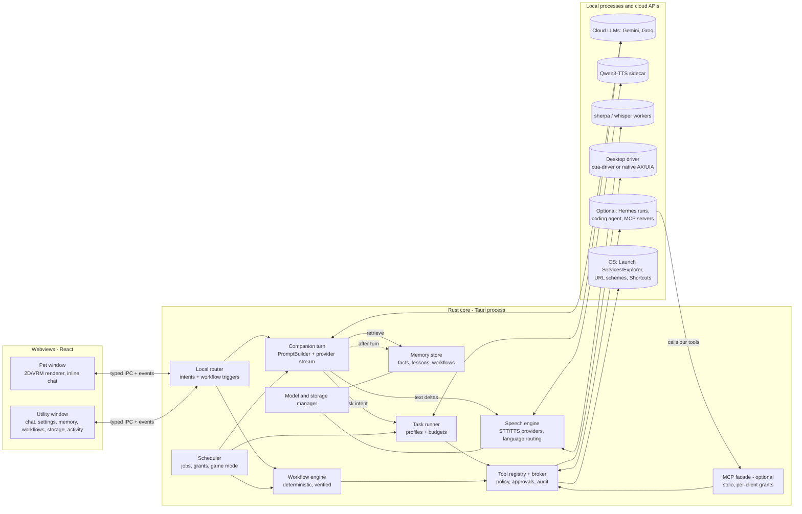
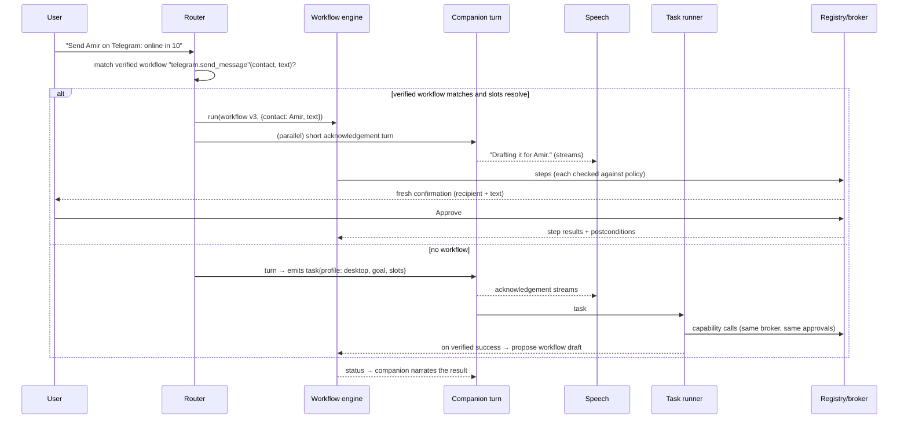
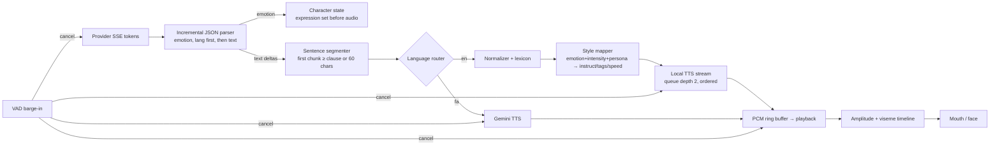
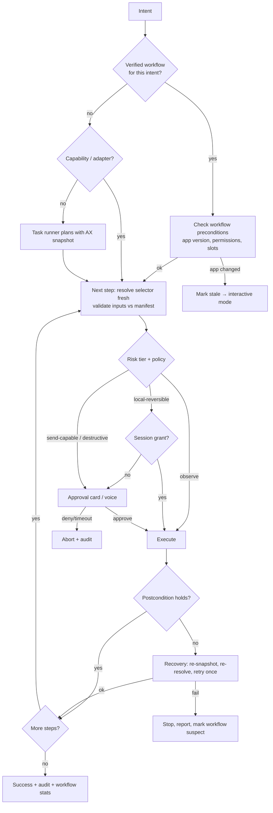
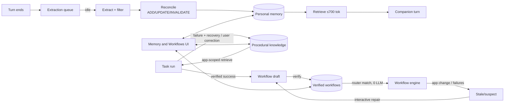

# Mivuneko — Architecture & Feature Evolution Plan (v2)

| | |
|---|---|
| Author | Claude (Opus 5.5) |
| Date | 2026-10-29 |
| Baseline | `main` @ `a3131b0` |
| Supersedes | v1 (`EVOLUTION_PLAN.v1.md`) |
| Status | **Planning only.** Nothing is implemented, deleted, installed or downloaded until the owner approves this plan. |

Legend used throughout:
- **[V]** verified in this repo (file:line) or by running a command here.
- **[R]** from external research with a source; not run on this project.
- **[A]** assumption.
- **[P]** proposal.

Scope rule: this plan covers the desktop app, local runtimes and the cloud model APIs Mivuneko already calls. Server hosting and VPS topics are out of scope.

### Owner decisions already made (2026-10-29)

1. Make and justify the best technical decisions.
2. The current agent system may change substantially if needed.
3. Removing existing pieces requires an audit plus a tested migration and rollback (§1.6).
4. **Local TTS (Qwen and others) speaks English only.** Persian speech uses Gemini TTS only.
5. Speech recognition models are offered as **ranked choices in Settings**, with a recommendation for the user's device.
6. Ordinary conversation is independent of Hermes, and low-latency streaming is the top priority.
7. Hermes stays optional, used only for complex, open-ended tasks where it measurably adds value.
8. Learned workflows:
   - are executable without LLM calls only after verification;
   - are semantic, not coordinate replay;
   - are permissioned, versioned and invalidated on app change;
   - never grant permissions.
9. Plan for hardware tiers, not the owner's current machine.

### Changes from v1

- Personal memory, procedural knowledge and executable workflows are now three separate layers (§5).
- Added a deterministic workflow engine (§5.3).
- Added a native tool registry with an optional MCP facade, evaluated against an MCP-only design (§2.4).
- cua-driver is evaluated as the desktop driver (§4.1).
- Hermes now has a measured-value gate (§2.6).
- Added speech-recognition ranking and recommendation (§3.6).
- Added language routing (§3.2).
- Added an audit of the code proposed for change, with migration and rollback (§1.6).
- Removed server-hosting material.

---

## 0. Executive summary

1. **Conversation is one streamed call, never through Hermes.** [P]
   - The local router handles instant commands with no model call (exists today).
   - Everything else is one streamed companion turn.
   - Speech starts on the first sentence. Today it waits for the whole reply [V `App.tsx:425-500`], which makes this the largest latency win available, independent of TTS engine.
2. **Not a society of agents.** [P] The pieces are:
   - one companion turn;
   - one task runner with capability profiles for multi-step work;
   - a deterministic workflow engine that replays verified procedures with **zero** LLM calls;
   - background workers (memory, scheduler).

   Peer multi-agent meshes add calls, latency and permission complexity with no benefit on the fast path.
3. **One native tool registry with central permissions** in the Rust core. Mivuneko's own runner calls it in-process. An **optional MCP facade** exposes a filtered, per-client-granted subset to Hermes or other agents. All actions from all callers pass the same broker.
4. **Desktop control is semantic.** The ladder is:
   1. app channels (URL schemes, CLIs, Shortcuts);
   2. accessibility tree (macOS AX / Windows UIA) with stable selectors, preconditions and postconditions;
   3. vision only interactively.

   **cua-driver** (MIT, Rust, AX + UIA, the engine under Hermes's computer use [R]) is the leading candidate for the driver layer. It sits behind our own `DesktopDriver` trait and is chosen by a reliability spike.
5. **Hermes is an optional executor** for open-ended jobs (multi-step research, terminal and coding work, browser workflows). It runs through `/v1/runs` with approvals routed to our UI. It is kept per task category only where a benchmark shows it beats the built-in runner (§2.6). Its "learning" does not reduce LLM calls: skills are prompts and background review adds calls [R]. Our verified workflows do.
6. **Voice:**
   - **Light tier:** Kokoro + Pocket TTS on the sherpa-onnx we already ship.
   - **Expressive tier:** Qwen3-TTS (English), sidecar, hardware-gated.
   - **Cloud tier:** Gemini TTS (also the only Persian voice).
   - Per-character persona and voice identity live in the character pack.
7. **Speech recognition:**
   - Add Nemotron Speech Streaming EN for real-time captions, on our existing sherpa-onnx runtime.
   - Keep Parakeet for final English transcripts.
   - Route Persian to a Persian-tuned Whisper (ggml) or Gemini.
   - Rank every engine in Settings using a device probe plus a 30-second on-device benchmark.
8. **Memory** has three layers in the existing SQLite: personal facts, procedural knowledge (lessons the LLM reads) and executable workflows (run without the LLM). Extraction is asynchronous and never on the chat path.
9. **Nothing working is removed early.** The "mock Hermes" adapter is actually the live "open X" path, and the Hermes backend carries the E2E test harness (§1.6). Both are migrated behind flags with parity tests and rollback.

---

## 1. Current project assessment

### 1.1 What exists and works [V]

| Area | State | Evidence |
|---|---|---|
| Shell | Tauri 2, transparent pet window + hidden utility window, tray, macOS Accessory policy, multi-monitor placement | `src-tauri/src/main.rs:716-780`, `pet_displays.rs` |
| LLM providers | Gemini (multi-key pool, cooldowns, proxy, cancel, SSE streaming) and Groq (SSE). `auto` round-robins Gemini/Groq with fallback | `crates/gemini-client/src/lib.rs:204-253,352-429,510`, `groq.rs:144`, `apps/desktop/src/agent.ts:49-83` |
| Streaming to UI | Token streaming via a `provider-stream` event; `partialText()` extracts the JSON `text` field | `agent.ts:111-126`, `partialText.ts:1` |
| Structured replies | `{text, emotion, speech?, appQuery?, companionActions?}`, schema-constrained on Gemini, with plain-text fallback | `agent.ts:3-62`, `gemini-client lib.rs:657`, `shared-schemas/pet-actions.ts:3-44` |
| Local intents | Regex parsers handle move/sit/hide/expression/open with no LLM | `shared-schemas/desktop-intent.ts:29-99`, `App.tsx:317-424` |
| App launching | Catalog (mac `.app` scan, Windows `Get-StartApps`), single-use approvals with 60 s expiry (max 8), re-discovery before launch, env scrubbing; ask/auto/deny policy | `crates/os-broker/src/lib.rs:39-267`, `windows_catalog.rs`, `preferences.ts:89,154` |
| Screen | Explicit capture + Gemini analysis; temp file deleted immediately | `src-tauri/src/screen.rs:23-42`, `ScreenAssistant.tsx:48-60` |
| STT | Parakeet TDT 0.6B v2 (resident sherpa offline websocket server) → whisper-server → whisper-cli; energy VAD; open mic; barge-in | `desktop-core/src/lib.rs:414-698`, `shared-schemas/vad.ts`, `useOpenMic.ts` |
| TTS | Kokoro (resident `luna-tts` C worker or per-phrase CLI), Gemini TTS (streamed PCM), macOS `say`; per-character Kokoro blend packs with per-mood speed/gain/pause | `desktop-core/src/lib.rs:102-221,556-596`, `tools/luna-tts/luna-tts.c`, `assets/characters/*/voice/voice.json`, `voice-style.ts` |
| Characters | 12 built-in 2D characters (21 emotion cells + locomotion); VRM via three-vrm; importable packs (2D/2.5D/3D) in IndexedDB | `lunaModel.ts`, `CharacterScene.tsx`, `shared-schemas/character-pack.ts:27-42` |
| Proactive | Opt-in check-ins (15 s timer in the pet window, quiet hours, daily cap, unanswered suppression); fixed strings | `Pet.tsx:355-410`, `packages/character/controller.ts:138-157` |
| Persistence | Opt-in history (one-row JSON in SQLite, 0600, `secure_delete`); prefs in localStorage; assets in IndexedDB | `desktop-core/src/lib.rs:727-783`, `apps/desktop/src/preferences.ts:9-43` |
| Model install | Verified (SHA-256), resumable, cancellable in-app downloads for Whisper / Parakeet / Kokoro into `app_data/speech/*` | `src-tauri/src/voice_install.rs:269-475` |
| Tests | 27 unit files (node:test), 4 Playwright specs with mocked Tauri IPC, cargo tests for 4 crates in CI on 3 OSes | `tests/`, `.github/workflows/ci.yml` |

### 1.2 Gaps relevant to the requested features [V]

- **No per-character personality.** There are four hard-coded system prompts:
  - Hermes, `agent-client/src/lib.rs:105`;
  - Groq, `groq.rs:136`;
  - Gemini chat, `gemini-client/src/lib.rs:657`;
  - Gemini screen analysis, `lib.rs:719`.

  Identity is just a name injected as a fake user/assistant pair (`agent.ts:85-98`). Packs have no persona field.
- **Speech starts only after the full reply** (`App.tsx:425-500`, `InlineChat.tsx:96`).
- **No memory** beyond a rolling window (30 messages, ~13k chars; `shared-schemas/agent.ts:63-78`). No summarization.
- **No accessibility API, URL-scheme opening, shell or file access.** Capabilities are window-only (`capabilities/default.json`). The launcher only runs `open -a <app>`.
- **No streaming ASR.** Open mic re-transcribes the whole buffer every 6 s for partials (`useOpenMic.ts:181-198`). End-of-turn waits 3.5 s of silence by default (`preferences.ts:172`).
- **No scheduler** beyond the check-in timer, which lives in the *pet webview*.
- **No storage management.**
- **Secrets:** Gemini keys from Settings are session-only. Only the Hermes key uses the Keychain (`main.rs:160-180`). There is no Windows credential store.

### 1.3 Defects found while planning [V] — cheap, high-value fixes

| # | Defect | Evidence | Impact |
|---|---|---|---|
| D1 | The in-app Kokoro installer never builds `luna-tts`, so app-installed users always take the per-phrase CLI path that reloads the 321 MB model | `voice_install.rs:333-403`, selection `main.rs:354-366`, `docs/VOICE.md:227` | Seconds of extra latency per phrase for every non-developer user |
| D2 | `synthesize_speech` calls `worker.cancel()` per phrase, bumping a counter shared with transcription | `main.rs:428` | Can drop user utterances during barge-in |
| D3 | The Kokoro blend cache writes a full 28 MB copy of `voices.bin` per character per recipe and never deletes old ones | `main.rs:302-328` | ~336 MB for 12 characters; unbounded growth |
| D4 | The check-in fullscreen gate reads the pet webview's `document.fullscreenElement` | `Pet.tsx:375` | Can't see a fullscreen game; proactive speech can interrupt games |
| D5 | No `propertyOrdering` in the Gemini `responseSchema` | `gemini-client/src/lib.rs:657` | `emotion` may arrive after `text`; blocks mood-correct streaming TTS |
| D6 | Pet inline chat hard-codes `Assist`, has no streaming callback and no identity, and ignores `approvalMode` and `companionActions` | `InlineChat.tsx:67-94` | Two divergent chat paths; the fast surface is the slower one |
| D7 | Native Gemini STT has no frontend caller | `gemini.rs:66` | Becomes the Persian cloud path (§3.6) |
| D8 | `load_history` / `clear_history` are not window-restricted, and `consent:true` is always sent | `history.ts:23`, `main.rs:690-694` | Weak command ACL, which matters once memory exists |
| D9 | `src-tauri` crate tests are not in CI | `ci.yml` | Installer and voice-pack regressions go unseen |
| D10 | Stale docs: GAPS.md says streaming responses and barge-in are missing; ARCHITECTURE.md says the cap is 29 s and TTS is `say` | `docs/GAPS.md:12`, `docs/ARCHITECTURE.md:34` | Misleads contributors and reviewers |
| D11 | Preference normalization coerces `gemini` / `groq` to `auto` | `shared-schemas/preferences.ts:282-286` | The user can't pin a single provider (relevant to latency testing) |

### 1.4 Hermes client vs current Hermes [V code + R upstream]

- `validate_toolsets` calls `value.as_array()` on the whole `/v1/toolsets` body (`crates/agent-client/src/lib.rs:52`). Current Hermes returns `{"object":"list","data":[…]}` [R]. If so, **every Hermes turn fails at preflight**.
- Upstream also ignores request-level `tools` / `tool_choice` / `max_tokens` [R].
- It injects MCP and memory tools outside the toolsets listing [R].
- It layers our system prompt over its own persona/memory/skills prompt [R].
- Not yet checked against a live install; Phase 0 confirms it.

### 1.5 Disk observations on the dev checkout [V]

`.local/` holds:
- 4 Whisper models (74–574 MB);
- Parakeet (634 MB) and Kokoro (394 MB);
- 2 sherpa runtimes (66 + 71 MB);
- one 28 MB blend cache and 9.5 MB of samples.

That is ~2.2 GB of voice files with no usage visibility.

### 1.6 Audit of components proposed for change [V]

| Component | Actual role today | Dependents | Proposal | Migration and rollback |
|---|---|---|---|---|
| `services/agent-adapter/mock.ts` (`mockHermes`) | **Not a mock in practice.** It is the production path for every explicit "open X" on every backend (`agent.ts:39-41`), and for the whole `offline` backend (`agent.ts:42-43`) | `agent.ts`, `tests/unit/agent.test.mjs` (5 cases) | **Keep the behaviour, rename it.** It becomes the local intent responder inside the Rust router (`open` → broker request), and the offline reply text stays | 1. Port with identical outputs. 2. Run the existing unit cases against both old and new. 3. Keep the old TS module until the E2E suite passes on the new path for one release. 4. Rollback = restore the import (pure TS, no data impact) |
| Hermes chat backend (`hermes_chat`, `hermes_status`, `BackendSettings` option, `agent-client` crate) | Optional user-selected backend. **Probably broken** against current Hermes (§1.4). Also the **mocked chat path for 14 E2E tests** (`desktop.spec.ts` ×8, `settings-redesign.spec.ts` ×6) | Prefs value `"hermes"` (`preferences.ts:84,284`), env-scrub lists (os-broker, desktop-core, screen, voice_install), `doctor.mjs`, Keychain service `dev.mivuneko.hermes` | **Not removed in Phase 0.** 1) Fix the preflight to read `data[]` and add a live contract test. 2) Introduce a neutral `test` provider for E2E so tests stop depending on the Hermes mock. 3) In Phase 5 the Hermes *executor* replaces the chat backend; chat via Hermes is retired only after the §2.6 comparison | Keep `"hermes"` as an accepted pref value that maps to `auto` + a notice ("Hermes now runs tasks, not chat"). Feature flag `legacyHermesChat` for one release. Rollback = flip the flag; the crate stays until the flag is deleted |
| Four system prompts | Each provider's prompt differs: Groq never mentions `appQuery`, and only Gemini gets the app catalog (`lib.rs:646-653`) | Gemini schema tests (`lib.rs:1306,1351`), E2E behaviour | **Consolidate into a Rust `PromptBuilder`** with per-provider adapters (schema vs instruction-only) | 1. Snapshot (golden) tests of today's prompts and schema per provider/mode. 2. Build the PromptBuilder behind flag `promptV2`. 3. Contract tests: same reply schema accepted, same capabilities offered per mode. 4. A/B on a fixed prompt set (§11) for reply validity rate. Rollback = flag off |

---

## 2. Recommended architecture

### 2.1 Is a multi-agent design needed?

**Assessment.** The features need three things:
- (a) one fast conversational turn with the right context;
- (b) sometimes a multi-step tool-using plan;
- (c) background work.

Sub-agents help with context isolation in long tool work and with parallel, independent read-only work. Both matter only on the slow path.

**Decision [P]: "one voice, one hands, verified muscle memory, background chores".**

| Component | LLM calls | Runs | Responsibility |
|---|---|---|---|
| **Local router** (Rust) | 0 | Every message, first | Instant commands, approval answers, **workflow trigger matching** (exact or slot-filled intents) |
| **Companion turn** | 1 streamed | Every non-local message | Conversation, persona, emotion, speech text. May emit a `task` intent |
| **Workflow engine** | 0 (1 only to fill missing slots or repair a step) | When a verified workflow matches | Deterministic semantic replay with preconditions and postconditions (§5.3) |
| **Task runner** | Tool loop, one task at a time | When there is no verified workflow | Plans and executes with a **capability profile** (`desktop`, `dev`, `research`); proposes new workflows from successful runs |
| **Memory worker** | Cheap, async | After a turn / when idle | Personal-fact extraction, conversation summaries, lessons |
| **Scheduler** | 0 | Rust timer | Reminders, automations, check-ins |
| **External executors** (optional) | Theirs | On demand | Hermes `/v1/runs`, coding agents (Codex app-server / ACP), MCP servers — always through the registry and broker |

Parallel sub-tasks are **deferred**. If added, they are read-only fan-out inside the task runner.

### 2.2 Overall architecture



Structural moves [P]:
1. Move the turn loop and PromptBuilder into Rust. Both chat surfaces call one `companion_turn` command (fixes D6).
2. Generalize `os-broker` into the tool registry + broker. Keep its guarantees: typed requests, single-use approvals, expiry, re-resolution before execution, no model-supplied paths.
3. Move check-ins into the Rust scheduler (fixes D4 together with native fullscreen detection).

### 2.3 Delegation sequence



- **Task envelope:** `{id, profile, goal, slots, origin: user|automation|suggestion, risk_ceiling, budget:{steps:12, seconds:90, tokens}, parent_turn}`. Persisted, with a single `cancel_task(id)` propagated everywhere.
- **Context:** pulled, not broadcast. The runner receives goal + slots + requested memory only.
- **Failure:**
  1. A failed postcondition triggers a re-observe and one retry.
  2. If that fails, stop and report. The pet is never left "busy".

### 2.4 Tool registry vs MCP-only (evaluation)

| Criterion | **A. Native registry (Rust) + optional MCP facade** | B. Tools implemented directly as an MCP server |
|---|---|---|
| Fast-path latency | In-process typed calls (µs) | JSON-RPC serialization + process/stdio hop for every call, including our own runner |
| Permission model | Central broker with typed manifests, risk tiers, approvals, audit; MCP clients get a *filtered* view | Must be encoded in MCP conventions; approvals rely on elicitation support in each client; easier to bypass if a client misbehaves |
| Rich UI (approval cards, diffs, progress) | Native events to our webviews | Needs an out-of-band channel back to our UI anyway |
| Interop with Hermes and other agents | Via facade | Native |
| Code size | Registry + facade (~1 extra module) | One surface, but our runner becomes an MCP client of itself |
| Testing | Unit-test capabilities directly; contract-test the facade | Everything is an integration test |

**Decision [P]: A.**
- The registry is the single source of truth: manifests, risk tiers, platform availability, postconditions.
- The MCP facade (via `rmcp`, stdio, launched by us for the external agent) lists tools from the registry that the client's **grant** allows. Default grant for Hermes: `observe` + `local-reversible` desktop tools, no `send-capable` without per-call approval routed to our UI.
- Every MCP call is attributed to its client in the audit log.

**Capability manifest example**

```text
id: telegram.open_chat_draft      risk: send-capable   platforms: [mac, win]
inputs: {handle: Username, text: ≤4096}   reads: [contacts]   effects: [opens app, fills draft]
precondition: Telegram installed (catalog)      postcondition: focused chat title contains display name
confirmation: always (fresh)       workflow-usable: yes       automatable: no
```

**Risk tiers**

| Tier | Examples | Policy |
|---|---|---|
| `observe` | app list, focused window title, AX/UIA snapshot of a named app, read files in project scope | allowed after the OS permission |
| `local-reversible` | launch app, open allowlisted URL schemes, focus, scroll, type into a confirmed field | per-app session grant, revocable |
| `send-capable` | message send, email, form submit, call, git commit | **fresh confirmation each time**, showing the exact payload |
| `destructive` | delete/move files, apply code changes, non-allowlisted commands, purchases | fresh confirmation + preview; never automatable |

Content from external sources (web, AX text, screenshots, files, messages, MCP results) is tagged **untrusted**. It can't create tasks, widen grants or select a recipient.

### 2.5 Hermes: role and integration

**Correcting the premise [R]:**
- Hermes skills are instruction documents the model reads. Using one still runs the full tool loop. One user audit reported ~4k base + ~19k tool-schema tokens and several calls per turn.
- Its learning is a background review (extra LLM forks; the curator pass is "typically 50–100 API calls").
- Zero-LLM execution exists only for scripts run by `no_agent` cron.

So Hermes does not reduce LLM calls. Verified workflows in Mivuneko do (§5.3).

**Windows control [R]:** Hermes's Windows strength comes from **cua-driver** (trycua, MIT, Rust; UIA + background input on Windows, AX on macOS). Mivuneko can use it directly (§4.1). Otherwise Hermes adds Git Bash and approvals on Windows.

**Role [P]:** an optional executor for open-ended tasks Mivuneko can't script: multi-step web research, terminal/coding chores, browser workflows, long background jobs. Integration:
- Use `/v1/runs` (SSE events, `approval.request` → our approval UI → `POST /v1/runs/{id}/approval`, `stop`) [R].
- Use a Mivuneko-generated profile:
  - restricted toolsets;
  - `no_mcp` except our facade;
  - `memory_enabled: false`;
  - background review off;
  - skills read from a shared `external_dirs` folder.
- Mivuneko's desktop tools reach Hermes **only** through our MCP facade, so approvals and audit stay ours.
- Requirements stated to the user:
  - Python/Node install;
  - ~640 MB RSS reported for a long-running gateway [R];
  - a ≥64K-context model.

### 2.6 Hermes value gate (measurable comparison)

Before Hermes is offered for a task category, run the same **task suite** through (a) the built-in task runner and (b) Hermes via `/v1/runs`, with the same model where possible.

| Metric | Measured how |
|---|---|
| Success rate | Scripted postcondition per task |
| LLM calls / tokens per task | Provider usage counters |
| Wall time p50 / p95 | Instrumentation spans |
| Approvals requested / unsafe attempts | Broker audit log |
| Peak RAM / idle RAM | Process sampling |
| Setup failure rate | Clean-machine install script (Windows + macOS) |

Suite (initial):
- 10 desktop tasks;
- 10 research tasks (multi-source summary);
- 10 coding chores in a sample repo;
- 5 multi-day scheduled jobs.

**Keep Hermes for a category only if** success is ≥ 15 points higher, or wall time ≥ 30% lower at equal success, **and** it makes no extra unsafe attempts. Otherwise it stays off for that category. Results are recorded with the date and Hermes version, because it changes weekly [R].

---

## 3. Voice and character system

### 3.1 Qwen TTS research summary [R]

| Fact | Detail |
|---|---|
| Model | **Qwen3-TTS** (2026-01-22), Apache-2.0. Variants: 1.7B VoiceDesign / CustomVoice / Base, 0.6B CustomVoice / Base. Disk ≈ 2.5 GB (0.6B) / 4.5 GB (1.7B) bf16; quantized MLX/GGUF builds exist |
| Languages | 10, including English (Persian not needed; owner decision) |
| Control | Per-line natural-language instructions (CustomVoice), voice design from a description (1.7B VoiceDesign), 3 s cloning (Base). Laughter/whisper are **not documented** and must be tested |
| Consumer speed | faster-qwen3-tts: RTX 4090 4.2–4.8× real time, 156–174 ms first audio; RTX 4060 1.8–2.3×, 413–460 ms. mlx-audio: M4 Pro below real time for streaming, M4 Max just above. GGUF + ONNX: RTF 1.3 on CPU/iGPU (slower than real time) |
| Runtimes | faster-qwen3-tts (CUDA; GGML/Metal on arm64), mlx-audio (Apple Silicon, streaming, OpenAI-style local endpoint), community GGUF + ONNX, mainline llama.cpp (1.7B Base only), immature Candle crates. Not in sherpa-onnx |
| Known issues | Time/number misreads, clone echoes of the reference tail, start noise, missing EOS on Base, timbre drift across separately synthesized sentences |

Alternatives kept in the matrix:
- **Kyutai Pocket TTS:** ~100M, CPU ~6× real time, ~200 ms first chunk, cloning, already in sherpa-onnx. Weight licence to confirm.
- **Chatterbox Turbo:** MIT, `[laugh]` / `[chuckle]` tags, always watermarked.
- **CosyVoice3:** phoneme-level pronunciation control; CUDA-oriented.
- **Excluded for licence:** Fish/OpenAudio, Spark-TTS, IndexTTS2, Higgs.

### 3.2 Speech architecture and language routing [P]

```text
trait TtsProvider { caps() -> Caps{stream, instruct, clone, nonverbal_tags, langs, sample_rate};
                    synth(Utterance{text, voice: VoiceRef, style: Style, lang}) -> Stream<PcmChunk>;
                    warm(); unload(); }
```

| Tier | Engine | Language | Role |
|---|---|---|---|
| Light (default) | Kokoro (existing) + **Pocket TTS** on sherpa-onnx | English | Always available, CPU, game-safe; Pocket clones each character's timbre cheaply |
| Expressive (opt-in) | **Qwen3-TTS** 0.6B (CustomVoice for emotion, Base for cloned identity) in a local sidecar: `mlx-audio` on Apple Silicon, `faster-qwen3-tts` on NVIDIA | English | Emotional delivery; enabled only when the on-device benchmark passes |
| Cloud | Gemini TTS (existing, streaming) | **English + Persian** | Expressive without local GPU; **the only Persian voice** |
| System | macOS `say`, Windows SAPI/OneCore (new) | English | Explicit last resort only (existing rule) |

**Language routing:**
1. Detect language per sentence (script ratio: Arabic-script letters → Persian; plus the reply's `lang` field from the model).
2. English sentences go to the user's chosen local tier.
3. Persian sentences go to Gemini TTS with the character's Gemini voice.
4. If Gemini is unavailable, Persian is shown as text only, with a small "voice unavailable offline" hint. There is no silent fallback to a wrong-language engine.
5. Mixed replies switch per sentence. The character's Gemini and local voices are chosen to be timbre-compatible during voice design (§3.4).

**Sidecar:**
- Local loopback HTTP with an OpenAI-style speech endpoint and chunked PCM, which both candidates provide.
- Started on first use, warm while a conversation is active, unloaded after 3 min idle or when a game is detected.
- Pinned, hash-locked environment installed by the existing verified-download installer under `app_data/speech/qwen`.
- A native (no-Python) path via llama.cpp + ONNX Runtime is a later optimization, not a prerequisite.

### 3.3 Streaming pipeline (applies to every engine) [P]



- Fix D5: set `propertyOrdering: [emotion, lang, companionActions, appQuery, text]`, and use the same order in the prompts for other providers. [A: Gemini honours ordering in streamed output — verify in Phase 0.]
- Drop the separate `speech` field and speak streamed `text` incrementally through `speakable()`. This removes duplicate generation.
- Barge-in cancels the provider stream, TTS jobs and queued audio. Fix D2 so STT and TTS cancellation are independent.
- Move audio IPC from `number[]` JSON to binary responses. Native audio output is only considered if measurements require it.
- **Timbre drift across sentences** (a known Qwen issue): synthesize with the cached reference/speaker embedding and the same seed per turn; prefer 2-sentence chunks after the first.

### 3.4 Per-character voice and personality [P]

New versioned, optional fields in the pack schema (`shared-schemas/character-pack.ts`). Existing packs keep working.

```jsonc
"persona": {
  "summary": "Shy, gentle, quietly witty; warms up over time.",
  "traits": {"energy": 0.3, "playfulness": 0.5, "formality": 0.4, "verbosity": 0.35},
  "speechStyle": "short sentences, soft hedges, rare exclamations",
  "proactivity": "low"
},
"voice": {
  "identity": {"reference": "voice/ref.wav", "transcript": "…", "designPrompt": "young adult female, soft, airy"},
  "engines": {
    "qwen3":  {"mode": "clone", "baseInstruct": "gentle, warm"},
    "pocket": {"mode": "clone"},
    "kokoro": {"blend": [{"speaker": "af_heart", "weight": 0.65}, {"speaker": "af_sky", "weight": 0.35}]},
    "gemini": {"voice": "Leda", "style": "soft adult anime companion"}
  },
  "emotionStyles": {"excited": {"instruct": "bright, quicker", "speed": 1.08}, "sad": {"instruct": "quiet, slower"}},
  "lexicon": [{"match": "Mivuneko", "say": "Mee-voo-neh-ko"}],
  "expressive": {"laugh": true, "whisper": true, "hesitation": true}
}
```

- **One identity reference clip** per character, designed once (Qwen VoiceDesign, or user-supplied with consent). It is reused by every cloning engine. Emotion changes instruct/speed/pause only, never the speaker (today's principle, kept).
- **Dynamic emotion:** the turn emits `emotion` + `intensity`. A deterministic mapper blends this with persona traits, so a shy character's "excited" stays soft. Expressive markers are passed per engine: Qwen instruction text, Chatterbox tags, or punctuation/silence.
- **Personality to the LLM** goes through the PromptBuilder: persona + speech style + relationship notes, ≤ ~400 tokens.
- **Lip sync:**
  - 2D characters ignore `mouth` today [V `Luna.tsx:14`, `CompanionVisual.tsx:118-124`]. Step 1: amplitude-driven mouth overlay frames.
  - Step 2: viseme timelines where the engine gives phonemes (Kokoro/Pocket) for VRM. Qwen and Gemini stay on amplitude.
- **Switching characters** swaps persona + voice atomically. Reference embeddings are cached per character.

### 3.5 Pronunciation [P]

1. A Rust text normalizer for numbers, dates, times, units, currency, emoji and code. It targets Qwen's time/number issues and Kokoro misreads.
2. A layered lexicon: global → character → user ("say it like…" corrections, stored as procedural knowledge).
3. Phoneme overrides where engines accept them (Kokoro G2P); respelling elsewhere.
4. A hard-words regression list in the test suite (§11).

### 3.6 Speech recognition: options, ranking and recommendation [R + P]

**Candidates** (all runnable on the sherpa-onnx or whisper.cpp runtimes we already ship unless noted):

| Engine | Lang | Streaming | Accuracy (reported) | Size | Licence | Runtime |
|---|---|---|---|---|---|---|
| **Nemotron Speech Streaming EN 0.6B** (NVIDIA, 2026-03) | en | **Yes**, 80–1120 ms chunks, punctuation built in | Open ASR avg 6.93% (1.12 s chunks), 7.67% (0.16 s) | ~632 MB int8 | NVIDIA Open Model (commercial OK) | sherpa-onnx ≥ 1.13.4 online server (**our pin is v2.0.1 — confirm it includes the online server and an official model archive**) |
| Parakeet TDT 0.6B v2 (current) | en | No | strong; 0.2–0.8 s warm on Intel i9 [V doc] | ~634 MB | CC-BY-4.0 | sherpa-onnx (installed) |
| Parakeet TDT 0.6B v3 | 25 EU langs | No | Open ASR avg 6.34% | ~0.6 GB | CC-BY-4.0 | sherpa-onnx |
| Moonshine v2 Tiny / Base | en | Yes (sliding window) | Tiny 12.0%, Small 7.8%, Medium 6.65% (self-reported) | small | MIT [A] | sherpa-onnx (Tiny/Base) |
| Whisper large-v3-turbo q5_0 (current) | 99 incl. **fa** | No | Persian CV WER ~44, FLEURS ~36 | 574 MB | MIT | whisper.cpp (installed) |
| **BuzzASR/persian** (Whisper large-v3 fine-tune) | **fa** | No | FLEURS+CV combined WER 14.45 / CER 4.71 | ~1.5B params | MIT | Needs a one-time ggml conversion + q5_0 quantization by us, then whisper.cpp |
| Gemini transcription (native code exists, D7) | many incl. fa | No | not measured for Persian | cloud | — | existing client |
| Qwen3-ASR 0.6B (sherpa) | incl. fa | No | **Persian FLEURS WER 53.8** — weak | 0.6B | Apache-2.0 | sherpa-onnx |
| Cohere Transcribe, Granite Speech 4.1, Voxtral, Kyutai STT | no fa | mixed | top English accuracy | 1–2.6B | various | Python / CUDA / MLX — **excluded** (new runtimes) |

**Default pipeline [P]:**
- **English live captions:** Nemotron streaming at 560 ms chunks. Real partials replace the 6 s whole-buffer re-transcribe.
- **English final:** Nemotron's own final (one decode). Parakeet v2 runs a second pass only on machines with headroom, if the benchmark shows a WER gain.
- **Persian:** a user language toggle ("I'm speaking: English / فارسی / Auto"). In Auto, the first ~2 s are checked with Whisper language-ID. Persian goes to BuzzASR (ggml) when installed and fast enough, else Gemini (online), else Whisper large-v3-turbo.
- **End-of-turn:** with streaming partials, use a hybrid rule (silence ≥ 700 ms **and** the partial ends in terminal punctuation; otherwise the user's configured pause, default 3.5 s). This cuts typical wait from 3.5 s to under 1 s without cutting people off. Manual "Done speaking" stays.

**Settings → Speech recognition ranking [P]:**
- Every installed or installable engine is listed as a card: accuracy stars (from the reference numbers above, plus local measurement when available), speed on *this* device, size, languages, streaming badge, licence.
- A **"Recommended for this device"** badge per language. Sorting by Recommended / Accuracy / Speed / Size.
- **Device probe** (Rust): RAM, physical cores, CPU brand (Apple M-gen via `sysctl`), GPU vendor and VRAM (Metal device on Mac; DXGI adapter enumeration on Windows, plus NVIDIA via NVML if present), free disk.
- **Initial heuristic:**

| Device | English | Persian |
|---|---|---|
| RAM < 8 GB or < 4 cores | Moonshine Base streaming | Gemini |
| Apple Silicon ≥ 16 GB | Nemotron streaming (+ Parakeet second pass) | BuzzASR (Metal) |
| NVIDIA ≥ 4 GB VRAM | Nemotron | BuzzASR (CUDA build if available, else CPU) |
| Other x64 / Intel Mac | Nemotron or Parakeet | Gemini → Whisper turbo offline |

- **On-device benchmark (~30 s, opt-in, after install):**
  - Bundled 10 s English and 10 s Persian clips with reference transcripts.
  - Warm up once, then decode ×3 and take the median.
  - Record RTF and WER/CER.
  - Recommend the most accurate engine with final RTF < 0.3. A streaming engine must keep up at its chunk size.
  - The result overrides the heuristic and is stored with the app/engine version. Re-run on engine update.

---

## 4. Desktop intelligence

### 4.1 Interaction ladder and driver choice [P]

| Rung | Mechanism | When |
|---|---|---|
| 1 | App channels: URL schemes (`tg://`, `mailto:`, `vscode://`…), app CLIs, macOS Shortcuts / AppleScript for scriptable apps | Always preferred |
| 2 | Accessibility tree via a `DesktopDriver` trait: `snapshot(app) → tree with stable refs`, `find(selector)`, `act(ref, action)`, `wait_for(predicate)` | When no channel exists |
| 3 | Vision (screenshot + model grounding) | Interactive, per-task opt-in only; never inside verified workflows |

**Driver implementations, chosen by a spike:**

| Option | Pros | Cons |
|---|---|---|
| **cua-driver** (MIT, Rust; AX on macOS, UIA + background input on Windows, AT-SPI on Linux; designed for embedding; records trajectories) [R] | Mature cross-app handling, background clicks without stealing focus, handles UIA edge cases and returns `background_unavailable` when it can't; actively maintained | macOS path uses **private SkyLight APIs** (OS updates can break it); Rust SDK crate is `publish=false` (git/vendored dependency); running it as a separate sidecar needs its *own* TCC grants, while embedding inherits ours |
| Native crates (`objc2-application-services` for AX, `uiautomation` 0.25 for UIA) [R] | Public APIs only; minimal dependencies; full control | We write selector matching, waiting and input ourselves; more Windows edge cases to discover |

**Decision [P]:** implement the `DesktopDriver` trait with both backends behind it in a 2-week spike on 6 apps × 2 OSes (Telegram, Chrome, VS Code, Finder/Explorer, Spotify, System Settings / Control Panel). Score selector stability, action success, latency and permission UX.
- Expected outcome: cua-driver **embedded** for Windows breadth, and native AX on macOS if the private-API risk shows up.
- Desktop control needs Developer-ID distribution with a **stable signing identity**, or TCC grants reset on update [R]. Permissions (Accessibility; Screen Recording only for rung 3) are requested just in time, with an explainer.

### 4.2 Telegram and similar workflows [P]

- **"Send Amir a message…"**
  1. Resolve Amir from the people memory; ask once if unknown.
  2. `telegram.open_chat_draft` → `tg://resolve?domain=<handle>&text=<urlencoded>` (opens the chat with a draft; it does not send) [R].
  3. Postcondition: the AX/UIA chat title matches.
  4. The user presses Enter or says "send". `telegram.send_draft` is `send-capable` and needs fresh confirmation with recipient + text. Never automatable.
- **"Call Amir"**
  1. Open the chat.
  2. Locate the call button by selector (role=button, name≈"Call") and confirm.
  3. Press, then verify the call UI appears.
  4. If the selector fails: "Amir's chat is open — tap the phone icon."
- **Not used:** a TDLib/MTProto user client (session custody, accounts "put under observation", ban risk, calls need WebRTC) [R]. The Bot API can't initiate chats [R].
- **App adapters:** per-app manifests of capabilities + URL templates + selectors. Learned workflows extend adapters, never permissions.
- **Launcher addition:** an `open_url` capability with a scheme allowlist.

### 4.3 IDE and development assistance [P]

- **Mivuneko owns:**
  - **Project scope:** user-picked folder; canonical paths, symlink checks, path-confined capabilities.
  - **Read-only understanding:** search/read files, git status/diff, detect the open VS Code workspace.
  - **Diff UX:** unified/side-by-side preview, per-file apply/reject. Git is the checkpoint: refuse on a dirty tree unless the user agrees; stash or branch first.
  - **Command allowlist:** project-declared scripts only (`package.json`, `Cargo.toml`, user-approved), with timeouts, no shell interpolation, output streamed to Activity.
- **Delegated:** edit loops go to an installed coding agent over a protocol (Codex app-server JSON-RPC, or any ACP agent, Hermes included) [R]. Their edits return as patches that we preview and apply through the broker.
- **Fallback:** a minimal built-in `dev` profile producing SEARCH/REPLACE patches.
- **Not building:** our own full coding agent or a VS Code extension in v1.

### 4.4 Desktop action execution



---

## 5. Memory and learning — three distinct layers

| Layer | What it is | Who reads it | Executes? | Example |
|---|---|---|---|---|
| **Personal memory** | Facts about the user and their world | Companion turn (retrieved) | No | "Amir is a close friend; Telegram @amir_x" |
| **Procedural knowledge** | Lessons, tips, corrections, app quirks (prose) | Task runner and companion (retrieved for the relevant app) | No — advice only | "In Telegram Desktop the call button is hidden when the window is narrow" |
| **Executable workflows** | Typed, verified step programs with selectors and checks | Workflow engine | **Yes, without LLM** once verified | `telegram.send_message(contact, text)` v3 |

### 5.1 Personal memory [P]

**Storage:** the existing SQLite file, migrated from one-row JSON (`desktop-core/src/lib.rs:727-747`). The migration keeps the old row until the new tables verify, so rollback = read the old row.

```text
messages(id, conversation_id, character_id, role, text, lang, created_at)               -- FTS5
memories(id, kind{fact,preference,person,project,routine,relationship}, subject, text,
         scope{user|character:<id>|project:<id>}, source{message_id|manual|import},
         confidence, pinned, sensitive, valid_from, invalidated_at, superseded_by,
         created_at, last_used_at, use_count)                                           -- FTS5
memory_events(id, memory_id, op{add,update,invalidate,restore,delete}, actor{model,user}, at, before, after)
```

**Write path** (async):
1. Extract candidates with a cheap model, after filtering out secrets.
2. Reconcile against top-k similar memories: ADD / UPDATE / INVALIDATE / NOOP (Mem0 pattern [R]).
3. Contradictions **invalidate**, not delete (bi-temporal, Zep/Graphiti [R]).
4. Sensitive categories need an explicit "remember this".

**Read path** (budgeted, on the turn):
- Pinned core (≤ 300 tokens) + FTS5 top-k (k ≤ 5, ≤ 400 tokens), ranked by relevance × recency × use.
- Target < 15 ms p95.
- Multilingual embeddings (fastembed-rs with multilingual-e5-small or EmbeddingGemma Q4 [R]) are added only if FTS recall measurably misses, downloaded on demand. They handle the Persian/English mix that FTS5 tokenization serves less well.

**Scopes:**
- `user` is shared by all characters;
- `character:<id>` holds private relationship notes;
- `project:<id>` holds dev context.

**Short-term memory:** a rolling window + a rolling summary written by the memory worker when the window overflows.

### 5.2 Procedural knowledge [P]

- Prose notes attached to an app, a capability or a workflow, e.g. `{app, applies_to_version_range, text, source{task_id|user}, confidence, last_confirmed_at}`.
- Retrieved only into the task runner's context for that app (≤ 300 tokens), never into ordinary chat.
- Created from failures + recoveries, and from user corrections ("no, the send button is the arrow").
- Version-scoped: notes for older app versions are down-ranked, not deleted.
- Format-compatible with agentskills.io `SKILL.md` folders [R] for export/import with Hermes (`external_dirs`). Imported notes start as `unverified`.

### 5.3 Executable learned workflows [P]

**Workflow definition** (stored as JSON in SQLite, exportable):

```jsonc
{
  "id": "telegram.send_message", "version": 3, "status": "verified",
  "intent": {"patterns": ["send {contact} a telegram message saying {text}", "..."], "slots": {"contact": "person", "text": "string"}},
  "requires": {"capabilities": ["telegram.open_chat_draft", "telegram.send_draft"], "platforms": ["mac", "win"]},
  "app": {"id": "telegram-desktop", "fingerprint": {"bundle": "ru.keepcoder.Telegram|org.telegram.desktop", "version": ">=6.8 <7"}},
  "preconditions": [{"app_installed": true}, {"slot_resolved": "contact.telegram_handle"}],
  "steps": [
    {"do": "telegram.open_chat_draft", "args": {"handle": "{contact.telegram_handle}", "text": "{text}"},
     "post": {"window_title_contains": "{contact.display_name}"}, "timeout_ms": 5000,
     "recover": [{"do": "focus_app"}, {"retry": 1}]},
    {"do": "telegram.send_draft", "confirm": "fresh",
     "post": {"element_absent": {"role": "text_field", "value": "{text}"}}}
  ],
  "stats": {"successes": 7, "failures": 0, "last_success_at": "…", "verified_at": "…", "verified_app_version": "6.9.4"},
  "provenance": {"created_from_task": "…", "edited_by_user": false}
}
```

Rules:
- **Semantic steps only.**
  - Steps call registry capabilities or driver actions on **selectors** (role, name/label, automation id, ancestry path, window).
  - Each step re-resolves its selector at run time.
  - Raw coordinates are stored only as *diagnostic evidence* and are **never executed** (cua-driver itself warns that recorded handles and geometry go stale [R]).
- **Pre- and postconditions on every step.**
  - The postcondition is the success signal.
  - Recovery is limited to focus, re-snapshot and one retry. Then stop.
- **Lifecycle** (state machine):

  ```text
  draft ──(1st verified run, user watched)──▶ candidate ──(2nd verified run or user approval)──▶ verified
  verified ──(app fingerprint changed)──▶ stale ──(interactive re-run passes)──▶ verified (version+1)
  verified ──(2 consecutive postcondition failures)──▶ suspect ──(repair by task runner + user OK)──▶ candidate
  any ──(user disable / capability removed)──▶ disabled
  ```

- **Zero-LLM execution:**
  - Allowed only for `verified` workflows whose slots are all resolved deterministically (exact pattern match + memory lookup).
  - Missing or ambiguous slots → one cheap LLM call to fill them, or ask the user.
  - A failed step → stop; the task runner may *propose* a repair, which the user must accept.
- **Permissions never come from learning.**
  - `requires.capabilities` is a ceiling checked against current policy on **every** run.
  - `send-capable` / `destructive` steps keep `confirm: fresh` regardless of history.
  - A workflow is automatable only if every capability is `automatable: yes` **and** the user created a grant (§6.1).
  - Editing a workflow's `requires` resets it to `draft`.
- **Versioning:** each change increments `version`, and old versions are kept for rollback (UI: "use previous version").
- **Validation before save:** a schema check, capability existence, a risk-tier summary shown to the user, and a dry-run of preconditions.

### 5.4 Memory lifecycle



### 5.5 Memory management interface [P]

Utility-window **Memory** section, with tabs:
- **About you:** facts grouped by kind, each with source message and date; edit / forget / pin / "not true anymore".
- **Characters:** per-character notes.
- **Conversations:** opt-in history, search, delete by range.
- **Know-how:** procedural notes per app.
- **Workflows:** status, version, capabilities and risk, run history, re-verify, roll back, disable, delete.
- **Automations:** grants and run logs.
- **Settings:** on/off, categories, retention (raw messages 90 days default; facts until deleted), "forget everything", export (JSON + Markdown).

Deletion is a row delete + `secure_delete` + FTS rebuild, and it is logged. The UI states that provider-side data is outside Mivuneko's reach.

---

## 6. Automation and proactive behaviour

### 6.1 Three classes, never blurred [P]

| Class | Created by | May perform |
|---|---|---|
| **Suggestion** | Companion/memory | Nothing until accepted → becomes a one-off task |
| **Standing grant (automation)** | The user, explicitly | Only `observe` + `local-reversible` capabilities or verified workflows named in the grant; expiry (default 30 days); run log; one-click revoke |
| **Fresh confirmation** | Any step reaching `send-capable` / `destructive` | Pauses and notifies; a timeout means "skipped" |

Mivuneko never sends messages, places calls, modifies code or deletes data because it learned a pattern.

### 6.2 Scheduler [P]

- **Rust core**, replacing the pet-window timer (`Pet.tsx:355-410`).
- **Jobs:** `jobs(id, kind{reminder,check_in,workflow,task,research,project_check}, trigger{at|cron|interval|event}, grant_id, next_run, last_run, status, retries, backoff)`.
- **Missed runs:** reminders fire once on wake, marked "missed at…". `skip_if_missed` jobs don't run. Network jobs wait for connectivity, with backoff (max 3).
- **Game/focus mode** (fixes D4) uses native detection: macOS frontmost app + window covering the screen; Windows `SHQueryUserNotificationState` + foreground window. While active:
  - proactive speech is suppressed;
  - the GPU sidecar unloads;
  - background jobs defer.
- **Notifications:** a pet bubble first, then an OS notification when the pet is hidden. Speech only with the existing `spokenCheckins` opt-in.

### 6.3 Feeling alive, non-intrusively [P]

- Zero-cost idle behaviours: look at the cursor, stretch, nap, time-of-day reactions.
- Check-ins generated by the cheap model from pinned memory + time context. They replace the fixed strings (`Pet.tsx:382-389`), keep the same gates, and the default stays 2/day.
- Follow-ups only for things the user asked for.

### 6.4 Background automation

```mermaid
sequenceDiagram
  participant S as Scheduler
  participant G as Gatekeeper (quiet hours, game mode, battery, budget)
  participant W as Workflow engine / task runner
  participant B as Broker
  participant U as User
  S->>G: job due (grant g1)
  G-->>S: defer | proceed
  S->>W: run{origin: automation, grant: g1}
  W->>B: step within g1?
  alt within grant and automatable
    B-->>W: execute + audit
  else send-capable / destructive / outside grant
    B->>U: notification "Automation X wants to … — Approve?"
    U-->>B: approve / ignore (timeout → skipped)
  end
  W-->>S: result → run log; retry/backoff on transient failure
```

---

## 7. Resource and storage management

### 7.1 Runtime footprint [P with R data]

| Component | RAM | GPU | Loaded when |
|---|---|---|---|
| Tauri core + 2 webviews | ~150–300 MB [A] | compositing | always |
| Nemotron / Parakeet worker | ~0.7–1 GB [A; models ~0.63 GB] | — | voice use; unload after 10 min idle |
| Kokoro worker | ~0.6 GB [V doc] | — | voice use |
| Pocket TTS | ~0.3 GB [A] | — | Light tier |
| Qwen3-TTS 0.6B sidecar | 2.5–4.6 GB [R] | 2–6 GB VRAM on CUDA [R] | Expressive tier while active; 3 min idle unload |
| BuzzASR (Persian) | ~1.5–2 GB q5_0 [A] | Metal/CUDA if available | Persian turns only; unload after idle |
| Embeddings (optional) | < 200 MB [R] | — | memory worker |
| Desktop driver | small [A] | — | during desktop tasks |
| Hermes (optional) | ~640 MB RSS reported [R] | — | only if enabled |

Policies:
1. One heavy model resident at a time where possible.
2. Idle unload timers.
3. Game mode drops GPU users within 5 s and falls back to Light/Cloud.
4. Idle CPU < 1%: pause animation loops when static, lower the VRM frame rate when idle, move timers to Rust.

### 7.2 Disk footprint estimates

| Item | Size | Class |
|---|---|---|
| Character art (PNG atlases) | ~2.5–2.9 MB each [V] | install |
| Whisper models | 74–574 MB each [V] | model |
| Nemotron streaming | ~632 MB [R] | model |
| Parakeet + runtime | ~700 MB [V] | model |
| Kokoro + runtime | ~465 MB [V] | model |
| Kokoro blend cache | 28 MB per character per recipe today [V D3] → ~0.5 MB after fix (blended rows only) | cache |
| Pocket TTS | ~100–400 MB [A] | model |
| Qwen3-TTS 0.6B / 1.7B | ~2.5 / ~4.5 GB bf16 [R]; quantized smaller | model |
| Qwen Python env | MLX: hundreds of MB [A]; CUDA torch: several GB [R] | model runtime |
| BuzzASR ggml q5_0 | ~1 GB [A] | model |
| Memory DB + workflows | MBs per year [A] | **user data** |
| Audit / automation / metrics logs | capped 20 MB, rotated | log |
| Screenshots, temp audio | 0 at rest (existing behaviour) | temp |

### 7.3 Storage lifecycle [P]

- **Classes** under `app_data`: `user/` (never auto-deleted), `models/` (manifest-managed), `cache/` (budget, default 512 MB, LRU), `logs/` (rotated), `tmp/` (purged at startup).
- **Model manifest:** `{id, files[{path, sha256, bytes}], installed_at, last_used_at, required_by[]}`.
  - Downloads go to `*.part` with resume.
  - A startup sweep removes orphan `.part` files and unlisted files **inside `models/` only**.
  - Shared runtimes are reference-counted, which avoids today's two sherpa runtimes.
- **Storage screen:**
  - usage per class;
  - models unused for 30 days, with Remove;
  - Clear caches / Clear logs;
  - a free-space check before downloads (refuse below 2 GB free).
  - `MIVUNEKO_DEBUG_AUDIO` recordings are flagged as containing voice.
- **Hard rule:** automatic cleanup touches only `cache/`, `logs/`, `tmp/` and unreferenced `models/`. Removing a model never removes a character pack; the pack falls back to another engine.

---

## 8. Architecture diagrams (index)

1. Overall architecture — §2.2
2. Agent communication and delegation — §2.3
3. Voice streaming pipeline — §3.3
4. Memory and learning lifecycle — §5.4
5. Desktop action execution — §4.4
6. Background automation and scheduling — §6.4

---

## 9. Technical comparisons and trade-offs

| Decision | Recommended | Alternatives | Why / risk |
|---|---|---|---|
| Topology | Router + 1 companion turn + workflow engine + 1 task runner + background workers | Peer multi-agent mesh; Hermes as brain | Fast path stays at 0–1 calls; one permission path |
| Tool surface | Native Rust registry + optional MCP facade | MCP-only server | In-process latency, rich approval UI, central policy; facade gives interop (§2.4) |
| Reducing LLM calls | Verified semantic workflows (0 calls) | Hermes skills (still LLM per step); coordinate replay (brittle) | Deterministic and auditable; cost: we build a step engine + recorder |
| Desktop driver | `DesktopDriver` trait; cua-driver vs native AX/UIA decided by spike | Vision-first computer use | Selectors > pixels; risks: cua-driver macOS private APIs, unpublished SDK crate |
| Hermes | Optional `/v1/runs` executor for open-ended tasks, behind the value gate | Core runtime; drop entirely | Real value for research/coding chores; heavy runtime, weekly churn |
| Expressive TTS | Qwen3-TTS 0.6B sidecar (MLX / CUDA), benchmark-gated, English | CosyVoice3, Chatterbox, Orpheus | Best open licence + instruction control; risks: Python packaging, real-time only on strong hardware, nonverbals unproven |
| Light TTS | Kokoro + Pocket TTS (sherpa-onnx) | Piper/Melo | Same runtime, adds cheap cloning |
| Persian TTS | Gemini only | Local Persian TTS | Owner decision |
| English STT | Nemotron streaming (+ Parakeet final where it helps) | Whisper, Moonshine, Python-only SOTA | True streaming on the existing runtime; confirm the sherpa version |
| Persian STT | BuzzASR ggml → Gemini → Whisper turbo | Qwen3-ASR 0.6B, Omnilingual 300M | Best measured Persian WER; cost: we convert and host the ggml once |
| Telegram | Deep link + selector verification | TDLib user client, Bot API | No ToS/ban risk; human in the loop |
| Dev assistance | Delegate to Codex app-server / ACP agent; own scope + diff UX | Build our own coding agent | Avoids rebuilding a hard product |
| Memory store | SQLite + FTS5 (+ embeddings later) | LanceDB, Mem0 / Graphiti services | No new services |
| Secrets | `keyring` 4.x | SQLCipher everything | Fixes session-only keys; SQLCipher optional for the memory DB |

---

## 10. Phased implementation roadmap

Each phase ends with a validation checkpoint. Every removal or replacement ships behind a flag with rollback (§1.6).

**Phase 0 — Foundations, fixes, measurement**
- Fix D1–D5, D8–D11.
- Latency spans: `speech_end → stt_final → first_token → first_sentence → first_audio`, written to a local metrics table, plus a `--telemetry` dump.
- Golden tests for the current prompts/schemas; a neutral `test` provider for E2E.
- Hermes preflight fix + live contract test.
- Device probe (shared by STT/TTS recommendations).
- **Checkpoint:** baseline numbers recorded; the existing test suites pass.

**Phase 1 — Streaming conversation + personality**
- Rust PromptBuilder + `companion_turn` (flag `promptV2`), with both chat surfaces on it (D6).
- Incremental JSON with `emotion`/`lang` first; sentence-streamed TTS (Kokoro, Gemini); language routing; full-chain barge-in; binary audio IPC.
- Persona + voice identity in packs, with migration of the 12 built-ins.
- Normalizer + lexicon.
- 2D amplitude mouth.
- **Checkpoint:** first-audio targets met (§11); A/B listening vs today; prompt A/B validity rate ≥ the baseline.

**Phase 2 — Speech engines and recommendations**
- STT: Nemotron streaming on sherpa-onnx (after the version check), the hybrid end-of-turn rule, Persian routing (BuzzASR ggml conversion + hosting with a checksum; Gemini STT wired up, D7).
- TTS: the `TtsProvider` trait; Pocket TTS.
- **Qwen3-TTS spike** (mlx-audio on M-series, faster-qwen3-tts on an RTX 3060/4060 class card): first audio, RTF, RAM/VRAM, timbre stability, nonverbal instructions, pronunciation list, with a game running. **Go/no-go.** If go: sidecar installer, benchmark gate, idle unload, VoiceDesign → reference clips.
- Settings ranking UI + on-device benchmark.
- **Checkpoint:** speech-to-caption < 300 ms partial latency; Persian CER measured on owner-recorded clips; TTS listening panel.

**Phase 3 — Personal memory, storage, secrets**
- SQLite migration (old row kept until verified), extraction worker, retrieval in the PromptBuilder, Memory UI, retention.
- `keyring`.
- Model manifest, cache budget, Storage UI.
- **Checkpoint:** memory precision/recall set; the sweep never touches `user/`.

**Phase 4 — Tool registry, desktop control, workflows**
- Registry + broker (generalized os-broker), audit log, `open_url`.
- `DesktopDriver` spike (cua-driver vs native), then the chosen backend.
- App adapters (Telegram, browser, VS Code, Finder/Explorer).
- Task runner `desktop` profile.
- Workflow engine + recorder + lifecycle + Workflows UI.
- Procedural knowledge.
- **Checkpoint:** scenario suite on both OSes; zero unconfirmed `send-capable` actions under the prompt-injection corpus; verified workflows run with 0 LLM calls.

**Phase 5 — Automation, dev assistance, external executors**
- Scheduler + grants + game mode; contextual check-ins.
- Project scope + diff UX + Codex app-server / ACP adapter.
- MCP facade (`rmcp`).
- Hermes `/v1/runs` executor + **value-gate benchmark** (§2.6).
- Retire Hermes *chat* (flag `legacyHermesChat` off by default for one release, then removal) only if the executor path is in place and the E2E suite no longer depends on it.

**Deferred (revisit with data):**
- Vision-driven workflows.
- MTProto Telegram.
- Wake word and full-duplex.
- Native (no-Python) Qwen.
- Phoneme visemes for Qwen.
- Parallel sub-agents.
- Live2D.
- Linux.

**Dependencies:**
- Phase 1 needs Phase 0 (spans, golden tests).
- Workflows (4) need the registry and postconditions (4) and benefit from people memory (3).
- The Hermes gate (5) needs the task runner (4).

---

## 11. Testing and acceptance criteria

**Targets (proposed, not measured).** All targets are warm-state, on three reference tiers: Apple Silicon Mac; Windows + mid NVIDIA; CPU-only x64 laptop.

| Metric | Target |
|---|---|
| Local intent → visible reaction | < 100 ms p95 |
| Verified workflow start → first action | < 300 ms p95 (0 LLM calls) |
| Send → first visible token (cloud) | < 700 ms p50, < 1.5 s p95 (provider-bound) |
| First token → first audio, Light tier | < 400 ms p50 |
| First token → first audio, Expressive (gated hardware) | < 700 ms p50 |
| First token → first audio, Gemini TTS | measured baseline 1.29 s [V doc]; target < 1.0 s p50 with sentence streaming |
| Speech → streaming partial caption | < 300 ms |
| End of speech → turn submitted | < 1.0 s typical (hybrid rule), never cutting mid-sentence in the test set |
| Barge-in → silence | < 150 ms |
| Memory retrieval | < 15 ms p95, ≤ 700 injected tokens |
| Idle CPU / idle RAM | < 1% / < 350 MB (no models loaded) |
| Game mode | Mivuneko GPU memory → 0 within 5 s |

**Suites [P]:**
- **Latency harness:** 50 recorded prompts × provider/engine matrix, reporting p50/p95 per span. Measured results are reported separately from targets.
- **STT:** English and Persian clip sets with WER/CER per engine and tier, plus end-of-turn false-cut rate.
- **TTS quality:**
  - hard-words list with ASR round-trip;
  - blind panel (≥ 5 listeners × 20 lines × character × engine) for naturalness, emotion match and identity consistency;
  - Persian/English switching correctness.
- **Memory:** a multi-session script measuring extraction precision/recall, invalidation correctness and forget completeness (row + FTS + summaries).
- **Workflows:**
  - record → verify → replay on clean VMs/machines;
  - app-update simulation (fingerprint change → `stale`);
  - UI-change simulation (selector miss → recovery → `suspect`);
  - assert permissions are unchanged after learning;
  - assert 0 LLM calls on verified replay.
- **Tools/security:**
  - per-window command ACL tests;
  - project path traversal;
  - a prompt-injection corpus via web/AX/file/MCP content (must yield zero unconfirmed `send-capable` executions);
  - MCP facade grant enforcement;
  - secrets absent from prompts/logs;
  - revocation affects queued jobs.
- **Hermes value gate:** the §2.6 suite, re-run on Hermes version bumps.
- **Resources:** 2-hour soak with a GPU benchmark; verify unloads.
- **Storage:** a fixture with orphans/caches/user DB; only disposable classes change (hash listing before and after).
- **Migration:** golden prompt tests; preference migration (`"hermes"` → mapped); history JSON → tables with rollback.
- **Cross-platform:** extend the macOS/Windows checklists (AX/UIA, TCC, notifications, keyring, game mode); add `src-tauri` tests to CI (D9).

---

## 12. Decisions requiring approval

Decisions I have made (approve or override):

1. **Topology:** router + one streamed companion turn + workflow engine + one task runner + background workers. No agent mesh.
2. **Tool surface:** native Rust registry with central policy, plus an optional MCP facade for external agents.
3. **Learned workflows:** semantic, verified, versioned, permission-capped; zero-LLM only when verified.
4. **Hermes:** optional `/v1/runs` executor for open-ended tasks, kept per category only if it passes the value gate; Hermes chat retired later behind a flag, after migration.
5. **Desktop driver:** spike cua-driver vs native AX/UIA behind one trait, then choose.
6. **Voice:**
   - Light (Kokoro + Pocket);
   - Expressive (Qwen3-TTS 0.6B via sidecar, hardware-gated, English);
   - Gemini for Persian;
   - order: streaming speech first.
7. **STT:** Nemotron streaming + Parakeet (English), BuzzASR / Gemini / Whisper (Persian), ranked in Settings with device benchmark.
8. **Telegram:** deep link + selector verification; no MTProto client.
9. **Dev assistance:** delegate edits to an installed coding agent; Mivuneko owns scope, diffs and approvals.
10. **Memory:** off until opted in (same as history today); 90-day default retention for raw messages; facts kept until deleted.

Still genuinely the owner's call:

11. **Python sidecar** for Qwen3-TTS (pinned, hash-verified) — acceptable for an opt-in tier?
12. **Cloud extraction:** may the configured cloud model process conversation snippets for memory extraction, or must it stay local?
13. **Encryption at rest:** SQLCipher for the memory DB, or OS file permissions only?
14. **Distribution:** Developer ID + notarization with a stable signing identity (required for desktop control).
15. **Project licence:** still open per README; affects which models may be bundled vs downloaded on demand.
16. **Hosting the converted BuzzASR ggml:** the source is MIT, but the distribution location (e.g. a project Hugging Face repo) is the owner's choice.

---

## Appendix A — Research sources (selected)

- **Hermes Agent:**
  - github.com/NousResearch/hermes-agent
  - hermes-agent.nousresearch.com/docs (api-server, acp, memory, skills, curator, computer-use, cron-script-only, providers, windows-native, security, toolsets-reference)
  - issues 77291, 139763
- **cua-driver:**
  - github.com/trycua/cua `libs/cua-driver/rust` (WINDOWS.md, EMBEDDING.md, RECORDING.md)
- **Qwen3-TTS:**
  - github.com/QwenLM/Qwen3-TTS
  - arxiv.org/html/2601.15621v1
  - huggingface.co/Qwen/Qwen3-TTS-12Hz-1.7B-CustomVoice
  - github.com/andimarafioti/faster-qwen3-tts
  - github.com/Blaizzy/mlx-audio
  - github.com/Blaizzy/mlx-audio-swift/issues/224
  - github.com/HaujetZhao/Qwen3-TTS-GGUF
- **Other TTS:**
  - github.com/kyutai-labs/pocket-tts
  - github.com/resemble-ai/chatterbox
  - github.com/FunAudioLLM/CosyVoice
  - k2-fsa.github.io/sherpa/onnx/tts
- **STT:**
  - huggingface.co/nvidia/nemotron-speech-streaming-en-0.6b
  - huggingface.co/nvidia/parakeet-tdt-0.6b-v3
  - openwhispr.com/blog/local-streaming-speech-to-text
  - github.com/QwenLM/Qwen3-ASR
  - arxiv.org/abs/2602.12241 (Moonshine v2)
  - huggingface.co/BuzzASR/persian
  - navidved-open-persian-asr-leaderboard.hf.space
  - k2-fsa.github.io/sherpa/onnx/pretrained_models
- **Desktop:**
  - docs.rs/objc2-application-services
  - crates.io/crates/uiautomation
  - developer.apple.com/forums/thread/749494
  - Playwright MCP snapshots
  - UFO2 arXiv 2504.14603
  - core.telegram.org/api/links, /api/terms, /api/calls
- **Memory:**
  - Mem0 arXiv 2504.19413
  - Zep/Graphiti arXiv 2501.13956
  - docs.letta.com
  - agentskills.io/specification
  - Voyager arXiv 2305.16291
  - github.com/asg017/sqlite-vec
  - github.com/Anush008/fastembed-rs
  - docs.rs/crate/keyring

## Appendix B — Not verified in this planning pass

- Hermes `/v1/toolsets` shape on a live install.
- Gemini `propertyOrdering` during streaming.
- Whether pinned sherpa-onnx v2.0.1 ships the online websocket server, and whether an official Nemotron sherpa archive exists.
- Qwen3-TTS nonverbals and real RTF on reference hardware.
- Pocket TTS weight licence.
- cua-driver macOS reliability under OS updates.
- BuzzASR ggml conversion quality and speed.
- Gemini Persian STT/TTS quality.
- Telegram phone/call deep-link forms and native macOS Telegram AX quality.
- All RAM figures marked [A].
- No tests were run during this pass.
